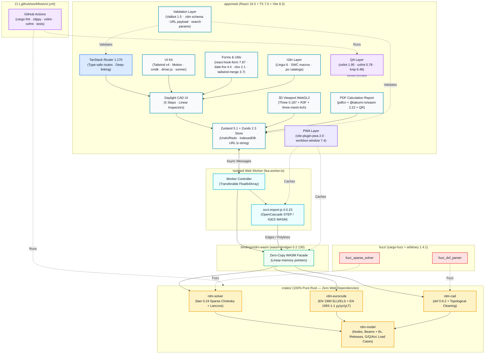
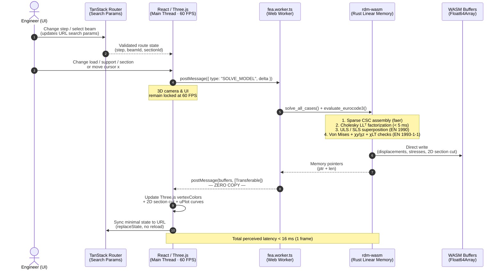
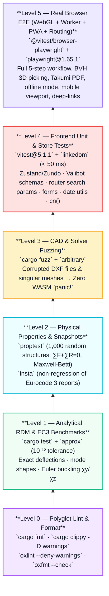
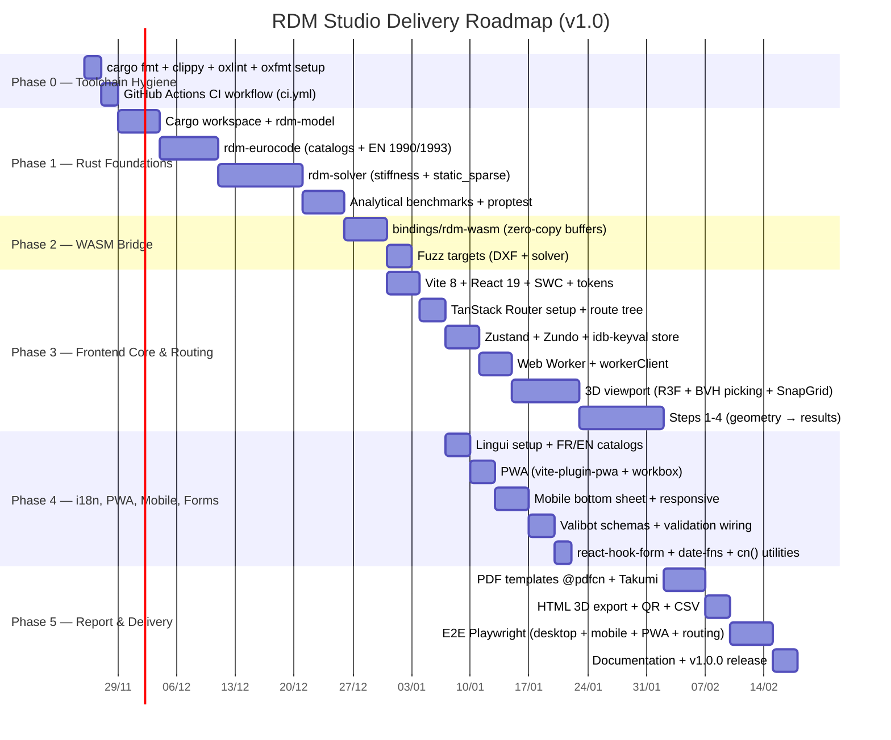

# ARCHITECTURE.md — RDM Studio (3D FE Workstation & Eurocode 3)

> **Monorepo Reference Document — `rdm-studio`**
> Clean Architecture Polyglot (Rust / WASM / React / Three.js)
> Local-First · Zero-Server · PWA · i18n · Mobile-Ready · Type-Safe Routing · Polyglot-QA · State-of-the-Art v1.0

---

## Table of Contents

1. [Vision & Architectural Principles](#1-vision--architectural-principles)
2. [Tech Stack & Exact Locked Versions](#2-tech-stack--exact-locked-versions)
3. [Dependency Graph (Clean Architecture Polyglot)](#3-dependency-graph-clean-architecture-polyglot)
4. [Real-Time Calculation & Memory Pipeline (60 FPS)](#4-real-time-calculation--memory-pipeline-60-fps)
5. [Complete Monorepo Structure](#5-complete-monorepo-structure)
6. [Model & Solver Evolutions (v1.0 State-of-the-Art)](#6-model--solver-evolutions-v10-state-of-the-art)
7. [Eurocode 3 Compliance (Full Implementation)](#7-eurocode-3-compliance-full-implementation)
8. [Frontend, Styling, Motion, Onboarding & PWA](#8-frontend-styling-motion-onboarding--pwa)
9. [Type-Safe Routing with TanStack Router](#9-type-safe-routing-with-tanstack-router)
10. [Forms, Date Utilities & Class Composition](#10-forms-date-utilities--class-composition)
11. [Internationalization (i18n) with Lingui](#11-internationalization-i18n-with-lingui)
12. [Validation with Valibot](#12-validation-with-valibot)
13. [Mobile & Tablet Responsiveness](#13-mobile--tablet-responsiveness)
14. [Test Pyramid & Validation Strategy](#14-test-pyramid--validation-strategy)
15. [Polyglot Linting & Formatting](#15-polyglot-linting--formatting)
16. [Evolvability Guarantee (Zero Hardcoding)](#16-evolvability-guarantee-zero-hardcoding)
17. [Design System & Ergonomics](#17-design-system--ergonomics)
18. [Roadmap & Delivery Milestones](#18-roadmap--delivery-milestones)
19. [Canonical Contracts, Build Config & Autonomous Agent Gates](#19-canonical-contracts-build-config--autonomous-agent-gates)

---

## 1. Vision & Architectural Principles

**RDM Studio** is a 3D structural engineering platform (12-DOF Euler-Bernoulli Finite Elements, modal analysis, and regulatory checks per Eurocode 0 / Eurocode 3) built on **eight non-negotiable pillars**:

1. **Local-First & Zero-Trust CAD**
   **100% client-side execution** in the browser via WebAssembly. No CAD file (`.dxf`, `.step`, `.igs`) or calculation report ever transits through a third-party server. Native offline operation, near-zero infrastructure cost, and project sharing via `.rdm` file or compressed URL (`lz-string`).

2. **Strict Separation of Domain / Solver / Standards / UI**
   - The mathematical and normative core is written in **pure Rust** (`crates/`), completely independent of the Web.
   - The React/Three.js interface (`apps/web/`) is a **pure projection layer**: no RDM formula or Eurocode coefficient is hardcoded in TypeScript.

3. **Real-Time Performance at 60 FPS**
   All matrix computations (`faer`), the OpenCascade parser (`occt-import-js`), and PDF generation (`@takumi-rs/wasm`) run in a **dedicated Web Worker** with **zero-copy** `Float64Array` linear-memory exchange (_Transferable Objects_).

4. **"Daylight CAD Workstation" Design System (Linear Light Mode)**
   Surgical interface in light mode (`#F9FAFB` / `#FFFFFF` / `1px #E5E7EB` borders / accent `#0891B2`), `Inter` + `JetBrains Mono` typography (`tabular-nums`), FEA thermal spectrum (`#2563EB` → `#06B6D4` → `#10B981` → `#F59E0B` → `#EF4444`) strictly reserved for the 3D model, force vectors, and section cuts.

5. **PWA First-Class & Mobile-Ready from Day One**
   Full Progressive Web App with service-worker caching of WASM binaries, OS file handlers (`.rdm`, `.dxf`, `.step`), window-controls-overlay, and a fully responsive UI (bottom-sheet inspectors on mobile, touch-friendly 3D controls, 100dvh viewport).

6. **i18n Compile-Time (FR / EN) & Runtime Validation**
   French and English catalogs compiled at build time via **Lingui 6 + SWC** (zero runtime overhead). All external inputs (`.rdm` files, URL payloads) validated with **Valibot** (~1.2 kB, zero `eval`).

7. **Polyglot Code Quality & CI Enforcement**
   **Rust:** `cargo fmt --check` + `cargo clippy --workspace --all-targets -- -D warnings` (zero tolerance for `unwrap()` in solver/CAD crates).
   **TypeScript:** `oxlint` + `oxfmt` (Rust-native, < 50 ms on the full project) + optional `knip` for unused-code detection.
   A single **GitHub Actions** workflow runs every gate on every push and pull request.

8. **Type-Safe Navigation & Deep-Linkable State**
   **TanStack Router** provides fully type-safe routes for the 5-step workflow, with Valibot-validated search params that preserve the model state in the URL (e.g., `?step=4&beam=12&section=IPE200`). This enables shareable calculation reports, bookmarkable positions, and deterministic browser back/forward behavior.

---

## 2. Tech Stack & Exact Locked Versions

### 2.1 Toolchain & Local Environment

| Tool            | Exact Version | Role                                      |
| :-------------- | :------------ | :---------------------------------------- |
| **`rustc`**     | `1.99.1`      | Rust compiler (edition `2024`)            |
| **`cargo`**     | `1.99.1`      | Crate manager & workspace                 |
| **`wasm-pack`** | `0.15.0`      | WASM packaging (`wasm32-unknown-unknown`) |
| **`node`**      | `v24.22.2`    | JS runtime (Vite, Vitest, Playwright)     |
| **`pnpm`**      | `12.18.0`     | Frontend package manager                  |
| **`bun`**       | `1.4.4`       | Optional alternative build tool           |

### 2.2 Rust Dependencies (`Cargo.toml` — `crates.io`)

| Crate                    | Exact Version | Role & Technical Justification                                                                                       |
| :----------------------- | :------------ | :------------------------------------------------------------------------------------------------------------------- |
| **`faer`**               | `0.24.4`      | Dense & sparse linear algebra (`SparseColMat`), SIMD-vectorized sparse Cholesky $LL^T$ (`simd128`).                  |
| **`nalgebra`**           | `0.35.0`      | Fixed-size local matrices $12 \times 12$ (`SMatrix<f64, 12, 12>`) and 3D orthogonal transformations.                 |
| **`glam`**               | `0.34.3`      | Ultra-fast 3D vector math (beam local frames, roll angle $\theta_x$, cross products).                                |
| **`serde`**              | `1.0.229`     | Canonical serialization/deserialization of `.rdm` models and section catalogs.                                       |
| **`thiserror`**          | `2.0.21`      | Exhaustive domain error typing (unstable mechanism, singular matrix, degenerate geometry).                           |
| **`dxf`**                | `0.6.2`       | Pure Rust DXF parser (layers, lines, polylines).                                                                     |
| **`wasm-bindgen`**       | `0.2.130`     | Rust ↔ JavaScript FFI bridge and direct WASM linear-memory pointer exposure.                                         |
| **`serde-wasm-bindgen`** | `0.6.5`       | Fast pass-through of configuration and structured result objects.                                                    |
| **`js-sys`**             | `0.3.107`     | Zero-copy `Float64Array` / `Uint32Array` views from WASM memory.                                                     |
| **`approx`** _(dev)_     | `0.6.0-rc2`   | Precise floating-point assertions ($10^{-12}$) for analytical RDM & EC3 benchmarks.                                  |
| **`proptest`** _(dev)_   | `1.6.0`       | Property-Based Testing (global equilibrium $\sum F + \sum R = 0$, Maxwell-Betti, energy $\frac{1}{2}U^T K U \ge 0$). |
| **`insta`** _(dev)_      | `1.42.0`      | Snapshot testing of Eurocode 3 reports, reaction tables, and buckling ratios.                                        |
| **`arbitrary`** _(fuzz)_ | `1.4.1`       | Random input generation for `cargo-fuzz` on the CAD parser and solver.                                               |

### 2.3 Frontend, Routing, Styling, Motion, i18n, PWA, Validation, QA & Test Dependencies (`apps/web/package.json` — `npm`)

| Package                                     | Exact Version | Role & Technical Justification                                                                                               |
| :------------------------------------------ | :------------ | :--------------------------------------------------------------------------------------------------------------------------- |
| **`react`** / **`react-dom`**               | `19.3.1`      | Reactive UI layer for the 5-step workstation.                                                                                |
| **`typescript`**                            | `7.0.2`       | Strict typing mirroring Rust/WASM contracts.                                                                                 |
| **`vite`**                                  | `8.3.8`       | Ultra-fast bundler (Rolldown) with native ESM Worker support.                                                                |
| **`@vitejs/plugin-react-swc`**              | `4.3.3`       | SWC-based React plugin for Vite 8 (Fast Refresh, Lingui macro compilation).                                                  |
| **`vite-plugin-wasm`**                      | `3.6.0`       | Transparent loading and initialization of `.wasm` modules.                                                                   |
| **`@tanstack/react-router`**                | `1.170.46`    | **Type-safe routing** for the 5-step workflow, with search-param validation and deep-linking.                                |
| **`@tanstack/router-devtools`**             | `1.167.2`     | Visual route tree, search-param, and loader inspection during development.                                                   |
| **`@tanstack/router-plugin`**               | `1.99.9`    | Vite plugin for automatic route-tree generation and type safety.                                                             |
| **`@tanstack/react-query`**                 | `5.108.3`     | Async state management for optional future remote data (e.g., shared template library). _Not required for local-first core._ |
| **`react-hook-form`**                       | `7.87.0`      | Performant form state management for inspector panels with multi-field validation.                                           |
| **`@hookform/resolvers`**                   | `7.0.7`       | Valibot resolver bridge for `react-hook-form` (keeps validation schemas unified).                                            |
| **`date-fns`**                              | `4.4.0`       | Date formatting and manipulation for project metadata, timestamps, and “last modified” sorting.                              |
| **`clsx`**                                  | `2.1.1`       | Tiny utility for conditionally composing `className` strings.                                                                |
| **`tailwind-merge`**                        | `3.7.0`       | Merges Tailwind CSS classes without style conflicts (used with `clsx`).                                                      |
| **`tailwindcss`** / **`@tailwindcss/vite`** | `4.3.5`       | **Tailwind CSS v4** (CSS-first `@theme` for Daylight CAD tokens, zero JS config).                                            |
| **`motion`**                                | `14.14.0`     | Fluid micro-interactions (`layoutId` for the active stepper, physical springs on drawers/inspectors).                        |
| **`cmdk`**                                  | `1.1.1`       | Keyboard-first `⌘K` command palette (instant access to profiles, supports, presets, and exports).                            |
| **`driver.js`**                             | `1.14.0`      | **Interactive onboarding** tour (ultra-light, context-aware walkthrough of the 3D viewport and 5 steps).                     |
| **`sonner`**                                | `2.0.8`       | Non-intrusive toast notifications for computation times and topological diagnostics.                                         |
| **`idb-keyval`**                            | `6.3.0`       | Simple, promise-based IndexedDB key-value store for local multi-project persistence.                                         |
| **`lucide-react`**                          | `1.79.0`      | Technical vector iconography, 1.5px stroke, consistent with Linear.                                                          |
| **`three`** / **`@types/three`**            | `0.187.0`     | Hardware-accelerated WebGL2/WebGPU rendering engine at 60 FPS.                                                               |
| **`@react-three/fiber`**                    | `9.8.2`       | Declarative 3D scene graph synchronized with the structural state.                                                           |
| **`@react-three/drei`**                     | `10.7.9`      | XYZ gizmo (`GizmoViewport`), infinite metric grid, CAD camera controls.                                                      |
| **`three-mesh-bvh`**                        | `0.10.0`      | BVH-accelerated raycasting (pixel-perfect selection of thousands of beams < 0.2 ms).                                         |
| **`zustand`**                               | `5.1.0`       | High-frequency atomic state store (avoids global re-renders during 3D drag).                                                 |
| **`zundo`**                                 | `2.3.0`       | Full Undo / Redo history (`Ctrl+Z` / `Ctrl+Y`) over the model tree.                                                          |
| **`uplot`**                                 | `1.6.32`      | Ultra-fast plotting (< 1 ms) of internal force diagrams ($M_y, M_z, T_y, T_z, N$).                                           |
| **`occt-import-js`**                        | `0.0.23`      | OpenCascade compiled to WASM for native **STEP (`.step`)** and **IGES (`.igs`)** CAD import.                                 |
| **`@takumi-rs/wasm`**                       | `2.22.1`      | Rust WASM vector PDF rendering engine used by **`pdfcn`** for calculation reports.                                           |
| **`pdf-lib`**                               | `1.17.1`      | PDF post-processing (metadata, watermarks, future 3D U3D annotation injection).                                              |
| **`qrcode`**                                | `1.5.4`       | QR code generation in the PDF, opening the interactive 3D model.                                                             |
| **`lz-string`**                             | `1.5.0`       | Serverless compression of the `.rdm` model in the URL hash (`#m=...`).                                                       |
| **`valibot`**                               | `1.5.0`       | Modular, type-safe schema validation for `.rdm` files, URL payloads, and route search params.                                |
| **`@lingui/core`**                          | `6.11.0`      | Core i18n runtime (message catalogs, pluralization).                                                                         |
| **`@lingui/react`**                         | `6.11.0`      | React bindings (`I18nProvider`, `Trans`, `useLingui`).                                                                       |
| **`@lingui/swc-plugin`**                    | `6.7.1`       | SWC plugin for compile-time macro extraction (zero runtime overhead).                                                        |
| **`@lingui/vite-plugin`**                   | `6.12.0`      | Vite plugin for on-the-fly catalog compilation (`.po` files).                                                                |
| **`@lingui/cli`**                           | `6.11.0`      | CLI for extracting and compiling message catalogs.                                                                           |
| **`@lingui/format-po`** | `6.11.0` | PO catalog formatter required by Lingui 6 CLI/Vite plugin. |
| **`vite-plugin-pwa`**                       | `2.0.0`       | Zero-config PWA generation (service worker, manifest, update prompt).                                                        |
| **`workbox-window`**                        | `7.4.1`       | Service worker communication and update notification.                                                                        |
| **`oxlint`**                                | `1.95.0`      | **Rust-native linter** for TypeScript/React (0 config, < 50 ms on full project).                                             |
| **`oxfmt`**                                 | `0.78.0`      | **Rust-native formatter** (Prettier-compatible, < 50 ms on full project).                                                    |
| **`knip`**                                  | `6.48.0`      | Unused file/export/dependency detection (optional, recommended).                                                             |
| **`vitest`**                                | `5.1.1`       | Unified test runner (unit + browser).                                                                                        |
| **`linkedom`**                              | `0.18.15`     | Ultra-light DOM (< 50 ms) for fast unit tests of components and exports.                                                     |
| **`@vitest/browser-playwright`**            | `5.1.1`       | Execution of component and WebGL tests in a real Chromium browser.                                                           |
| **`playwright`**                            | `1.65.1`      | Full E2E tests (5-step workflow, 3D interactions, PDF/HTML generation, PWA offline mode).                                    |

### 2.4 Version Verification & Corrections

The following versions were verified against the npm registry and GitHub releases as of **November 2026**.

| Package                                     | Previous Draft | **Verified Latest** | Status                               |
| :------------------------------------------ | :------------- | :------------------ | :----------------------------------- |
| **`tailwindcss`** / **`@tailwindcss/vite`** | `4.3.3`        | **`4.3.5`**         | Corrected                            |
| **`motion`**                                | `14.6.0`       | **`14.14.0`**       | Corrected                            |
| **`@vitejs/plugin-react-swc`**              | _(not listed)_ | **`4.3.3`**         | Pinned                               |
| **`vite-plugin-pwa`**                       | `2.0.0`        | `2.0.0`             | Confirmed                            |
| **`workbox-window`**                        | `7.4.1`        | `7.4.1`             | Confirmed                            |
| **`valibot`**                               | `1.x`          | **`1.5.0`**         | Pinned to latest stable              |
| **`@lingui/core`**                          | `6.12.0`       | **`6.11.0`**        | Corrected (6.12.0 not yet released)  |
| **`@lingui/react`**                         | `6.12.0`       | **`6.11.0`**        | Corrected (6.12.0 not yet released)  |
| **`@lingui/swc-plugin`**                    | `6.7.1`        | `6.7.1`             | Confirmed                            |
| **`@lingui/vite-plugin`**                   | `6.12.0`       | `6.12.0`            | Confirmed                            |
| **`@lingui/cli`**                           | `6.12.0`       | **`6.11.0`**        | Corrected (6.12.0 not yet released)  |
| **`oxlint`**                                | _(not listed)_ | **`1.95.0`**        | **New** (GitHub release 1.95.0)      |
| **`oxfmt`**                                 | _(not listed)_ | **`0.78.0`**        | **New** (GitHub/PyPI release 0.78.0) |
| **`knip`**                                  | _(not listed)_ | **`6.48.0`**        | **New** (GitHub release 6.48.0)      |
| **`@tanstack/react-router`**                | _(not listed)_ | **`1.170.46`**      | **New** (Snyk, Oct 2026)             |
| **`@tanstack/router-devtools`**             | _(not listed)_ | **`1.167.2`**       | **New** (Snyk, Sep 2026)             |
| **`@tanstack/react-query`**                 | _(not listed)_ | **`5.108.3`**       | **New** (GitHub, Nov 2026)           |
| **`react-hook-form`**                       | _(not listed)_ | **`7.87.0`**        | **New** (GitHub, Aug 2026)           |
| **`@hookform/resolvers`**                   | _(not listed)_ | **`7.0.7`**         | **New** (GitHub, Nov 2026)           |
| **`date-fns`**                              | _(not listed)_ | **`4.4.0`**         | **New** (GitHub, May 2026)           |
| **`clsx`**                                  | _(not listed)_ | **`2.1.1`**         | **New** (stable)                     |
| **`tailwind-merge`**                        | _(not listed)_ | **`3.7.0`**         | **New** (Nov 2026)                   |

> **Note on Lingui version skew:** `@lingui/vite-plugin` is at `6.12.0` while the other Lingui packages are at `6.11.0`. This is intentional: the Vite plugin received a patch release ahead of the core packages. Mixing `6.11.0` and `6.12.0` is fully compatible within the Lingui 6 line.

> **Note on `vite-tsconfig-paths`:** Version `7.0.0` is currently in **alpha** (as of Nov 2026). The architecture pins the latest **stable** release, `6.1.1`. The v7 alpha migrates to OXC/Rolldown and should be evaluated once stable, but is not production-ready today.

---

## 3. Dependency Graph (Clean Architecture Polyglot)

Dependencies are **strictly unidirectional**: the UI layer depends on the Worker, the Worker depends on the WASM facade, and **all domain crates point only to `rdm-model`**. No arrow ever points back to the Web layer.



### Golden Rules

| Rule                                           | Architectural Consequence                                                                                                    |
| :--------------------------------------------- | :--------------------------------------------------------------------------------------------------------------------------- |
| **`rdm-solver` does not know about Eurocodes** | It only manipulates stiffness matrices, DOFs, and force vectors. It can be tested in complete isolation in 0.3 s.            |
| **`rdm-eurocode` consumes internal forces**    | Applies partial factors from `EN 1990` and checks from `EN 1993-1-1` (Von Mises, buckling `χy/χz`, lateral-torsional `χLT`). |
| **React contains no formula**                  | It projects Zustand state and sends commands to the Worker. All physics lives in `crates/`.                                  |
| **`rdm-cad` ignores rendering**                | It produces clean topology (merged nodes, beams split at intersections) consumable by `rdm-model`.                           |
| **Routing is type-safe**                       | TanStack Router generates `routeTree.gen.ts` at build time. Search params are validated with Valibot before being trusted.   |
| **i18n is compile-time**                       | Lingui SWC macros extract messages during the build; zero runtime parsing overhead.                                          |
| **Validation is at the boundary**              | Valibot schemas guard `.rdm` ingestion, URL decompression, and route search params before state mutation.                    |
| **Zero `unwrap()` in solver/CAD**              | `cargo clippy -D warnings` + `oxlint --deny-warnings` enforce this in CI (Gate G0).                                          |

---

## 4. Real-Time Calculation & Memory Pipeline (60 FPS)

The solver solves **each elementary load case** ($G$ permanent, $Q$ variable, $Acc$ acceleration) **once** via sparse factorization $K = LL^T$, then **linearly superimposes** displacement and force vectors to instantly generate **ULS ($1.35G + 1.50Q$)** and **SLS ($1.00G + 1.00Q$)** envelopes — without refactorizing.



### Key Pipeline Points

- **Zero UI blocking:** matrix computations, CAD import, and PDF rendering never touch the main thread.
- **Zero memory copy:** `Float64Array` buffers are transferred by ownership (`Transferable`) — no `structuredClone` serialization.
- **One factorization per load case:** FE linearity allows solving `G`, `Q`, `Acc` separately, then superimposing for all ULS/SLS combinations in < 0.1 ms.
- **Mechanism detection:** stiffness matrix rank is checked before factorization to return a clean domain error (`Err(UnstableMechanism)`) instead of a WASM `panic!`.
- **URL synchronization is non-blocking:** route search params are updated via `replaceState` to avoid polluting browser history, and only on debounced state changes.

---

## 5. Complete Monorepo Structure

```text
rdm-studio/
├── ARCHITECTURE.md                     # This reference document
├── Cargo.toml                          # Rust workspace (opt-level = 3, lto = true, codegen-units = 1)
├── package.json                        # Unified monorepo scripts (build:wasm, dev, test:all, fuzz, i18n:extract)
├── pnpm-workspace.yaml                 # pnpm workspace declaration
├── .github/
│   └── workflows/
│       └── ci.yml                      # Full CI pipeline (all gates, see §19.5)
│
├── crates/                             # LAYER 1: DOMAIN & PURE ENGINES (RUST)
│   ├── rdm-model/                      # Canonical model & serialization
│   │   ├── Cargo.toml
│   │   └── src/
│   │       ├── lib.rs
│   │       ├── geometry.rs             # Node (x, y, z), Beam (n1, n2, section_id, material_id, roll_angle_rad, releases_start/end, k_buckling_y/z)
│   │       ├── boundary.rs             # Support (node_id, locked_dofs [bool; 6], spring_stiffness [f64; 6])
│   │       ├── loads.rs                # LoadCase (Permanent G, Variable Q, Wind W, Snow S, Acceleration Acc) + self-weight, point loads (position_ratio), trapezoidal loads (q_start, q_end)
│   │       ├── validator.rs            # ModelValidator: orphan nodes, duplicate beams, length < 1e-4 m, pedagogical DOF diagnostics for mechanisms
│   │       └── project.rs              # .rdm file format (canonical JSON) + SHA-256 fingerprint
│   │
│   ├── rdm-eurocode/                   # French & European standards (data-driven)
│   │   ├── Cargo.toml
│   │   ├── data/                       # Normalized tables embedded via include_str!()
│   │   │   ├── en10365_profiles.json   # IPE 80-600, HEA 100-600, HEB 100-600, HEM 100-400, UPN/UPE
│   │   │   ├── en10210_hollow.json     # CHS, SHS, RHS tubes (hot-rolled & cold-formed EN 10219)
│   │   │   ├── en10056_angles.json     # Equal & unequal leg angles L
│   │   │   └── en10025_materials.json  # S235JR, S275JR, S355J2, S460N, 304L/316L stainless, 6061-T6 aluminium
│   │   └── src/
│   │       ├── lib.rs
│   │       ├── catalog.rs              # Typed queries (Iy, Iz, It, Wely, Welz, Wply, Wplz, Avy, Avz)
│   │       ├── en1990.rs               # ULS combinations (1.35G + 1.50Q) and SLS (1.00G + 1.00Q)
│   │       └── en1993.rs               # Section classification (Classes 1-4), Von Mises, Euler buckling χy/χz, lateral-torsional buckling χLT, SLS deflection limits (L/200, L/250, L/300)
│   │
│   ├── rdm-solver/                     # 3D Finite Element & Dynamic Solver
│   │   ├── Cargo.toml
│   │   ├── src/
│   │   │   ├── lib.rs
│   │   │   ├── stiffness.rs            # 12×12 Euler-Bernoulli local matrix + R(θx) rotation + distributed loads
│   │   │   ├── static_sparse.rs        # Sparse CSC assembly + Cholesky LLᵀ (faer) + mechanism detection (rank check)
│   │   │   ├── modal.rs                # Modal analysis (Lanczos / subspace iteration) + mass participation factors
│   │   │   └── section_cut.rs          # n-point sampling + 2D σ_vM(y,z) grid on a straight cut
│   │   └── tests/
│   │       ├── analytical_benchmarks.rs # Cantilevers, simply supported, portiques, Euler buckling (approx 10⁻¹²)
│   │       ├── physics_invariants.rs   # proptest (∑F+∑R=0, Maxwell-Betti, rotation invariance)
│   │       └── report_snapshots.rs     # insta snapshots of Eurocode 3 reports
│   │
│   └── rdm-cad/                        # CAD Import/Export & Topology
│       ├── Cargo.toml
│       └── src/
│           ├── lib.rs
│           ├── dxf_importer.rs         # DXF line entity extraction via `dxf` crate
│           └── topology_cleaner.rs     # Coincident node merging (ε), splitting at T/X intersections
│
├── bindings/                           # LAYER 2: WASM BRIDGE
│   └── rdm-wasm/
│       ├── Cargo.toml                  # crate-type = ["cdylib", "rlib"]
│       └── src/
│           ├── lib.rs                  # wasm-bindgen API exposed to the Web Worker
│           └── buffers.rs              # Zero-copy Float64Array buffers for Three.js & uPlot
│
├── fuzz/                               # LAYER 3: CONTINUOUS FUZZING
│   ├── Cargo.toml
│   └── fuzz_targets/
│       ├── fuzz_dxf_parser.rs          # Robustness against corrupted DXF files
│       └── fuzz_sparse_solver.rs       # Robustness against singular / degenerate structures
│
└── apps/web/                           # LAYER 4: WEB APPLICATION
    ├── package.json
    ├── tsconfig.json                   # compilerOptions.paths: { "@/*": ["./src/*"] }
    ├── vite.config.ts                  # Vite 8 + TanStack Router + multi-WASM + Lingui + PWA (see §19.1)
    ├── lingui.config.ts                # Lingui extraction/compilation config (see §19.2)
    ├── oxlintrc.json                   # Oxlint configuration (see §15.2)
    ├── index.html                      # Daylight CAD Workstation shell (Inter + JetBrains Mono)
    ├── public/
    │   └── logo-rdm-studio.svg         # Isometric IPE beam logo with thermal gradient
    └── src/
        ├── main.tsx                    # createRouter + RouterProvider
        ├── routeTree.gen.ts            # Auto-generated by @tanstack/router-plugin (DO NOT EDIT)
        ├── routes/                     # TanStack Router file-based routes
        │   ├── __root.tsx              # Root layout (AppHeader, PWA update prompt)
        │   ├── index.tsx               # Redirects to /geometry
        │   ├── geometry.tsx            # Step 1: Geometry & Section Inspector
        │   ├── supports.tsx            # Step 2: Supports & 6-DOF Matrix
        │   ├── loads.tsx               # Step 3: Loads & Combinations
        │   ├── results.tsx             # Step 4: Results & 2D Section Cut
        │   └── report.tsx              # Step 5: Report & Exports
        ├── i18n/                       # Lingui catalogs & runtime
        │   ├── locales/
        │   │   ├── fr.po               # French catalog (default)
        │   │   └── en.po               # English catalog
        │   └── setup.ts                # i18n.load + i18n.activate
        ├── styles/
        │   └── app.css                 # @import "tailwindcss"; + @theme { --color-canvas: #F9FAFB; --color-accent: #0891B2; ... }
        ├── domain/
        │   └── types.ts                # TS interfaces mirroring rdm-wasm contracts
        ├── schemas/                    # Valibot validation schemas
        │   ├── project.schema.ts       # .rdm file validation
        │   ├── urlPayload.schema.ts    # compressed URL payload validation
        │   └── searchParams.schema.ts  # Route search-param validation (step, beamId, sectionId)
        ├── store/
        │   ├── useModelStore.ts        # Zustand + Zundo + idb-keyval autosave
        │   └── urlShare.ts             # URL encode/decode via lz-string + Valibot validation
        ├── lib/
        │   ├── cn.ts                   # clsx + tailwind-merge helper (cn(...classes))
        │   └── dates.ts                # date-fns wrappers (format, formatDistanceToNow, etc.)
        ├── worker/
        │   ├── fea.worker.ts           # Worker hosting rdm-wasm + occt-import-js
        │   └── workerClient.ts         # Typed Promise/Stream client
        ├── viewport3d/
        │   ├── ViewportCanvas.tsx      # Three.js / R3F scene + XYZ gizmo + infinite metric grid
        │   ├── BeamMeshes.tsx          # Extruded volumetric rendering + vertexColors thermal gradient
        │   ├── SupportMarkers.tsx      # RDM 7 support symbols (fixed, pinned, roller, sliding)
        │   ├── ForceVectors3D.tsx      # Oriented 3D force arrows
        │   ├── SnapGrid.tsx            # Magnetic snapping (10/50/100 mm) + Shift orthogonal lock
        │   ├── LayerToolbar.tsx        # Selective layer visibility (Nodes, Beams, Dimensions, Loads, Supports, 3D Volumetric / Wireframe)
        │   └── useBvhPicking.ts        # BVH-accelerated raycasting
        ├── components/
        │   ├── AppHeader.tsx           # 44px bar + SVG logo + 5-step stepper (Motion layoutId cyan underline, links via <Link>)
        │   ├── CommandPalette.tsx      # ⌘K command palette (cmdk) — navigation via router.navigate
        │   ├── OnboardingTour.tsx      # driver.js guided tour (persisted in localStorage)
        │   ├── ProjectGalleryModal.tsx # Project manager (idb-keyval) + template library (Portique, Warren truss, Cantilever, Continuous beam)
        │   ├── PropertyRow.tsx         # Linear-style flat key/value row
        │   ├── NumericInput.tsx        # JetBrains Mono field with locked unit suffix + react-hook-form integration
        │   ├── BottomSheet.tsx         # Mobile-friendly draggable bottom sheet (Motion drag="y")
        │   └── UpdatePrompt.tsx        # PWA update notification (workbox-window)
        ├── features/
        │   ├── step1-geometry/         # Section inspector, node/beam creation, DXF/STEP import, multi-select (Shift+Click / box selection)
        │   ├── step2-supports/         # 6-DOF RDM 7 matrix, 3D selection, static determinacy diagnostics
        │   ├── step3-loads/            # ULS/SLS combinations, accelerations, nodal & distributed loads
        │   ├── step4-results/          # Eurocode 3 KPIs, deformed shape/modes, 2D section cut + uPlot curves
        │   └── step5-report/           # Calculation report, PDF Takumi / HTML 3D / CSV exports
        └── export/
            ├── pdfTakumiReport.tsx     # React @pdfcn document rendered by @takumi-rs/wasm + QR code
            ├── standaloneHtml3d.ts     # Self-contained offline interactive 3D HTML report
            └── csvExport.ts            # Excel UTF-8 BOM export
```

### 5.1 Cargo Workspace Configuration (`Cargo.toml` Root)

```toml
[workspace]
resolver = "2"
members = [
    "crates/rdm-model",
    "crates/rdm-eurocode",
    "crates/rdm-solver",
    "crates/rdm-cad",
    "bindings/rdm-wasm",
]

[workspace.package]
version = "0.1.0"
edition = "2024"
authors = ["RDM Studio"]

[workspace.dependencies]
# --- Math engine ---
faer = { version = "0.24.4", default-features = false }
nalgebra = "0.35.0"
glam = "0.34.3"
approx = "0.6.0-rc2"

# --- Serialization & errors ---
serde = { version = "1.0.229", features = ["derive"] }
thiserror = "2.0.21"

# --- CAD ---
dxf = "0.6.2"

# --- WASM bridge ---
wasm-bindgen = "0.2.130"
serde-wasm-bindgen = "0.6.5"
js-sys = "0.3.107"

# --- Tests ---
proptest = "1.6.0"
insta = { version = "1.42.0", features = ["json"] }
arbitrary = { version = "1.4.1", features = ["derive"] }

[profile.release]
opt-level = 3
lto = true
codegen-units = 1
# NOTE: panic = "abort" and strip = true are intentionally omitted here.
# They are applied only during the final wasm-pack build via RUSTFLAGS
# to avoid breaking `cargo test --release` and to preserve wasm-bindgen
# metadata required for .d.ts generation.
```

---

## 6. Model & Solver Evolutions (v1.0 State-of-the-Art)

The initial architecture was functional but lacked the expressive power required for real-world structural engineering. The following evolutions bring `rdm-model` and `rdm-solver` to a production-grade level.

### 6.1 Beam Model (`rdm-model`)

| Feature             | Initial Architecture                              | v1.0 Evolution                                                                                                                                                                                  | Technical Impact                                                                                                             |
| :------------------ | :------------------------------------------------ | :---------------------------------------------------------------------------------------------------------------------------------------------------------------------------------------------- | :--------------------------------------------------------------------------------------------------------------------------- |
| **Beam definition** | `Beam { n1, n2, sec, mat }` rigid by default.     | Native support for:<br/>• `roll_angle_rad: f64` ($\theta_x$ in rad)<br/>• `releases_start / end: [bool; 6]` (end releases)<br/>• `k_buckling_y / z: f64` ($L_{cr}/L$ ratios)                    | Models true pinned trusses, oriented purlins, and columns with differentiated buckling conditions without splitting members. |
| **Loads**           | Nodal and uniform loads only; manual self-weight. | • Automatic self-weight ($\vec{q}_g = \rho \cdot A \cdot \vec{g}$) in case G<br/>• Point loads on span (`position_ratio` $\in [0, 1]$)<br/>• Trapezoidal distributed loads (`q_start`, `q_end`) | Eliminates artificial intermediate nodes for point or triangular loads on a member.                                          |
| **Validation**      | Raw model sent directly to solver.                | `ModelValidator` before solving: detects orphan nodes, duplicate beams, lengths $< 10^{-4}\text{ m}$, and provides pedagogical DOF diagnostics for mechanisms.                                  | Guarantees zero WASM `panic!` and tells the engineer which rigid-body motion is unconstrained.                               |

### 6.2 Eurocode 3 Checks (`rdm-eurocode`)

| Feature                        | Initial Architecture | v1.0 Evolution                                                 |
| :----------------------------- | :------------------- | :------------------------------------------------------------- |
| **Section classification**     | Not implemented.     | Classes 1–4 per EN 1993-1-1 Table 5.2.                         |
| **Buckling**                   | Basic Euler only.    | Euler buckling + EC3 buckling curves ($\chi_y, \chi_z$).       |
| **Lateral-torsional buckling** | Not implemented.     | $\chi_{LT}$ for open bending sections.                         |
| **Deflection (SLS)**           | Not implemented.     | Limits: $L/200$, $L/250$, $L/300$.                             |
| **Combinations**               | Not implemented.     | Full NF EN 1990: ULS $1.35G + 1.50Q$, SLS $G + Q$.             |
| **Von Mises stress**           | Normal stress only.  | Full Von Mises including shear and torsion.                    |
| **Wely / Welz separation**     | Single `Wel` value.  | Strict separation of strong-axis and weak-axis section moduli. |

---

## 7. Eurocode 3 Compliance (Full Implementation)

The `rdm-eurocode` crate is designed as a **data-driven normative engine**. All profile tables and material properties are stored as JSON files embedded at compile time via `include_str!()`, meaning:

- Adding a new profile series (e.g., AISC US, Eurocode 5 timber) requires **zero UI code changes** — only a new JSON file in `crates/rdm-eurocode/data/`.
- All formulas are pure Rust and tested against analytical benchmarks with `approx` at $10^{-12}$ tolerance.

The v1.0 implementation covers:

- **EN 1990 (Eurocode 0):** ULS combinations ($1.35G + 1.50Q$) and SLS combinations ($1.00G + 1.00Q$).
- **EN 1993-1-1 (Eurocode 3):**
  - Section classification (Classes 1–4) based on width-to-thickness ratios.
  - Cross-section resistance: Von Mises yield criterion (including shear and torsion), plastic resistance $N_{pl,Rd}$, $M_{pl,Rd}$, $V_{pl,Rd}$.
  - Flexural buckling: Euler critical loads $N_{cr,y}$, $N_{cr,z}$ and EC3 buckling curves $\chi_y, \chi_z$ (with `k_buckling_y/z` support for effective length factors).
  - Lateral-torsional buckling: $\chi_{LT}$ for open sections under bending.
  - Serviceability: deflection limits $L/200$, $L/250$, $L/300$ per project configuration.
  - **Wely vs. Welz:** independent section moduli for strong and weak axes.

---

## 8. Frontend, Styling, Motion, Onboarding & PWA

The UI layer has been elevated to **Linear-grade polish** with a full PWA shell.

### 8.1 Styling: Tailwind CSS v4 (CSS-First)

- **`tailwindcss@4.3.5`** + **`@tailwindcss/vite@4.3.5`**.
- Zero JavaScript config. All Daylight CAD tokens are defined in `app.css` via `@theme`:

```css
@import "tailwindcss";

@theme {
  --color-canvas: #F9FAFB;
  --color-panel: #FFFFFF;
  --color-border-subtle: #E5E7EB;
  --color-accent: #0891B2;
  --color-spectrum-cold: #2563EB;
  --color-spectrum-cool: #06B6D4;
  --color-spectrum-neutral: #10B981;
  --color-spectrum-warm: #F59E0B;
  --color-spectrum-hot: #EF4444;
  --font-sans: "Inter", sans-serif;
  --font-mono: "JetBrains Mono", monospace;
}
```

### 8.2 Micro-Interactions: Motion (`motion@14.14.0`)

| Interaction                  | Implementation                                                                                                                           |
| :--------------------------- | :--------------------------------------------------------------------------------------------------------------------------------------- |
| **Stepper active indicator** | `motion.div layoutId="activeStep"` — a 2px cyan underline glides between the 5 tabs with spring physics (`stiffness: 500, damping: 38`). |
| **Inspector appearance**     | `motion.div` fades in (`opacity: 0 → 1`, `y: 4 → 0`, 140 ms) when a beam or node is selected, without layout shift.                      |
| **Drawers & modals**         | Physical spring transitions for slide-over inspectors and the project gallery.                                                           |
| **Mobile bottom sheet**      | `motion.div` with `drag="y"` for a native-feeling draggable panel.                                                                       |

### 8.3 Keyboard Productivity: cmdk (`cmdk@1.1.1`)

- **`⌘K` / `Ctrl+K` command palette** for CAD-native workflow:
  - `⌘K` → type `IPE 240` → `Enter` to assign a section.
  - `⌘K` → type `Hinge` → `Enter` to place a pinned support.
  - `⌘K` → type `ULS` → `Enter` to run the calculation.
  - `⌘K` → type `PDF` → `Enter` to export the calculation report.
  - `⌘K` → type `Step 4` → `Enter` to navigate via `router.navigate({ to: "/results" })`.
- All commands are context-aware (only available when a valid selection exists).

### 8.4 Onboarding: driver.js (`driver.js@1.14.0`)

- **First-launch guided tour** (5 steps) over the real UI controls and a preloaded example model:
  1. Create a node.
  2. Place a support.
  3. Apply a load.
  4. Run the ULS calculation.
  5. Move the section-cut cursor.
- Lightweight (< 5 kB gzipped, zero dependencies), persisted in `localStorage`, and re-triggerable via a discreet `?` button in the header.

### 8.5 Notifications: sonner (`sonner@2.0.8`)

- **Non-intrusive toasts** for:
  - Calculation completion ("ULS calculation finished in 3.2 ms").
  - Topological diagnostics ("Warning: node #12 has no connected beam").
  - Export success/failure.
- Positioned bottom-right, auto-dismiss after 4 s, with a close button.

### 8.6 Local Persistence: idb-keyval (`idb-keyval@6.3.0`)

- **Multi-project manager** backed by IndexedDB:
  - Auto-save every 2 s (debounced).
  - Project gallery modal with **template library**: Portal frame, Warren truss, Cantilever, Continuous beam.
  - Import/export `.rdm` files.

### 8.7 PWA: Offline-First & Installable

- **`vite-plugin-pwa@2.0.0`** generates the service worker and manifest.
- **`workbox-window@7.4.1`** handles update notifications (`UpdatePrompt.tsx`).
- **Caching strategy:**
  - Precache: app shell, WASM binaries (`rdm-wasm`, `occt-import-js`, `@takumi-rs/wasm`), fonts, core assets.
  - Runtime cache: `.rdm` files loaded from disk.
- **OS integration:**
  - `file_handlers` for `.rdm`, `.dxf`, `.step` (open files directly from the OS).
  - `window-controls-overlay` for a native-like title bar.
- **Update flow:** when a new service worker is detected, a discreet toast (sonner) offers "Reload to update".

### 8.8 3D Precision & Selection

- **Multi-selection**: `Shift+Click` or drag a selection box to modify sections/releases in batch.
- **Magnetic snapping**: `SnapGrid` locks to 10/50/100 mm grid and beam midpoints; `Shift` locks orthogonal movement.
- **Layer toolbar**: Toggle visibility of Nodes, Beams, Dimensions, Loads, Supports, and switch between 3D volumetric / wireframe rendering.

---

## 9. Type-Safe Routing with TanStack Router

RDM Studio uses **TanStack Router** for fully type-safe, deep-linkable navigation across the 5-step workflow.

### 9.1 Why TanStack Router?

| Requirement                | TanStack Router Solution                                                                                         |
| :------------------------- | :--------------------------------------------------------------------------------------------------------------- |
| **5-step linear workflow** | File-based routes (`geometry.tsx`, `supports.tsx`, `loads.tsx`, `results.tsx`, `report.tsx`).                    |
| **Deep-linkable state**    | Valibot-validated search params (`?step=4&beam=12&section=IPE200`).                                              |
| **Type safety**            | Auto-generated `routeTree.gen.ts` ensures `Link` and `navigate` props are compile-time checked.                  |
| **Browser back/forward**   | Search params are synchronized with `replaceState` (debounced), preserving navigation history without pollution. |
| **Data loading**           | Optional route loaders for future async data (e.g., template library from IndexedDB).                            |

### 9.2 Route Tree

```text
src/routes/
├── __root.tsx              # Root layout: <AppHeader />, <Outlet />, <UpdatePrompt />
├── index.tsx               # Redirects to /geometry
├── geometry.tsx            # Step 1: Geometry & Section Inspector
├── supports.tsx            # Step 2: Supports & 6-DOF Matrix
├── loads.tsx               # Step 3: Loads & Combinations
├── results.tsx             # Step 4: Results & 2D Section Cut
└── report.tsx              # Step 5: Report & Exports
```

### 9.3 Search-Param Validation with Valibot

```ts
// src/schemas/searchParams.schema.ts
import * as v from "valibot";

export const SearchParamsSchema = v.partial(
	v.object({
		step: v.picklist(["geometry", "supports", "loads", "results", "report"]),
		beamId: v.pipe(v.number(), v.integer(), v.minValue(0)),
		nodeId: v.pipe(v.number(), v.integer(), v.minValue(0)),
		sectionId: v.string(),
	}),
);
```

```ts
// src/routes/results.tsx (excerpt)
import { createFileRoute } from "@tanstack/react-router";
import { SearchParamsSchema } from "@/schemas/searchParams.schema";

export const Route = createFileRoute("/results")({
	validateSearch: (search) => SearchParamsSchema.parse(search),
	component: ResultsPage,
});
```

### 9.4 Vite Plugin Configuration

The `@tanstack/router-plugin` is mandatory for automatic route-tree generation. It must be placed **before** `react()` in `vite.config.ts` (see §19.1).

### 9.5 Navigation Rules

- **Never use `window.location`** for in-app navigation. Use `<Link>` from `@tanstack/react-router` or `router.navigate()`.
- **Search-param updates** are debounced (150 ms) and use `replace: true` to avoid polluting browser history during rapid inspector changes.
- **Route changes must not trigger WASM recomputation** unless the underlying model has changed. The router is a projection layer only.

---

## 10. Forms, Date Utilities & Class Composition

### 10.1 Forms: `react-hook-form` + `@hookform/resolvers`

Inspector panels with multi-field validation (e.g., section material properties, load combinations) use **`react-hook-form@7.87.0`** with the **Valibot resolver** from **`@hookform/resolvers@7.0.7`**.

```ts
import { useForm } from "react-hook-form";
import { valibotResolver } from "@hookform/resolvers/valibot";
import { LoadCaseSchema } from "@/schemas/loadCase.schema";

const form = useForm({
	resolver: valibotResolver(LoadCaseSchema),
	defaultValues: { name: "", type: "Q", magnitude: 0 },
});
```

> **Why not rely on `zustand` alone for forms?** `react-hook-form` avoids re-rendering the entire inspector on every keystroke and provides field-level validation feedback. It remains a UI-layer tool; the validated output is then dispatched to Zustand.

### 10.2 Date Utilities: `date-fns@4.4.0`

Used for project metadata (last modified, creation date), report timestamps, and sorting in the project gallery.

```ts
import { formatDistanceToNow, format } from "date-fns";
import { fr } from "date-fns/locale";

formatDistanceToNow(project.updatedAt, { locale: fr, addSuffix: true });
```

### 10.3 Class Composition: `clsx@2.1.1` + `tailwind-merge@3.7.0`

A single helper `cn()` is used everywhere conditional or merged Tailwind classes are needed.

```ts
// src/lib/cn.ts
import { clsx, type ClassValue } from "clsx";
import { twMerge } from "tailwind-merge";

export function cn(...inputs: ClassValue[]) {
	return twMerge(clsx(inputs));
}
```

Example usage:

```tsx
<button
	className={cn(
		"px-4 py-2 rounded-md text-sm font-medium",
		isActive
			? "bg-accent text-white"
			: "bg-panel text-secondary hover:bg-canvas",
	)}
/>;
```

### 10.4 TypeScript Path Aliases

`vite-tsconfig-paths@6.1.1` resolves the `@/*` alias declared in `tsconfig.json`:

```json
// apps/web/tsconfig.json (excerpt)
{
  "compilerOptions": {
    "baseUrl": ".",
    "paths": {
      "@/*": ["./src/*"]
    }
  }
}
```

This allows imports like:

```ts
import { cn } from "@/lib/cn";
import { useModelStore } from "@/store/useModelStore";
import { SearchParamsSchema } from "@/schemas/searchParams.schema";
```

Without `vite-tsconfig-paths`, Vite would not resolve these aliases at build time.

### 10.5 Optional: `@tanstack/react-query`

`@tanstack/react-query@5.108.3` is **not required** for the local-first core. It is included in the dependency inventory only as an optional future addition (e.g., if a shared template library or cloud-synced project feature is introduced). Do not add it to `package.json` until that feature is planned.

---

## 11. Internationalization (i18n) with Lingui

RDM Studio ships with **French (default) and English** from day one, using **compile-time extraction** for zero runtime overhead.

### 11.1 Stack

| Package                   | Version  | Role                                                                 |
| :------------------------ | :------- | :------------------------------------------------------------------- |
| **`@lingui/core`**        | `6.11.0` | Runtime: `i18n.load()`, `i18n.activate()`, pluralization.            |
| **`@lingui/react`**       | `6.11.0` | `<I18nProvider>`, `<Trans>`, `useLingui()`.                          |
| **`@lingui/swc-plugin`**  | `6.7.1`  | SWC macro extraction during Vite build (zero runtime macro parsing). |
| **`@lingui/vite-plugin`** | `6.12.0` | On-the-fly `.po` catalog compilation.                                |
| **`@lingui/cli`**         | `6.11.0` | `lingui extract` and `lingui compile` commands.                      |

### 11.2 Workflow

1. **Extract:** `pnpm i18n:extract` scans source files for `<Trans>` and `t` macros, updating `src/i18n/locales/fr.po` and `en.po`.
2. **Translate:** translators edit `.po` files.
3. **Compile:** during `vite build`, `@lingui/vite-plugin` compiles `.po` files into minimal JS modules.
4. **Runtime:** `i18n.activate("fr")` or `i18n.activate("en")` loads the compiled catalog.

### 11.3 Vite Configuration (Lingui)

```ts
// vite.config.ts (excerpt)
import { defineConfig } from "vite";
import react from "@vitejs/plugin-react-swc";
import { lingui } from "@lingui/vite-plugin";

export default defineConfig({
	resolve: {
		tsconfigPaths: true,
	},
	plugins: [
		react({
			plugins: [["@lingui/swc-plugin", {}]],
		}),
		lingui(),
		// ... other plugins
	],
});
```

### 11.4 Best Practices

- All user-facing strings must use `<Trans>` or the `t` macro.
- Numerical formatting uses `Intl.NumberFormat` (via Lingui helpers) with French locale by default.
- Unit labels (`kN`, `mm`, `MPa`) remain in SI notation across languages.

---

## 12. Validation with Valibot

All external data entering the application is validated at the boundary before it reaches Zustand, the Router, or WASM.

### 12.1 Why Valibot?

- **~1.2 kB** (vs. Zod's ~13 kB) — critical for a WASM-heavy PWA.
- **Zero `eval`** — compatible with strict Content Security Policy (CSP).
- **Modular** — tree-shakeable schemas.
- **Unified validation** — the same schemas power `.rdm` file validation, URL payload validation, route search params, and `react-hook-form` resolvers.

### 12.2 Schemas

| Schema                   | File                                 | Validates                                                        |
| :----------------------- | :----------------------------------- | :--------------------------------------------------------------- |
| **`ProjectSchema`**      | `src/schemas/project.schema.ts`      | `.rdm` file structure (nodes, beams, supports, loads, metadata). |
| **`UrlPayloadSchema`**   | `src/schemas/urlPayload.schema.ts`   | Decompressed URL hash (`lz-string`) before state hydration.      |
| **`SearchParamsSchema`** | `src/schemas/searchParams.schema.ts` | Route search params (`step`, `beamId`, `sectionId`).             |
| **`LoadCaseSchema`**     | `src/schemas/loadCase.schema.ts`     | Form input for load cases (`react-hook-form` resolver).          |

### 12.3 Usage Example

```ts
import * as v from "valibot";
import { ProjectSchema } from "@/schemas/project.schema";

export function loadProject(raw: unknown) {
	const result = v.safeParse(ProjectSchema, raw);
	if (!result.success) {
		throw new Error(`Invalid .rdm file: ${result.issues[0].message}`);
	}
	return result.output; // fully typed
}
```

### 12.4 Integration Points

- **File import:** `loadProject` is called before dispatching `SET_MODEL`.
- **URL sharing:** `urlShare.ts` decompresses with `lz-string`, then validates with `UrlPayloadSchema` before calling `setState`.
- **Route navigation:** `SearchParamsSchema` is used in `validateSearch` for every route.
- **Forms:** `@hookform/resolvers/valibot` bridges Valibot schemas into `react-hook-form`.
- **Worker messages:** command payloads from the UI to the Worker are validated (lightweight schemas) to prevent malformed data from reaching Rust.

---

## 13. Mobile & Tablet Responsiveness

The UI is fully responsive from day one, with specific optimizations for touch devices.

### 13.1 Layout Strategy

| Breakpoint              | Layout                                                                                                 |
| :---------------------- | :----------------------------------------------------------------------------------------------------- |
| **Desktop (≥ 1024px)**  | Side-by-side: 3D viewport + right inspector panel.                                                     |
| **Tablet (768–1023px)** | Viewport full-width; inspector becomes a collapsible side drawer.                                      |
| **Mobile (< 768px)**    | Viewport full-screen (`100dvh`); inspector becomes a **draggable bottom sheet** (`motion` `drag="y"`). |

### 13.2 Touch Controls

- **3D navigation:** single-finger orbit, two-finger pan/zoom (via `@react-three/drei` `OrbitControls` with touch enabled).
- **Selection:** tap to select; long-press for context menu.
- **Bottom sheet:** swipe up/down to expand/collapse; content scrolls independently.

### 13.3 Mobile-Specific Components

- **`BottomSheet.tsx`:** wraps inspector content in a `motion.div` with `drag="y"`, spring physics, and snap points (collapsed, half, full).
- **`LayerToolbar.tsx`:** on mobile, becomes a horizontal scrollable chip bar.
- **`CommandPalette.tsx`:** accessible via a floating action button (FAB) on mobile, since `⌘K` is not available.

### 13.4 Viewport Height

- Use `100dvh` (dynamic viewport height) instead of `100vh` to account for mobile browser chrome.
- Safe-area insets (`env(safe-area-inset-*)`) are respected for notches and home indicators.

### 13.5 PWA on Mobile

- **Installable:** add-to-home-screen prompt via `vite-plugin-pwa`.
- **Offline:** full offline capability after first load.
- **File handlers:** tapping a `.rdm` file in the OS opens RDM Studio directly (where supported).

---

## 14. Test Pyramid & Validation Strategy

Each layer has a test harness **matched to its execution speed** and scope.



### Test Harness Inventory

| Level                | Tool                                              | Command                                          | Target Time | Coverage                                                                                                                             |
| :------------------- | :------------------------------------------------ | :----------------------------------------------- | :---------- | :----------------------------------------------------------------------------------------------------------------------------------- |
| **0. Lint & Format** | `cargo fmt` + `cargo clippy` + `oxlint` + `oxfmt` | See §15.4                                        | < 1 s       | Zero warnings, zero formatting diffs, zero `unwrap()` in solver/CAD                                                                  |
| **1. Analytical**    | `cargo test` + `approx`                           | `cargo test --workspace`                         | < 1 s       | Fundamental RDM laws (5qL⁴/384EI deflection, mode shapes, Euler buckling)                                                            |
| **2. Properties**    | `proptest` + `insta`                              | `cargo test --release --test physics_invariants` | < 5 s       | Physical invariants + Eurocode 3 snapshots                                                                                           |
| **3. Fuzzing**       | `cargo-fuzz` + `arbitrary`                        | `cargo fuzz run fuzz_dxf_parser`                 | < 30 s      | Parser and solver robustness (zero panic)                                                                                            |
| **4. Web Unit**      | `vitest` + `linkedom`                             | `pnpm --filter web test:unit`                    | < 2 s       | Store, conversions, exports, cmdk logic, onboarding state, Valibot schemas, router search params, form resolvers, date utils, `cn()` |
| **5. Browser E2E**   | `@vitest/browser-playwright` + `playwright`       | `pnpm --filter web test:e2e`                     | < 60 s      | Full 5-step workflow, WebGL, Worker, PDF, PWA offline, mobile viewport, deep-link navigation                                         |

---

## 15. Polyglot Linting & Formatting

Code quality is enforced uniformly across Rust and TypeScript using Rust-native tooling for both sides.

### 15.1 Rust Side (`crates/` + `bindings/`)

| Tool               | Command                                                 | Purpose                                                                                                                          |
| :----------------- | :------------------------------------------------------ | :------------------------------------------------------------------------------------------------------------------------------- |
| **`cargo fmt`**    | `cargo fmt --all --check`                               | Canonical Rust formatting (zero diffs required).                                                                                 |
| **`cargo clippy`** | `cargo clippy --workspace --all-targets -- -D warnings` | Zero Clippy warnings. Critically, this rejects `unwrap()` and `expect()` in `rdm-solver` and `rdm-cad`, eliminating WASM panics. |

### 15.2 TypeScript Side (`apps/web/`)

| Tool                    | Version  | Command                  | Purpose                                                                                                               |
| :---------------------- | :------- | :----------------------- | :-------------------------------------------------------------------------------------------------------------------- |
| **`oxlint`**            | `1.95.0` | `oxlint --deny-warnings` | Rust-native linter, < 50 ms on the full project. TypeScript 7, React 19, hooks, and imports supported out of the box. |
| **`oxfmt`**             | `0.78.0` | `oxfmt --check`          | Rust-native formatter, Prettier-compatible, < 50 ms.                                                                  |
| **`knip`** _(optional)_ | `6.48.0` | `knip`                   | Detects unused files, exports, and dependencies. Recommended but not blocking.                                        |

#### `oxlintrc.json` (Minimal Recommended Config)

```json
{
	"$schema": "https://raw.githubusercontent.com/oxc-project/oxc/main/npm/oxlint/configuration_schema.json",
	"plugins": ["typescript", "react", "react-hooks", "import"],
	"rules": {
		"no-unused-vars": "warn",
		"no-console": "warn",
		"react-hooks/rules-of-hooks": "error",
		"react-hooks/exhaustive-deps": "warn",
		"typescript/no-explicit-any": "warn"
	},
	"ignorePatterns": [
		"dist",
		"node_modules",
		"src/wasm-pkg",
		"src/routeTree.gen.ts"
	]
}
```

> **Note:** `src/routeTree.gen.ts` is auto-generated by TanStack Router and must be excluded from linting and formatting.

### 15.3 Combined Gate Command

```bash
# Rust side
cargo fmt --all --check && \
cargo clippy --workspace --all-targets -- -D warnings && \
# TypeScript side
pnpm --filter web exec oxfmt --check && \
pnpm --filter web exec oxlint --deny-warnings
```

### 15.4 CI Integration

This combined command is executed as **Gate G0** in the GitHub Actions workflow (§19.5) and in the autonomous agent execution order (§19.6).

---

## 16. Evolvability Guarantee (Zero Hardcoding)

What was previously hardcoded in the HTML prototype and how the new architecture eliminates it permanently:

| Previously Hardcoded                                                               | Clean Solution in Target Architecture                                                                                                                                                                                                                                              |
| :--------------------------------------------------------------------------------- | :--------------------------------------------------------------------------------------------------------------------------------------------------------------------------------------------------------------------------------------------------------------------------------- |
| **Section categories (`famInfo`, `welzMap`)** scattered in multiple places.        | **Single source of truth in `rdm-eurocode`**: EN 10365 / EN 10210 tables loaded from JSON files embedded via `include_str!()` at compile time, exposed to the frontend via `rdm-wasm`. Adding a new standard (e.g., AISC US, Eurocode 5 timber) requires **zero UI code changes**. |
| **Single global load case** (`nodLoads`, `beamLoads` mixed).                       | **Typed `LoadCase`** (`G` Permanent, `Q` Variable, `W` Wind, `S` Snow, `Acc` Acceleration) in `rdm-model`. The solver solves each elementary case once, then linearly superimposes ULS (`1.35G + 1.50Q`) and SLS (`1.00G + 1.00Q`) combinations in < 0.1 ms.                       |
| **Fixed section orientation** (impossible to rotate an IPE 90° around its X-axis). | **Local roll angle $\theta_x$ (`roll_angle_rad`)** native on every beam in `rdm-model` and in the 3D transformation matrix of `rdm-solver` (like RDM 7 / Robot).                                                                                                                   |
| **Calculations mixed with `<canvas>` rendering.**                                  | **100% of formulas in `crates/`**: `cargo test` in 0.3 s verifies that a simply supported beam deflection equals exactly $\frac{5qL^4}{384EI}$ to $10^{-12}$, without ever opening a browser.                                                                                      |
| **Hand-crafted HTML PDF.**                                                         | **React `@pdfcn` templates rendered by `@takumi-rs/wasm`**: the calculation report is a typed React component, rendered by a Rust WASM vector engine (native typographic quality, zero pixels).                                                                                    |
| **Hardcoded UI strings.**                                                          | **Lingui compile-time macros**: all strings extracted to `.po` files, translated, and compiled into minimal JS modules. No runtime string parsing.                                                                                                                                 |
| **Untrusted external data.**                                                       | **Valibot schemas** at every boundary (`.rdm` files, URL payloads, route search params, form inputs). Invalid data is rejected before reaching Zustand, the Router, or WASM.                                                                                                       |
| **Inconsistent code style.**                                                       | **Polyglot QA gate (G0):** `cargo fmt` + `cargo clippy` + `oxlint` + `oxfmt` enforced in CI on every commit.                                                                                                                                                                       |
| **Ad-hoc navigation with `window.location`.**                                      | **TanStack Router** with type-safe `<Link>` and `router.navigate()`. Search params are validated with Valibot.                                                                                                                                                                     |

### Future Extensions Without Architectural Impact

| Extension                                                 | Impact                                                                                                        |
| :-------------------------------------------------------- | :------------------------------------------------------------------------------------------------------------ |
| **New profile standard** (AISC US, EC5 timber)            | Add a JSON file in `crates/rdm-eurocode/data/` — **0 UI code changes**.                                       |
| **New language**                                          | Add a `.po` file in `src/i18n/locales/` — **0 component changes**.                                            |
| **New workflow step**                                     | Add a route file in `src/routes/` — **0 changes to existing routes** (TanStack Router regenerates the tree).  |
| **Non-linear analysis** (cables, P-Δ large displacements) | Add a `nonlinear.rs` module in `rdm-solver` reusing `faer` — **0 changes to `rdm-model`**.                    |
| **Native 3D PDF (U3D stream for Acrobat Reader)**         | Add a U3D encoder in `crates/` + inject via `pdf-lib` already present in `apps/web`.                          |
| **Desktop native version** (macOS / Windows / Linux)      | Wrap `apps/web` + `crates/` directly in **Tauri v2** without rewriting a single line.                         |
| **Headless CLI / server** (batch calculation)             | Reuse `rdm-model` + `rdm-solver` + `rdm-eurocode` directly in a native Rust binary (`cargo build --release`). |

---

## 17. Design System & Ergonomics

### Daylight CAD Palette (Linear Light Mode)

| Token                      | Value               | Usage                                   |
| :------------------------- | :------------------ | :-------------------------------------- |
| `--color-canvas`           | `#F9FAFB`           | Application background                  |
| `--color-panel`            | `#FFFFFF`           | Panels, inspectors, bars                |
| `--color-border-subtle`    | `1px solid #E5E7EB` | Separators (never nested boxes)         |
| `--color-accent`           | `#0891B2`           | Primary actions, active selection       |
| `--color-text-primary`     | `#111827`           | Primary text                            |
| `--color-text-secondary`   | `#6B7280`           | Labels, units                           |
| `--color-spectrum-cold`    | `#2563EB`           | Cold end of FEA spectrum                |
| `--color-spectrum-cool`    | `#06B6D4`           | Cool intermediate zone                  |
| `--color-spectrum-neutral` | `#10B981`           | Neutral zone (low stresses)             |
| `--color-spectrum-warm`    | `#F59E0B`           | Alert zone                              |
| `--color-spectrum-hot`     | `#EF4444`           | Critical zone (> 100% of EC3 criterion) |

### Typography

- **Interface**: `Inter` (400 / 500 / 600)
- **Numerals**: `JetBrains Mono` with `font-variant-numeric: tabular-nums` (perfect vertical alignment of numerical values)
- **Header bar**: 44px tall (Linear-style), isometric IPE beam SVG logo

### Ergonomics Rules

- **Zero nested boxes**: inspectors use flat `PropertyRow` (key/value separated by subtle `border-top`).
- **Locked units**: every `NumericInput` displays its unit in a non-editable span on the right (`kN`, `mm`, `MPa`).
- **Thermal spectrum strictly FEA**: warm colors are never used for static UI elements (reserved for stresses/temperatures).
- **Instant 3D feedback**: selected state is highlighted by a cyan edge outline (no mesh color change).
- **Touch targets**: minimum 44×44 px on mobile.
- **Safe areas**: bottom sheet and FAB respect `env(safe-area-inset-*)`.
- **Consistent class composition**: all conditional class names go through `cn()` (`clsx` + `tailwind-merge`).

---

## 18. Roadmap & Delivery Milestones



### Critical Milestones

| Milestone                        | Validation Criterion                                                                                         |
| :------------------------------- | :----------------------------------------------------------------------------------------------------------- |
| **M0 — CI green**                | `cargo fmt` + `clippy` + `oxlint` + `oxfmt` pass on an empty workspace.                                      |
| **M1 — Stable Rust core**        | `cargo test --workspace` green + analytical benchmarks at $10^{-12}$                                         |
| **M2 — Operational WASM**        | `.wasm` imported in Vite + first FE calculation displayed in the Worker console                              |
| **M3 — Type-safe routing**       | `routeTree.gen.ts` generated; `Link` and `navigate` are compile-time checked.                                |
| **M4 — Interactive 3D viewport** | Beam selection < 0.2 ms on 10,000 elements (BVH validated)                                                   |
| **M5 — PWA installable**         | Lighthouse PWA audit ≥ 95; offline mode verified.                                                            |
| **M6 — i18n complete**           | FR and EN catalogs 100% translated; language switch works without reload.                                    |
| **M7 — Mobile responsive**       | Bottom sheet, touch controls, and 100dvh layout validated on iPhone + iPad.                                  |
| **M8 — v1.0.0 release**          | Playwright E2E green on Chromium + Firefox + Safari; PWA offline test passed; deep-link navigation verified. |

---

## 19. Canonical Contracts, Build Config & Autonomous Agent Gates

### 19.1 Mandatory Vite 8 + TanStack Router + Multi-WASM + Lingui + PWA Configuration (`apps/web/vite.config.ts`)

Vite 8 / Rolldown can break WASM binary paths inside Web Workers if not explicitly configured. Lingui requires the SWC plugin. TanStack Router requires `@tanstack/router-plugin` (placed **before** `react()`). PWA requires `vite-plugin-pwa`. **Workbox defaults to a 2 MiB limit per file; `occt-import-js.wasm` and `@takumi-rs/wasm` exceed this, so `maximumFileSizeToCacheInBytes` must be raised to prevent a hard build failure.**

```ts
import { defineConfig } from "vite";
import react from "@vitejs/plugin-react-swc";
import { TanStackRouterVite } from "@tanstack/router-plugin/vite";
import tailwindcss from "@tailwindcss/vite";
import wasm from "vite-plugin-wasm";
import { lingui } from "@lingui/vite-plugin";
import { VitePWA } from "vite-plugin-pwa";

export default defineConfig({
	plugins: [
		// TanStack Router plugin MUST come before react()
		TanStackRouterVite({
			routesDirectory: "./src/routes",
			generatedRouteTree: "./src/routeTree.gen.ts",
			autoCodeSplitting: true,
		}),
		react({
			plugins: [["@lingui/swc-plugin", {}]],
		}),
		lingui(),
		tailwindcss(),
		tsconfigPaths(), // resolves @/* aliases from tsconfig.json
		wasm(),
		topLevelAwait(),
		VitePWA({
			registerType: "prompt",
			includeAssets: ["logo-rdm-studio.svg"],
			manifest: {
				name: "RDM Studio",
				short_name: "RDM",
				description: "3D Structural Engineering Workstation",
				theme_color: "#1D4ED8",
				background_color: "#F8FAFC",
				display: "standalone",
				file_handlers: [
					{
						action: "/",
						accept: {
							"application/x-rdm": [".rdm"],
							"application/dxf": [".dxf"],
							"application/step": [".step", ".stp"],
						},
					},
				],
			},
			workbox: {
				maximumFileSizeToCacheInBytes: 15 * 1024 * 1024, // Obligatoire pour occt-import-js & takumi .wasm
				globPatterns: ["**/*.{js,css,html,wasm,svg,woff2}"],
				runtimeCaching: [
					{
						urlPattern: /\.rdm$/,
						handler: "CacheFirst",
					},
				],
			},
		}),
	],
	worker: {
		format: "es",
		plugins: () => [wasm()],
	},
	optimizeDeps: {
		exclude: ["rdm-wasm", "occt-import-js", "@takumi-rs/wasm"],
	},
});
```

### 19.2 Lingui Configuration (`apps/web/lingui.config.ts`)

This file is required for `pnpm i18n:extract` and `pnpm i18n:compile` to work. The `catalogs.path` must match the directory declared in Section 5 (`src/i18n/locales/{locale}`).

```ts
import { defineConfig } from "@lingui/cli";
import { formatter } from "@lingui/format-po";

export default defineConfig({
	sourceLocale: "fr",
	locales: ["fr", "en"],
	catalogs: [
		{
			path: "<rootDir>/src/i18n/locales/{locale}",
			include: ["src"],
		},
	],
	format: formatter({ lineNumbers: false }),
});
```

### 19.3 TypeScript Path Aliases (`apps/web/tsconfig.json`)

```json
{
	"compilerOptions": {
		"baseUrl": ".",
		"paths": {
			"@/*": ["./src/*"]
		},
		"strict": true,
		"noUncheckedIndexedAccess": true,
		"moduleResolution": "bundler",
		"jsx": "react-jsx"
	},
	"include": ["src", "vite.config.ts", "lingui.config.ts"]
}
```

`vite-tsconfig-paths@6.1.1` (configured in §19.1) resolves these aliases at build time.

### 19.4 Canonical SI Domain Structs (`crates/rdm-model/src/lib.rs`)

**All internal Rust/WASM computations strictly use SI units** (`m`, `N`, `Pa`, `rad`, `kg/m³`). Display unit conversions (`mm`, `kN`, `MPa`) occur exclusively in `apps/web`.

```rust
#[derive(Debug, Clone, Serialize, Deserialize)]
pub struct Node {
    pub id: u32,
    pub x: f64, // m
    pub y: f64, // m
    pub z: f64, // m
}

#[derive(Debug, Clone, Serialize, Deserialize)]
pub struct Beam {
    pub id: u32,
    pub n1: u32,
    pub n2: u32,
    pub section_id: String,
    pub material_id: String,
    pub roll_angle_rad: f64,        // θx local roll angle (rad)
    pub releases_start: [bool; 6],  // [Ux, Uy, Uz, Rx, Ry, Rz] true = released
    pub releases_end: [bool; 6],
    pub k_buckling_y: f64,          // Lcr,y / L (default 1.0)
    pub k_buckling_z: f64,          // Lcr,z / L (default 1.0)
}

#[derive(Debug, Clone, Serialize, Deserialize)]
pub struct Support {
    pub node_id: u32,
    pub locked_dofs: [bool; 6],     // [Ux, Uy, Uz, Rx, Ry, Rz]
    pub spring_stiffness: [f64; 6], // N/m or N.m/rad (0.0 if rigid)
}
```

### 19.5 GitHub Actions CI Workflow (`.github/workflows/ci.yml`)

Every push and pull request triggers the full gate sequence.

```yaml
name: CI

on:
  push:
    branches: [main]
  pull_request:
    branches: [main]

env:
  CARGO_TERM_COLOR: always
  RUST_BACKTRACE: 1

jobs:
  quality:
    name: Polyglot Quality Gates
    runs-on: ubuntu-latest
    steps:
      - uses: actions/checkout@v4

      - name: Setup Rust
        uses: dtolnay/rust-toolchain@stable
        with:
          components: rustfmt, clippy

      - name: Setup Node
        uses: actions/setup-node@v4
        with:
          node-version: 24
          cache: pnpm

      - name: Install pnpm
        run: npm install -g pnpm@12.18.0

      - name: Install dependencies
        run: pnpm install --frozen-lockfile

      # Gate G0 — Format & Lint
      - name: Rust Format Check
        run: cargo fmt --all --check

      - name: Rust Clippy
        run: cargo clippy --workspace --all-targets -- -D warnings

      - name: TypeScript Format Check (oxfmt)
        run: pnpm --filter web exec oxfmt --check

      - name: TypeScript Lint (oxlint)
        run: pnpm --filter web exec oxlint --deny-warnings

      # Gate G1 — Rust Tests
      - name: Rust Tests
        run: RUSTFLAGS="-D warnings" cargo test --workspace

      # Gate G2 — WASM Build
      - name: Install wasm-pack
        run: curl https://rustwasm.github.io/wasm-pack/installer/init.sh -sSf | sh

      - name: WASM Build
        run: wasm-pack build bindings/rdm-wasm --target web --out-dir ../../apps/web/src/wasm-pkg

      # Gate G2.5 — Route Tree Generation
      - name: Generate Route Tree
        run: pnpm --filter web exec tsr generate

      # Gate G3 — TypeScript Typecheck
      - name: TypeScript Typecheck
        run: pnpm --filter web exec tsc --noEmit

      # Gate G4 — i18n
      - name: i18n Extract & Compile
        run: pnpm --filter web i18n:extract && pnpm --filter web i18n:compile

      # Gate G5 — Unit Tests
      - name: Unit Tests
        run: pnpm --filter web test:unit

      # Gate G6 — E2E Tests
      - name: Install Playwright Browsers
        run: pnpm --filter web exec playwright install --with-deps chromium

      - name: E2E Tests
        run: pnpm --filter web test:e2e
```

> **Note:** The `tsr generate` command is provided by `@tanstack/router-cli` (bundled with `@tanstack/router-plugin`). It regenerates `routeTree.gen.ts` from the `src/routes/` directory. This step is mandatory before typechecking because `routeTree.gen.ts` is referenced by `main.tsx` and all route components.

### 19.6 Autonomous Agent Execution Order & Acceptance Gates

The agent must execute phases sequentially and pass each gate before advancing.

| Gate                                   | Command                                                                                                                                                                     | Acceptance Criterion                                                                                                                                     |
| :------------------------------------- | :-------------------------------------------------------------------------------------------------------------------------------------------------------------------------- | :------------------------------------------------------------------------------------------------------------------------------------------------------- |
| **G0 — Polyglot Format & Lint**        | `cargo fmt --all --check && cargo clippy --workspace --all-targets -- -D warnings && pnpm --filter web exec oxfmt --check && pnpm --filter web exec oxlint --deny-warnings` | 0 formatting diffs, 0 Clippy/Oxlint warnings, zero `unwrap()` in solver/CAD crates.                                                                      |
| **G1 — Rust Core & Standards**         | `RUSTFLAGS="-D warnings" cargo test --workspace`                                                                                                                            | 0 errors, 0 warnings; analytical benchmarks within `1e-12`.                                                                                              |
| **G2 — WASM Compilation**              | `wasm-pack build bindings/rdm-wasm --target web --out-dir ../../apps/web/src/wasm-pkg`                                                                                      | `.wasm` + `.d.ts` generated cleanly (no metadata warnings).                                                                                              |
| **G2.5 — Route Type Generation**       | `pnpm --filter web exec tsr generate`                                                                                                                                       | `src/routeTree.gen.ts` regenerated without errors; route types match `src/routes/`.                                                                      |
| **G3 — Frontend Typecheck**            | `pnpm --filter web exec tsc --noEmit`                                                                                                                                       | 0 TypeScript errors (including all TanStack Router `Link` and `navigate` props).                                                                         |
| **G4 — i18n Extraction & Compilation** | `pnpm --filter web i18n:extract && pnpm --filter web i18n:compile`                                                                                                          | `.po` catalogs updated, compiled without errors.                                                                                                         |
| **G5 — Fast Unit Suite**               | `pnpm --filter web test:unit` (Vitest + linkedom)                                                                                                                           | 100% pass in < 5 s; Valibot schemas (including `SearchParamsSchema`) validated.                                                                          |
| **G6 — Real Browser E2E**              | `pnpm --filter web test:e2e` (Playwright Chromium with WebGL, Web Worker, PWA offline, mobile viewport, deep-link navigation)                                               | Full 5-step workflow + PDF/HTML export verified with 0 console errors; offline mode functional; mobile bottom sheet works; deep-links resolve correctly. |

---

**RDM Studio — Architecture v1.0.0**
_Local-First · Zero-Trust · 60 FPS · Zero Hardcoding · Linear-Grade UX · Type-Safe Routing · PWA · i18n · Mobile-Ready · Polyglot-QA · Autonomous-Agent Ready_
