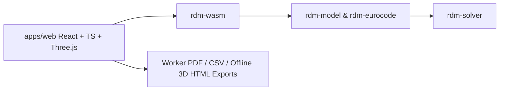

<div align="center">
  
  <p>
    <strong>A local-first 3D structural engineering workstation combining a Rust/WASM finite-element and Eurocode 3 solver with a browser 3D viewport.</strong><br/>
    Built for structural engineers and technical teams who want client-side structural analysis and report exports without sending models to a cloud backend. The core solver and Eurocode 3 logic run in Rust compiled to WebAssembly alongside a React, TypeScript, and Three.js interface (`apps/web`). Supports vector PDF reports, semicolon CSV exports, and self-contained offline 3D HTML reports.
  </p>
  <p>
    <a href="https://github.com/elcoosp/rdm-studio/actions"></a>
    <a href="https://github.com/elcoosp/rdm-studio"></a>
    <a href="https://github.com/elcoosp/rdm-studio"></a>
    <a href="https://github.com/elcoosp/rdm-studio"></a>
  </p>
  <p>
    <a href="#quickstart">Quickstart</a> •
    <a href="#features">Features</a> •
    <a href="#how-it-works">How it works</a> •
    <a href="#usage">Usage</a> •
    <a href="#status">Status</a>
  </p>
</div>

## Quickstart

```bash
git clone https://github.com/elcoosp/rdm-studio.git
```

## Features

- **Local-first execution**: Runs structural analysis and Eurocode 3 checks in Rust/WASM (`rdm-model`, `rdm-eurocode`, `rdm-solver`, `rdm-wasm`) with a React, TypeScript, and Three.js frontend (`apps/web`).
- **Vector PDF and offline 3D exports**: Generates vector PDF reports (`pdfTakumiReport.tsx` via `takumi-pdf` in a worker), UTF-8 BOM semicolon CSV exports (`csvExport.ts`), and standalone offline 3D HTML reports (`standaloneHtml3d.ts`).
- **Shareable deep links**: Encodes model state into share URLs for reproducible handoffs.
- **Resilient browser rendering**: Probes WebGL capabilities and provides an error boundary fallback when hardware acceleration is unavailable.
- **Responsive touch interface**: Includes `BottomSheet.tsx` with `motion` `drag="y"`, adapted header controls, and Playwright mobile viewports (`e2e/mobile.spec.ts`).
- **Bundled typography**: Ships with `Inter` and `JetBrains Mono` bundled for consistent engineering readouts and reports.

## How it works

The workspace separates domain computation from presentation so structural calculations execute in Rust/WASM while `apps/web` handles 3D visualization, mobile/desktop ergonomics, and client-side exports.



## Usage

### Workflows in `apps/web`

- **3D inspection and deep links**: Inspect models in the Three.js viewport, handle WebGL fallback gracefully, and share state via URL deep links.
- **Engineering and data exports**: Produce vector PDF reports via `pdfTakumiReport.tsx`, semicolon-delimited UTF-8 BOM CSV files via `csvExport.ts`, or portable 3D HTML packages via `standaloneHtml3d.ts`.
- **Mobile viewports**: Use `BottomSheet.tsx` (`motion` `drag="y"`) and responsive header layout tested against phone and tablet viewports in `e2e/mobile.spec.ts`.

### Planned backlog items

Items tracked in `STATUS.md` as unbuilt include `rdm-cad` (DXF/STEP import), `modal.rs`, `section_cut.rs`, `uPlot` section cuts, `driver.js` onboarding, `cmdk` palette, box multi-select, and fuzz targets (`b2`).

## Status

> [!IMPORTANT]
> **Maturity:** Active pre-release development through milestone M8 (Release & Exports), following M7 (Mobile Responsiveness). Gates G0-G5 and Chromium/Firefox G6 E2E tests were recorded green prior to the repository dump; WebKit E2E was skipped due to missing system libraries in the sandbox, and several backlog features (`rdm-cad`, `modal.rs`, `section_cut.rs`, `uPlot`, `driver.js`, `cmdk`, box multi-select, `b2` fuzz targets) remain unbuilt.

- **Browser & E2E verification:** Chromium and Firefox G6 E2E passed prior to the dump; WebKit requires an environment with its system libraries installed.
- **Support:** Open an issue or discussion in the repository with reproduction steps, browser/OS details, and target milestone context.

## Learn more

- [Project status and milestone notes](STATUS.md)
- [Mobile E2E tests](https://www.google.com/search?q=e2e/mobile.spec.ts)
- [PDF report exporter](https://www.google.com/search?q=apps/web)
