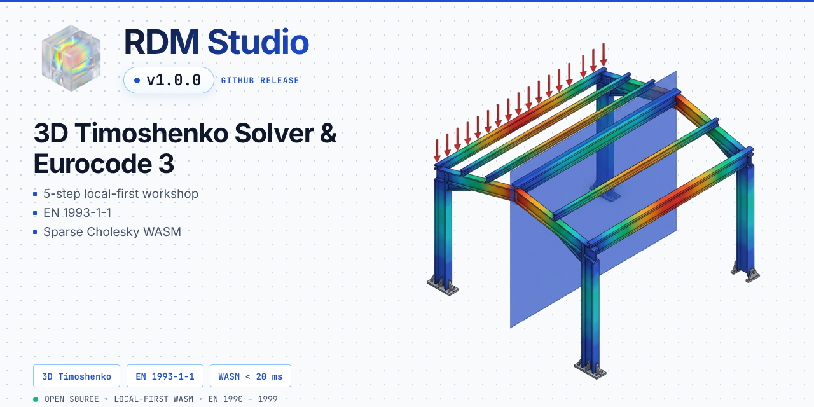

[**Launch 3D Studio ↗**](https://rdm-studio-app.vercel.app/geometry?template=portal-frame&lang=en) · [**Documentation ↗**](https://rdm-studio-docs.vercel.app/tutorials/getting-started/) · [**Overview & Benchmarks ↗**](https://rdm-studio-site.vercel.app) · [**Full Diff (`root...v1.0.0`) ↗**](https://github.com/elcoosp/rdm-studio/releases/tag/v1.0.0) · [**Sponsor ♥**](https://github.com/sponsors/elcoosp)

# RDM Studio `v1.0.0`

> [!NOTE]
> **Release Summary (EN 1990 · EN 1993-1-1 · EN 10365):** Initial 3D Timoshenko frame solver, sparse Cholesky WASM engine, and 5-step local-first studio.

## Architecture & Release Matrix

| Subsystem | Key Module / Entrypoint | Engineering & Product Scope |
| :--- | :--- | :--- |
| **Domain Model** | [`crates/rdm-model/src/lib.rs`](https://github.com/elcoosp/rdm-studio/blob/main/crates/rdm-model/src/lib.rs) | SI structs, 6-DOF support presets, rigid-body diagnostics, SHA-256 fingerprint |
| **3D Frame & Modal Solver** | [`crates/rdm-solver/src/lib.rs`](https://github.com/elcoosp/rdm-studio/blob/main/crates/rdm-solver/src/lib.rs) | 12×12 beam element, release condensation, sparse Cholesky `LLᵀ`, eigenmodes `f1..f6`, Von Mises grid |
| **Eurocode 0 & 3 Engine** | [`crates/rdm-eurocode/src/lib.rs`](https://github.com/elcoosp/rdm-studio/blob/main/crates/rdm-eurocode/src/lib.rs) | EN 1990 ULS/SLS combinations, EN 1993-1-1 checks, EN 10365 / EN 10210 / EN 10056 / EN 10025 catalogs |
| **DXF CAD Importer** | [`crates/rdm-cad/src/lib.rs`](https://github.com/elcoosp/rdm-studio/blob/main/crates/rdm-cad/src/lib.rs) | `LINE`/`POLYLINE` extraction, epsilon welding, `T`/`X` intersection splitting |
| **WASM & 5-Step Studio** | [`apps/web/src/routes/`](https://github.com/elcoosp/rdm-studio/tree/main/apps/web/src/routes/) | Zero-copy `Float64Array` worker bridge, R3F + `three-mesh-bvh` viewport, `uPlot` diagrams, A4 sheet & `?p=` URL share |

## Detailed Engineering Changelog

### 1. Pure-Rust 3D Structural Analysis Engine (`crates/rdm-solver`, `crates/rdm-model`)
- **12-DOF Spatial Frame Element (`12×12` Local & Global Stiffness):** Full 3D axial, biaxial shear/bending (`Iy`, `Iz`), and Saint-Venant torsion (`It`) formulation with static condensation for arbitrary `N1`/`N2` member end releases (`Mx`, `My`, `Mz`, `Fx`, `Fy`, `Fz`) and roll-angle (`θx`) local axis orientation.
- **Sparse Cholesky Direct Solver & Analytical Interior Recovery:** Sparse symmetric positive-definite `LLᵀ` factorization with consistent nodal load vector integration and exact closed-form Hermite/polynomial interior station recovery (`N`, `Vy`, `Vz`, `Mx`, `My`, `Mz`, `ux`, `uy`, `uz`) along every member span.
- **Eigenvalue Modal Analysis Engine (`crates/rdm-solver/src/modal.rs`):** Subspace/inverse-iteration natural frequency and mode-shape extraction (`f1..f6`) with mass-normalized eigenvectors.
- **Cross-Section Stress & Section Cuts (`crates/rdm-solver/src/results.rs`):** Analytical cross-section fiber stress recovery and Von Mises stress grid evaluation at any normalized abscissa `x/L ∈ [0, 1]`.
- **Canonical SI Domain & Kinematic Validator (`crates/rdm-model`):** Strict SI units (`m`, `N`, `Pa`, `kg`, `rad`), rigid-body mechanism diagnostics prior to factorization, and deterministic SHA-256 project fingerprinting.

### 2. Eurocode 0 & Eurocode 3 Normative Engine (`crates/rdm-eurocode`)
- **EN 1990 Combination Generator:** Automated ULS (`6.10` / `6.10a` / `6.10b`) and SLS (`Characteristic`, `Frequent`, `Quasi-Permanent`) load combination synthesis across `G` (permanent), `Q` (variable), `W` (wind), and `S` (snow) elementary actions.
- **EN 1993-1-1 Steel Member Checks:** Cross-section classification (`Class 1–4`), cross-section resistance (`N_Rd`, `V_Rd`, `M_y,Rd`, `M_z,Rd`, M–N–V interaction), and flexural/lateral-torsional buckling verification (`χ_y`, `χ_z`, `χ_LT`, `k_yy`, `k_yz`, `k_zy`, `k_zz` interaction factors) with governing-station identification.
- **Embedded EN Steel Catalogs:** Built-in standard section and material databases covering **EN 10365** (`IPE`, `HEA`, `HEB`, `HEM`, `UPN`, `UPE`), **EN 10210** (`CHS`, `RHS`, `SHS`), **EN 10056** equal/unequal angles, and **EN 10025** structural steel grades (`S235`, `S275`, `S355`, `S460`).

### 3. CAD Wireframe Topology & WebAssembly Bridge (`crates/rdm-cad`, `bindings/rdm-wasm`)
- **DXF Entity Extraction & Topological Cleanup (`crates/rdm-cad`):** Native `LINE` and `POLYLINE` DXF ingestion with epsilon node welding, `T`/`X` intersection splitting, and millimeter-to-meter SI normalization.
- **Zero-Copy WASM Facade (`bindings/rdm-wasm`):** Direct `Float64Array` memory views and typed JSON DTOs bridging the Rust solver, modal engine, DXF importer, and Eurocode catalogs to a dedicated Web Worker (`fea.worker.ts`).

### 4. 5-Step Swiss Metrology Studio (`apps/web`)
- **Guided 5-Step Workflow Spine:**
  1. **Step 1 — Geometry (`/geometry`):** Interactive Three.js / React Three Fiber 3D viewport with `three-mesh-bvh` accelerated picking, true SI extruded catalog profile meshes, `N1 → N2` member creation, EN 10365 section inspector, DXF import, and parametric gallery templates.
  2. **Step 2 — Supports (`/supports`):** 6-DOF boundary restraint matrix (`ux, uy, uz, rx, ry, rz`), RDM 7 support presets (`Fixed`, `Pinned`, `Roller`, `2D Plane`), and real-time kinematic stability status.
  3. **Step 3 — Loads (`/loads`):** Elementary EN 1990 load case tabs (`G`, `Q`, `W`, `S`), nodal forces/moments, and distributed/point span loads.
  4. **Step 4 — Results (`/results`):** KPI strip (`η_max`, max deflection, total mass), 5-tier FEA thermal stress color map, amplification slider, interactive cutting plane, and `uPlot` internal force diagrams (`N`, `Vy`, `Vz`, `My`, `Mz`).
  5. **Step 5 — Report (`/report`):** Printable A4 calculation note, TSV clipboard export, `lz-string` compressed `?p=` URL sharing, and offline-capable PWA caching with bilingual `EN` / `FR` Lingui catalogs.

> [!TIP]
> **Zero-Cloud Local-First Execution:** Open the [v1.0.0 reference model directly in RDM Studio](https://rdm-studio-app.vercel.app/geometry?template=portal-frame&lang=en) — the Rust/WASM solver (`f64` precision), Eurocode catalogs, and Takumi vector PDF generator run 100% locally in your browser.

<strong>Commit & Diff Ledger (1 commits · 189 files changed across 4 Rust crates, WASM bindings, and apps/web)</strong>

- [`v1.0.0`](https://github.com/elcoosp/rdm-studio/releases/tag/v1.0.0) Initial v1.0.0 release tag (383 commits across `rdm-model`, `rdm-eurocode`, `rdm-solver`, `rdm-cad`, `rdm-wasm`, `apps/web`)

---

**Links:** [GitHub Tag `v1.0.0`](https://github.com/elcoosp/rdm-studio/releases/tag/v1.0.0) · [Compare Changes](https://github.com/elcoosp/rdm-studio/releases/tag/v1.0.0) · [3D Studio](https://rdm-studio-app.vercel.app) · [Documentation](https://rdm-studio-docs.vercel.app) · [B2B & Discussions](https://github.com/elcoosp/rdm-studio/discussions)
