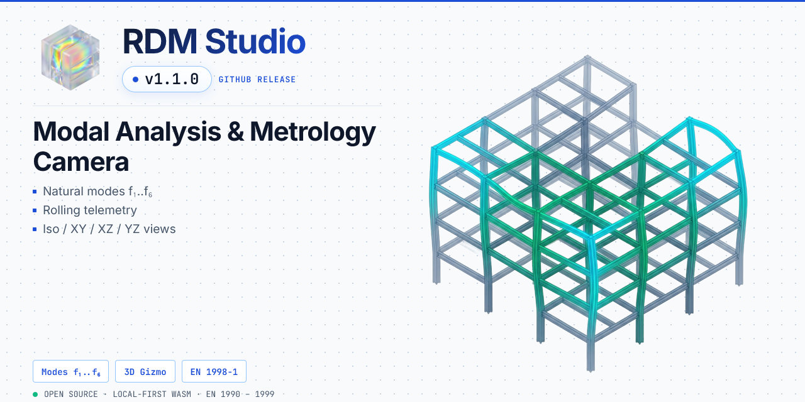

[**Launch 3D Studio ↗**](https://rdm-studio-app.vercel.app/geometry?template=portal-frame&lang=en) · [**Documentation ↗**](https://rdm-studio-docs.vercel.app/tutorials/lifting-beam-and-modal/) · [**Overview & Benchmarks ↗**](https://rdm-studio-site.vercel.app) · [**Full Diff (`v1.0.0...v1.1.0`) ↗**](https://github.com/elcoosp/rdm-studio/compare/v1.0.0...v1.1.0) · [**Sponsor ♥**](https://github.com/sponsors/elcoosp)

# RDM Studio `v1.1.0`

> [!NOTE]
> **Release Summary (EN 1998-1 · EN 1993-1-1):** Eigenmode playback (`f1..f6`), synchronized section-cut plane, smooth camera glides, and rolling KPI telemetry.

## Architecture & Release Matrix

| Subsystem | Key Module / Entrypoint | Engineering & Product Scope |
| :--- | :--- | :--- |
| **Modal Report Cache** | [`apps/web/src/wasmBridge/workerClient.ts`](https://github.com/elcoosp/rdm-studio/blob/main/apps/web/src/wasmBridge/workerClient.ts) | `getLastModal()` persistence across steps & Step 5 Natural Frequencies (`Modes propres`) table |
| **Interactive Mode Playback** | [`apps/web/src/routes/_studio/results.tsx`](https://github.com/elcoosp/rdm-studio/blob/main/apps/web/src/routes/_studio/results.tsx) | Harmonic eigenmode animation (`modal-play`) & view selector (`view-selector`) |
| **Synchronized Section Cut** | [`apps/web/src/viewport3d/ViewportCanvas.tsx`](https://github.com/elcoosp/rdm-studio/blob/main/apps/web/src/viewport3d/ViewportCanvas.tsx) | Translucent Deep Cobalt cutting plane coupled to `uPlot` station scrubber (`uplot-cursor`) |
| **Camera & Snap Reticle** | [`apps/web/src/viewport3d/ForceVectors3D.tsx`](https://github.com/elcoosp/rdm-studio/blob/main/apps/web/src/viewport3d/ForceVectors3D.tsx) | `CameraControls` smooth glides (`Iso`/`XY`/`XZ`/`YZ`), magnetic snap reticle, crimson load arrows |
| **Batch & Span Editing** | [`apps/web/src/routes/_studio/geometry.tsx`](https://github.com/elcoosp/rdm-studio/blob/main/apps/web/src/routes/_studio/geometry.tsx) | `NumberFlow` rolling KPIs, `Hold-Alt` keycap hints, `batch-editor`, span loads, 1-click EC3 upgrade |

## Detailed Engineering Changelog

### 1. Eigenmode Vibration Analysis & Report Integration
- **Modal Report Persistence (`apps/web/src/wasmBridge/workerClient.ts`):** Added `getLastModal(): ModalReport | null` caching extracted eigenmode results (`f₁..f₆` frequencies in Hz, periods `T` in s, and mass-normalized mode shapes) across route transitions so Step 5 (`report.tsx`) renders a complete **Natural Frequencies (`Modes propres`)** table alongside static ULS/SLS checks.
- **Interactive 3D Eigenmode Playback (`apps/web/src/routes/_studio/results.tsx`):** Added `data-testid="modal-play"` harmonic oscillation playback and view selector (`data-testid="view-selector"`) to visualize deformed mode shapes directly on the 3D frame.
- **Solver & WASM Refinements (`crates/rdm-solver`, `bindings/rdm-wasm/src/lib.rs`):** Cleaned up modal debug residue and enforced sequential DXF beam ID assignment in the WASM bridge.

### 2. 3D Metrology Camera, Section-Cut Sync & Force Rendering
- **Synchronized Section-Cut Plane (`apps/web/src/viewport3d/ViewportCanvas.tsx`):** Added a translucent Deep Cobalt (`#1D4ED8`) cutting plane synchronized in real time with the `uPlot` station scrubber (`data-testid="forces-plot"`, `data-testid="uplot-cursor"`).
- **Smooth Camera Glides & Snap Reticle:** Upgraded camera preset transitions (`Iso`, `XY`, `XZ`, `YZ`) using `CameraControls` glides, added a magnetic snap reticle with live cursor coordinate pill, and rendered crimson distributed load arrow arrays (`ForceVectors3D.tsx`).
- **Rolling Telemetry & Keycap Hints:** Integrated `NumberFlow` rolling numeric transitions (`number-flow`) on Step 4 KPI cards and `Hold-Alt` keyboard shortcut badges across the studio shell.

### 3. Batch Member Editing, Span Loads & E2E Verification
- **Step 1–4 Workflow Upgrades (`geometry.tsx`, `supports.tsx`, `loads.tsx`, `results.tsx`):**
  - Added multi-member **Batch Editor** (`data-testid="batch-editor"`), roll angle `θx (°)` editing, and quick-start hub in Step 1.
  - Added RDM 7 support presets (`data-testid="preset-*"`) and kinematic stability badge (`data-testid="kinematic-status"`) in Step 2.
  - Added EN 1990 case tabs (`data-testid="case-tabs"`), span loads (`PointOnSpan`, `Uniform`, `Trapezoid`), and resultant summary (`data-testid="resultant-summary"`) in Step 3.
  - Added 1-click governing-member reinforcement diagnostics (`data-testid="governing-diagnostic"`) in Step 4.
- **Verification & i18n (`apps/web/e2e/v110.spec.ts`):** Added the `v110` Playwright verification suite and refreshed bilingual `EN` / `FR` Lingui catalogs.

> [!TIP]
> **Zero-Cloud Local-First Execution:** Open the [v1.1.0 reference model directly in RDM Studio](https://rdm-studio-app.vercel.app/geometry?template=portal-frame&lang=en) — the Rust/WASM solver (`f64` precision), Eurocode catalogs, and Takumi vector PDF generator run 100% locally in your browser.

<strong>Commit & Diff Ledger (0 commits · 51 files changed, 1640 insertions(+), 1661 deletions(-))</strong>

---

**Links:** [GitHub Tag `v1.1.0`](https://github.com/elcoosp/rdm-studio/releases/tag/v1.1.0) · [Compare Changes](https://github.com/elcoosp/rdm-studio/compare/v1.0.0...v1.1.0) · [3D Studio](https://rdm-studio-app.vercel.app) · [Documentation](https://rdm-studio-docs.vercel.app) · [B2B & Discussions](https://github.com/elcoosp/rdm-studio/discussions)
