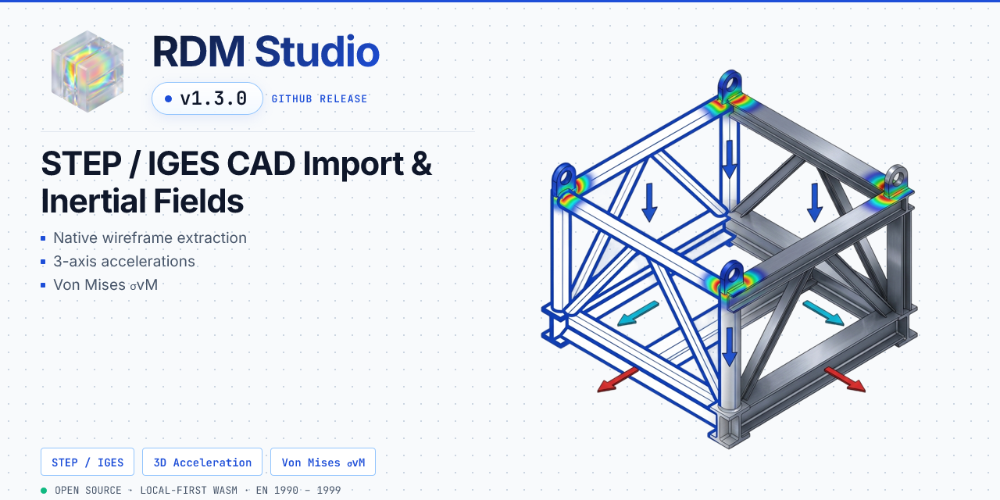

[**Launch 3D Studio ↗**](https://rdm-studio-app.vercel.app/geometry?template=naval-cradle&lang=en) · [**Documentation ↗**](https://rdm-studio-docs.vercel.app/tutorials/naval-cradle-verification/) · [**Overview & Benchmarks ↗**](https://rdm-studio-site.vercel.app) · [**Full Diff (`v1.1.0...v1.3.0`) ↗**](https://github.com/elcoosp/rdm-studio/compare/v1.1.0...v1.3.0) · [**Sponsor ♥**](https://github.com/sponsors/elcoosp)

# RDM Studio `v1.3.0`

> [!NOTE]
> **Release Summary (STEP AP203/214 · IGES 110 · EN 1993-1-1):** Pure-Rust STEP/IGES wireframe importer, 3-axis inertial acceleration fields (`g`-scenarios), and absolute Von Mises stress.

## Architecture & Release Matrix

| Subsystem | Key Module / Entrypoint | Engineering & Product Scope |
| :--- | :--- | :--- |
| **STEP / IGES Importer** | [`crates/rdm-cad/src/step_importer.rs`](https://github.com/elcoosp/rdm-studio/blob/main/crates/rdm-cad/src/step_importer.rs) | `import_step_or_iges` (`LINE`, `CARTESIAN_POINT`, `TRIMMED_CURVE`, IGES `110`), mm → m SI conversion |
| **Inertial Body Forces** | [`crates/rdm-solver/src/loads.rs`](https://github.com/elcoosp/rdm-studio/blob/main/crates/rdm-solver/src/loads.rs) | Consistent 3-axis acceleration field integration `(ax, ay, az) × g` verified by static equilibrium |
| **Von Mises Stress Grid** | [`crates/rdm-eurocode/src/en1993.rs`](https://github.com/elcoosp/rdm-studio/blob/main/crates/rdm-eurocode/src/en1993.rs) | `von_mises_stress` evaluation & governing `max_sigma_vm` across 6 eigenmodes and 3 thermal scales |
| **CAD Import & Scenarios** | [`apps/web/src/components/CadImportDialog.tsx`](https://github.com/elcoosp/rdm-studio/blob/main/apps/web/src/components/CadImportDialog.tsx) | Multi-format CAD import dialog (`cad-encastre`), 1-click `Self-weight (1g −Z)` & transport scenarios |
| **3D Picking & Brand Assets** | [`apps/web/src/viewport3d/NodeMarkers.tsx`](https://github.com/elcoosp/rdm-studio/blob/main/apps/web/src/viewport3d/NodeMarkers.tsx) | Pickable shared spherical node markers, hover highlight geometry, and official PWA icons |

## Detailed Engineering Changelog

### 1. Pure-Rust STEP & IGES Wireframe Importer (`crates/rdm-cad`)
- **Multi-Format CAD Parser (`crates/rdm-cad/src/step_importer.rs`, `lib.rs`):** Implemented `CadFormat`, `detect_cad_format`, `import_step_or_iges`, and extension-dispatched `import_cad` supporting AP203/AP214 **STEP** (`LINE`, `CARTESIAN_POINT`, `TRIMMED_CURVE`) and **IGES** (`110` line entities) with automatic millimeter-to-meter unit conversion, duplicate node welding, and `T`/`X` intersection splitting.
- **WASM & Worker CAD Pipeline (`bindings/rdm-wasm`, `fea.worker.ts`, `workerClient.ts`):** Exposed `import_cad` (`ImportCadRequest`) to the Web Worker so `.dxf`, `.step`, `.stp`, `.igs`, and `.iges` files convert directly into structural nodes and members.
- **Interactive CAD Import Dialog (`CadImportDialog.tsx`):** Added `data-testid="cad-import-dialog"` (`open-cad-import`, `cad-file-input`, `cad-choose`) with a 1-click leftmost-node fixed support option (`data-testid="cad-encastre"`).

### 2. 3-Axis Inertial Acceleration Fields & Von Mises Stress
- **Inertial Body-Force Load Kind (`crates/rdm-model/src/loads.rs`, `crates/rdm-solver/src/loads.rs`):** Added the 3-axis acceleration field load variant `(ax, ay, az) × g` with exact consistent distributed body-force integration (`9a1748b`) verified by static equilibrium tests (`0630f76`).
- **Absolute Von Mises Stress (`crates/rdm-eurocode/src/en1993.rs`, `bindings/rdm-wasm`):** Added `von_mises_stress` cross-section evaluation and exposed governing `max_sigma_vm` on beam result DTOs.
- **1-Click Naval/Lifting Scenarios (`apps/web/src/routes/_studio/loads.tsx`):** Added Step 3 `data-testid="accel-field"` controls with 3-axis `(ax, ay, az)` inputs, 1-click **Self-weight (`1g −Z`)** (`data-testid="scenario-selfweight"`), **Transport/Lifting** scenarios (`data-testid="scenario-transport"`), and undoable `Clear all loads` (`data-testid="clear-loads"`).

### 3. 6 Eigenmodes, 3 Thermal Scales & 3D Node Picking
- **Step 4 Analysis Controls (`apps/web/src/routes/_studio/results.tsx`):** Expanded modal extraction to **6 eigenmodes** (`f1..f6`) and added 3 thermal color scales (`data-testid="scale-modes"`).
- **3D Viewport & Shell Upgrades (`NodeMarkers.tsx`, `ViewportCanvas.tsx`, `__root.tsx`):** Added pickable shared spherical node markers, hover highlight geometry, bottom-right orientation gizmo, 3-zone header with locale switcher, and official PWA icons (`icon-192.png`, `icon-512.png`, `icon-maskable-512.png`).
- **Verification (`apps/web/e2e/v130.spec.ts`):** Added end-to-end Playwright coverage for STEP/IGES import, inertial acceleration scenarios, and thermal scales.

> [!TIP]
> **Zero-Cloud Local-First Execution:** Open the [v1.3.0 reference model directly in RDM Studio](https://rdm-studio-app.vercel.app/geometry?template=naval-cradle&lang=en) — the Rust/WASM solver (`f64` precision), Eurocode catalogs, and Takumi vector PDF generator run 100% locally in your browser.

<strong>Commit & Diff Ledger (69 commits · 52 files changed, 2300 insertions(+), 649 deletions(-))</strong>

- [`0b22674`](https://github.com/elcoosp/rdm-studio/commit/0b22674f087819f24d086ddf4559ea0c9fde0633) docs: v1.3.0 milestone ledger
- [`948b094`](https://github.com/elcoosp/rdm-studio/commit/948b094a304ef34fe529514924259d5cb832e657) chore(scripts): pwa icon regeneration
- [`18903a3`](https://github.com/elcoosp/rdm-studio/commit/18903a39bf60d5f5cae0b7c2f1e34878dbb0fb7a) test(unit): beam fixture fields for the new dto
- [`fd9a834`](https://github.com/elcoosp/rdm-studio/commit/fd9a83490982458af77ef57125f6aafc78202b59) test(e2e): loads inspector heading
- [`2387f81`](https://github.com/elcoosp/rdm-studio/commit/2387f81f3576a9fcaccfd7ec78212f40e86bcddb) test(e2e): loads sheet heading rename
- [`7a4e929`](https://github.com/elcoosp/rdm-studio/commit/7a4e9298e71cba3873297e504d990442b9e4b117) test(e2e): renamed presets and uniform expectations
- [`bc9fb9f`](https://github.com/elcoosp/rdm-studio/commit/bc9fb9f946fb71460acad49d5db8b8652a04a6f8) test(e2e): v1.3.0 regression suite
- [`07dbdd3`](https://github.com/elcoosp/rdm-studio/commit/07dbdd3f102016dea23b2dc7c1eb3a310c5368e1) chore(i18n): compiled fr catalog
- [`5fa659c`](https://github.com/elcoosp/rdm-studio/commit/5fa659cf9155f8c9335cfa32648be637181cab77) chore(i18n): compiled en catalog
- [`bb8f4e2`](https://github.com/elcoosp/rdm-studio/commit/bb8f4e2a73be01b32bd56adff984073afe01d327) fix(i18n): fr source catalog refresh
- [`851ef20`](https://github.com/elcoosp/rdm-studio/commit/851ef20db2aeda37a184c6dc622dd08d52634eb8) fix(i18n): en translations for v1.3.0 strings
- [`b66ffc4`](https://github.com/elcoosp/rdm-studio/commit/b66ffc4b16b2b52b36118f6112ef555b06ea1436) chore(i18n): locale change event
- [`f513712`](https://github.com/elcoosp/rdm-studio/commit/f513712fb0bec998396954206d4fe0824a49d7d7) chore(brand): mirror emblem in docs
- [`1be3f40`](https://github.com/elcoosp/rdm-studio/commit/1be3f403c03a8d667ae1089d5ca95a269efb3c7b) chore(brand): maskable icon safe zone
- [`3a5ab11`](https://github.com/elcoosp/rdm-studio/commit/3a5ab11e94ad3259cf2719fd857b554e56e99a63) chore(brand): 512px pwa icon
- [`49ef208`](https://github.com/elcoosp/rdm-studio/commit/49ef208561e79ec1b037d58d1b566720be22f466) chore(brand): 192px pwa icon
- [`76ef092`](https://github.com/elcoosp/rdm-studio/commit/76ef092cb828e02f982903ef1b27e419bc2ad5e3) feat(brand): official emblem and pwa icons
- [`fbb75e4`](https://github.com/elcoosp/rdm-studio/commit/fbb75e45e6236920afaae7436282a7609fa8fea6) feat(step4): six modes and three thermal scales
- [`b688483`](https://github.com/elcoosp/rdm-studio/commit/b688483985b66de5b950b2ff32e9a16ffc671e7b) feat(step3): g scenarios, 3-axis forms, undoable clear
- [`5414588`](https://github.com/elcoosp/rdm-studio/commit/5414588b6d94744cd4ac30686415f43c0094513b) feat(step2): rdm 7 library, click-to-restrain, clear-all
- [`34cccef`](https://github.com/elcoosp/rdm-studio/commit/34cccef4ca8172b245d417f6d41ba8732d86585b) feat(step1): tool modes, dup guard, cad import, hover, next cta
- [`f8d3e39`](https://github.com/elcoosp/rdm-studio/commit/f8d3e39b7396dbb40d087c5c18efc5a11597e1f8) feat(shell): sheet clears the mobile tab bar
- [`25b6746`](https://github.com/elcoosp/rdm-studio/commit/25b67469c9aad5df70636f120a615aef609bbe78) feat(shell): 3-zone header, locale pill, reactive nav, toaster
- [`0ae2d30`](https://github.com/elcoosp/rdm-studio/commit/0ae2d306882342c2b471f06df6302521e11fdb32) feat(ui): cad import dialog
- [`8c0b5aa`](https://github.com/elcoosp/rdm-studio/commit/8c0b5aaf608b33c8773123192b4174fda89b3c6a) feat(viewport3d): bottom-right gizmo
- [`a9543dd`](https://github.com/elcoosp/rdm-studio/commit/a9543dd290816f103fd05f29ed28ffd30b820ff6) feat(viewport3d): union-safe arrow intensities
- [`ebf6929`](https://github.com/elcoosp/rdm-studio/commit/ebf69293353f7447d4dba64784353bd5b9619c49) feat(viewport3d): hover highlight geometry
- [`b9aadb4`](https://github.com/elcoosp/rdm-studio/commit/b9aadb47e724085e2cf5981f2f9d40d312054a58) feat(viewport3d): pickable shared node markers
- [`002a1ac`](https://github.com/elcoosp/rdm-studio/commit/002a1ac7cfbb3a8f0e38c6530333eced69abe6d8) feat(state): field action, 3-axis nodal, clear loads, clear supports
- [`8a7c9d1`](https://github.com/elcoosp/rdm-studio/commit/8a7c9d121886f0a9801f5fda399a833bd4eb33f1) feat(schema): acceleration field variant
- [`ab39411`](https://github.com/elcoosp/rdm-studio/commit/ab39411317e87c56fac73aae4329393028aeadfb) feat(worker-client): importCad and beam result fields
- [`c0d1683`](https://github.com/elcoosp/rdm-studio/commit/c0d168313da4ff990a1189cbb2681d85f31615b6) feat(worker): import_cad request
- [`f2291ec`](https://github.com/elcoosp/rdm-studio/commit/f2291ec6e944999d657cc3aca37921440a50a73a) feat(wasm): max sigma vm, governing check, import_cad, 6 modes
- [`1812278`](https://github.com/elcoosp/rdm-studio/commit/18122785eb9729ce84e9e70e56992786bb9a18e4) chore(eurocode): export von mises stress
- [`ae8df9e`](https://github.com/elcoosp/rdm-studio/commit/ae8df9ec4ec812d85dd4a1afac34e1831652ed60) feat(eurocode): absolute von mises stress
- [`0630f76`](https://github.com/elcoosp/rdm-studio/commit/0630f765d8d0dc25e6cefe2d3863cc9513639f84) feat(solver): field in ec3 stations and equilibrium test
- [`9a1748b`](https://github.com/elcoosp/rdm-studio/commit/9a1748bd6d668a5e1763e68df1f4920efe379ed6) feat(solver): exact inertial body-force integration
- [`716d9f4`](https://github.com/elcoosp/rdm-studio/commit/716d9f4214e8f6076473f91b57af5611192a8f89) feat(model): acceleration field validation arm
- [`c3aed1f`](https://github.com/elcoosp/rdm-studio/commit/c3aed1ff30ccb00f260e00ea09166881e6daef10) feat(model): g-acceleration field load kind
- [`3df5fb0`](https://github.com/elcoosp/rdm-studio/commit/3df5fb0a8772826fa3a97972b5c19d7db1284983) feat(cad): extension-dispatched import_cad
- [`c385f10`](https://github.com/elcoosp/rdm-studio/commit/c385f101e1207ed2f95774d3cf7a141a064ac488) feat(cad): pure-rust step and iges wireframe importer
- [`9fae5fe`](https://github.com/elcoosp/rdm-studio/commit/9fae5fed4eee53e1a436acc347f3b639160bb51d) chore: web changes
- [`34db22d`](https://github.com/elcoosp/rdm-studio/commit/34db22de045bccf5985ea925d7ae65f199b64114) chore: ignore session tooling artifacts
- [`d79d325`](https://github.com/elcoosp/rdm-studio/commit/d79d32596760fc9262b0d43838f7e563e24f3582) docs: v1.0.0 milestone ledger
- [`33962ed`](https://github.com/elcoosp/rdm-studio/commit/33962edd98ce7e73d047e4d4fcca12fd8e6a7db0) chore(i18n): compiled fr catalog
- [`cbef541`](https://github.com/elcoosp/rdm-studio/commit/cbef541b82d53d226a49453b744f288e458aafea) chore(i18n): compiled en catalog
- [`051d682`](https://github.com/elcoosp/rdm-studio/commit/051d6821365a0f98d14595eb630515013df39c80) fix(i18n): accented msgids in fr.po
- [`e4b7e28`](https://github.com/elcoosp/rdm-studio/commit/e4b7e28041a02f90047085c42286439f5053e8d4) fix(i18n): accented fr msgids in en.po
- [`e74ff9f`](https://github.com/elcoosp/rdm-studio/commit/e74ff9ff784cd3988c1a86cfb60f7e4fd8df35e6) feat(step5): a4 sheet, tsv copy, print stylesheet
- [`41a0b51`](https://github.com/elcoosp/rdm-studio/commit/41a0b516b0ebb283ac9d57a7d625f2a5ca1a9dc5) feat(step4): kpi strip, amplification slider, docked heatmap and uplot
- [`aeb35ee`](https://github.com/elcoosp/rdm-studio/commit/aeb35ee5d4f7e8cfe3bec943078efd65bbe8aea8) feat(step3): en 1990 case tabs and cobalt cta
- [`3107cce`](https://github.com/elcoosp/rdm-studio/commit/3107cce8d81dd523093bb2a98836b99085218ca8) feat(step2): rdm 7 presets and isostatic status
- [`3c55913`](https://github.com/elcoosp/rdm-studio/commit/3c559139e9be55800f5792a2e047aff4b1527a93) feat(step1): n1-to-n2 beams, en 10365 inspector, dxf import, empty state
- [`0978122`](https://github.com/elcoosp/rdm-studio/commit/09781225efc40b3d5387831c733e01a3c5b08316) feat(shell): single navigation spine, gallery, offline pill, driver tour
- [`c9e4199`](https://github.com/elcoosp/rdm-studio/commit/c9e4199b5275cbf304b67ecd0a13bd0af866bd59) feat(state): updateBeam action
- [`0adb645`](https://github.com/elcoosp/rdm-studio/commit/0adb645d4694b076576d27fb865aa06f4dcb7c6e) feat(bridge): typed client for the v1.0.0 engines
- [`d22bd3a`](https://github.com/elcoosp/rdm-studio/commit/d22bd3a6a802aeee93779cb71d2b3facdacce0a5) fix(viewport3d): gizmo helper hud and auto-framed camera
- [`c63d9b9`](https://github.com/elcoosp/rdm-studio/commit/c63d9b9ebd91cd3aff8d8013c2ff54717fb10848) feat(viewport3d): extrude catalog profiles with bvh fallback
- [`3c19317`](https://github.com/elcoosp/rdm-studio/commit/3c19317a8662e53b8d6e92d773aa4f3bb02f0b5e) feat(viewport3d): true si profile outlines and model bounds
- [`438ab8a`](https://github.com/elcoosp/rdm-studio/commit/438ab8aaea093b28939aa878fab1f5df763e6e19) chore(web): lock the ui stack
- [`4eb1da6`](https://github.com/elcoosp/rdm-studio/commit/4eb1da6209a07e93e18d63d54e8e1eb5d14badea) build(web): cmdk, driver.js, uplot, sonner, radix primitives
- [`d023a1e`](https://github.com/elcoosp/rdm-studio/commit/d023a1e61fd7580a8cc3bec297b1c5ba514f7ccd) feat(wasm): governing-station check and modal/stress/dxf/catalog exports
- [`cb50672`](https://github.com/elcoosp/rdm-studio/commit/cb506729128681940de4b6fbfe0c7b02cd01c833) feat(solver): modal analysis engine
- [`903f98b`](https://github.com/elcoosp/rdm-studio/commit/903f98b8e262276c1f4e2a9f4a487ebaeba5e2a2) fix(ci): update actions to versions supporting Node.js 24
- [`fce0fe0`](https://github.com/elcoosp/rdm-studio/commit/fce0fe0a3ff84991587404999ddde4d4b1387615) fix: oxfmt formatting on e2e and i18n files
- [`66942a3`](https://github.com/elcoosp/rdm-studio/commit/66942a324d5ceb4c0cf6efdd77c9469639b2e323) fix(ci): approve only @swc/core and esbuild build scripts
- [`9546dcf`](https://github.com/elcoosp/rdm-studio/commit/9546dcfb02d18a54832b9ca1688e1ac4af1bc98d) fix(ci): configure pnpm to allow build scripts
- [`63e7f67`](https://github.com/elcoosp/rdm-studio/commit/63e7f67aaf89d9e416c413cd449e98eeadfeee53) chore: prompt session-mockups-parity
- [`a19a82e`](https://github.com/elcoosp/rdm-studio/commit/a19a82ea32b366d17e058e41435d124b44702b80) chore: prompt session-mockups-parity

---

**Links:** [GitHub Tag `v1.3.0`](https://github.com/elcoosp/rdm-studio/releases/tag/v1.3.0) · [Compare Changes](https://github.com/elcoosp/rdm-studio/compare/v1.1.0...v1.3.0) · [3D Studio](https://rdm-studio-app.vercel.app) · [Documentation](https://rdm-studio-docs.vercel.app) · [B2B & Discussions](https://github.com/elcoosp/rdm-studio/discussions)
