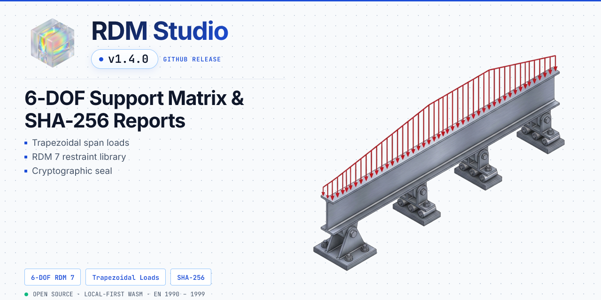

[**Launch 3D Studio ↗**](https://rdm-studio-app.vercel.app/geometry?template=continuous-beam&lang=en) · [**Documentation ↗**](https://rdm-studio-docs.vercel.app/guides/supports-and-releases/) · [**Overview & Benchmarks ↗**](https://rdm-studio-site.vercel.app) · [**Full Diff (`v1.3.0...v1.4.0`) ↗**](https://github.com/elcoosp/rdm-studio/compare/v1.3.0...v1.4.0) · [**Sponsor ♥**](https://github.com/sponsors/elcoosp)

# RDM Studio `v1.4.0`

> [!NOTE]
> **Release Summary (EN 1993-1-1 (4-Clause) · SHA-256):** Migration to `@base-ui/react`, 6-DOF RDM 7 support matrix, 4-clause EC3 breakdown, and SHA-256 report fingerprinting.

## Architecture & Release Matrix

| Subsystem | Key Module / Entrypoint | Engineering & Product Scope |
| :--- | :--- | :--- |
| **Base UI & Data Primitives** | [`apps/web/src/components/ui/`](https://github.com/elcoosp/rdm-studio/tree/main/apps/web/src/components/ui/) | 30 accessible primitives (`@base-ui/react`, `TanStack Table`, `Vaul` mobile drawers, `NumberField`, `Combobox`) |
| **Workstation & Onboarding** | [`apps/web/src/components/OnboardingTour.tsx`](https://github.com/elcoosp/rdm-studio/blob/main/apps/web/src/components/OnboardingTour.tsx) | `DesktopSplit` resizable panes, `useAppHotkeys`, shell drag-and-drop, `launchQueue`, 8-stage `driver.js` tour |
| **6-DOF Support Matrix** | [`apps/web/src/routes/_studio/supports.tsx`](https://github.com/elcoosp/rdm-studio/blob/main/apps/web/src/routes/_studio/supports.tsx) | 3D click-to-restrain spherical node picking, RDM 7 restraint library, kinematic stability status |
| **Span Loads & 4-Clause EC3** | [`apps/web/src/routes/_studio/loads.tsx`](https://github.com/elcoosp/rdm-studio/blob/main/apps/web/src/routes/_studio/loads.tsx) | 3D `PointOnSpan` & `Trapezoid` arrows, clause-by-clause EN 1993-1-1 breakdown (`GAMMA_M0`) |
| **SHA-256 Report Seal** | [`apps/web/src/routes/_studio/report.tsx`](https://github.com/elcoosp/rdm-studio/blob/main/apps/web/src/routes/_studio/report.tsx) | Modal, ULS reactions, EC3, SLS extremes tables, and cryptographic SHA-256 project fingerprint |

## Detailed Engineering Changelog

### 1. Migration to `@base-ui/react` & Swiss Metrology Component Library
- **30 Accessible UI Primitives (`apps/web/src/components/ui/`):** Migrated all interactive controls from Radix to `@base-ui/react` (`Dialog`, `Popover`, `Select`, `Tabs`, `Tooltip`, `Switch`, `Slider`, `Checkbox`, `Collapsible`, `Accordion`, `DropdownMenu`, `ToggleGroup`), stepped `NumberField` inputs, searchable EN 10365 profile `Combobox`, `TanStack Table` `DataTable` with `Shift+Click` multi-selection, `Resizable` `DesktopSplit` workstation panels, `UtilizationProgress` tiered EC3 bars, and non-blocking `Vaul` mobile `Drawer` sheets (`BottomSheet.tsx`).
- **Centralized Hotkeys, Drag-and-Drop & Onboarding (`useAppHotkeys.ts`, `useFileOpening.ts`, `OnboardingTour.tsx`):** Added centralized keyboard shortcut bindings (`react-hotkeys-hook`), shell-wide file drag-and-drop overlay, PWA `launchQueue` file opening, and an 8-stage cross-route `driver.js` onboarding tour styled with Swiss Metrology daylight tokens.

### 2. RDM 7 6-DOF Support Matrix, Span Loads & 4-Clause EC3 Breakdown
- **Step 1 & Gallery (`geometry.tsx`, `ProjectGalleryModal.tsx`):** Left-docked member/node inspector, blank project creation (`data-testid="new-blank-project"`), quick-start template cards (`data-testid="gallery-*"`), searchable profile `Combobox`, and batch section totals.
- **Step 2 (`supports.tsx`, `NodeMarkers.tsx`):** Interactive 3D click-to-restrain spherical node picking, RDM 7 restraint presets, 6-DOF checkbox matrix, and kinematic stability badge.
- **Step 3 (`loads.tsx`, `ForceVectors3D.tsx`):** EN 1990 load case tabs, 3-axis acceleration scenarios, resultant force/moment verification, and 3D rendering of `PointOnSpan` and `Trapezoid` distributed loads.
- **Step 4 & 5 (`results.tsx`, `report.tsx`, `crates/rdm-eurocode`):** Detailed 4-clause EN 1993-1-1 breakdown (`GAMMA_M0`, `Classification::as_u8`), ULS support reactions, SLS extreme deflection tables, and a cryptographic **SHA-256 model fingerprint** stamped on A4 reports (`vercel.json` SPA + WASM MIME headers included).
- **Verification (`apps/web/e2e/v140.spec.ts`):** Added Playwright E2E coverage for Base UI controls, 6-DOF supports, span loads, and SHA-256 report verification.

> [!TIP]
> **Zero-Cloud Local-First Execution:** Open the [v1.4.0 reference model directly in RDM Studio](https://rdm-studio-app.vercel.app/geometry?template=continuous-beam&lang=en) — the Rust/WASM solver (`f64` precision), Eurocode catalogs, and Takumi vector PDF generator run 100% locally in your browser.

<strong>Commit & Diff Ledger (94 commits · 66 files changed, 3389 insertions(+), 911 deletions(-))</strong>

- [`dd86689`](https://github.com/elcoosp/rdm-studio/commit/dd866899266a44b3dd750c791f848c51e74675d5) docs(status): record v1.4.0 milestone completion and gate verification
- [`cf2e5a0`](https://github.com/elcoosp/rdm-studio/commit/cf2e5a094ac350638d541a0e2acc444b5a3160bf) test(e2e): add Playwright suite covering v1.4.0 features and regressions
- [`33b4956`](https://github.com/elcoosp/rdm-studio/commit/33b4956b2ea53daca82f3045d46caa930cc8e54b) test(e2e): scope toast undo locator in v130 suite
- [`faf72c5`](https://github.com/elcoosp/rdm-studio/commit/faf72c53cfb6f0278fd101481d6dca8f73811e0e) test(exports): update SolveReport fixtures with v1.4.0 EC3 check fields
- [`4038650`](https://github.com/elcoosp/rdm-studio/commit/40386506566a1f2dc6875b8540d6349a81f00f66) i18n(fr): compile French Lingui catalog
- [`fb80cf8`](https://github.com/elcoosp/rdm-studio/commit/fb80cf89848c9dcc5af37173fd7ae841d1fb6861) i18n(fr): update French message catalog for v1.4.0 strings
- [`b2d2f35`](https://github.com/elcoosp/rdm-studio/commit/b2d2f359fff23fefc5aed297d1da3a384943deca) i18n(en): compile English Lingui catalog
- [`d8ba2db`](https://github.com/elcoosp/rdm-studio/commit/d8ba2dbe794d19e150a0d2ec3b9134531692939a) i18n(en): update English message catalog for v1.4.0 strings
- [`c77005c`](https://github.com/elcoosp/rdm-studio/commit/c77005c4b31c5775f4a793641239b027cbb9913f) feat(report): add modal, ELU reactions, EC3, ELS extreme tables, and SHA-256 footer
- [`8539f03`](https://github.com/elcoosp/rdm-studio/commit/8539f034fb3251eff7a3855a467f7f6768060a8e) feat(results): add 4-clause EC3 breakdown, modal playback, cutting plane, and uPlot scrub
- [`d08b6b7`](https://github.com/elcoosp/rdm-studio/commit/d08b6b72743a00a845e7b49bc2ad68515d477c24) feat(loads): add EN 1990 case tabs, acceleration scenarios, span loads, and resultants
- [`7b6d721`](https://github.com/elcoosp/rdm-studio/commit/7b6d721acad6c31f0534c87f96cdecf4e64bcee1) feat(supports): add 3D click-to-restrain viewport, RDM 7 library, and kinematic badge
- [`e6a9327`](https://github.com/elcoosp/rdm-studio/commit/e6a932794c81ea6917a66cc8a1e11ceafcb2f2b5) feat(geometry): dock inspector left, add quick-start pills, profile Combobox, and batch totals
- [`418a47b`](https://github.com/elcoosp/rdm-studio/commit/418a47bab50ea0d265e2dfa6d64e3c83677653ac) feat(shell): wire hotkeys, undo/redo header buttons, onboarding tour, and file drop
- [`15bc836`](https://github.com/elcoosp/rdm-studio/commit/15bc836081017da8e2bea7c7aeec811351878cab) feat(viewport): use CameraControls glides, runtime bridge, and project-scoped auto-fit
- [`f9c4869`](https://github.com/elcoosp/rdm-studio/commit/f9c48696a1af6de7bb1cc354348cac5255d12ef8) fix(viewport): re-bind SnapOverlay pointer listeners on WebGL init and resize
- [`5fa780f`](https://github.com/elcoosp/rdm-studio/commit/5fa780f19fa3778ddc92a4c0a07d7f395b66a75d) feat(viewport): render PointOnSpan and Trapezoid distributed loads in 3D
- [`cd4b9ce`](https://github.com/elcoosp/rdm-studio/commit/cd4b9ce5266271f2cce27197a2397bd51b93fb48) fix(viewport): include sectionDims in geometry memos and tint selected beams
- [`56f7a4d`](https://github.com/elcoosp/rdm-studio/commit/56f7a4dbe85e460516e23e21784625d947ad2609) feat(viewport): render 3D spherical node markers with per-node picking
- [`85efbe2`](https://github.com/elcoosp/rdm-studio/commit/85efbe2accc82d742502bf6e38b90bff14182900) fix(viewport): allow nullable catalog dimensions in ProfileDims
- [`d3ba82c`](https://github.com/elcoosp/rdm-studio/commit/d3ba82caf0a0e2d927b948b90210914bd8540001) feat(gallery): add blank project creation, rich template cards, and file import
- [`0293302`](https://github.com/elcoosp/rdm-studio/commit/029330211554f499c6ef1003446ff14df4f884a5) feat(tour): add 8-stage cross-route driver.js onboarding tour
- [`8e5a2bd`](https://github.com/elcoosp/rdm-studio/commit/8e5a2bd037449d8d3e453794b514e62fc858aa82) refactor(hotkeys): remove duplicate Cmd+K listener from CommandPalette
- [`1e60762`](https://github.com/elcoosp/rdm-studio/commit/1e607628e2dd09bdac670383f3890d60254a1e2f) refactor(cad): update CadImportDialog to Base UI DialogRoot and render prop
- [`9e42d05`](https://github.com/elcoosp/rdm-studio/commit/9e42d0539c5d8d673be466a12e03ceecc6123acd) refactor(ui): rebuild mobile BottomSheet on Vaul Drawer with snap points
- [`4ef68dc`](https://github.com/elcoosp/rdm-studio/commit/4ef68dcd3393148c3330c1bee3406d8551c40b92) feat(ui): add segmented Base UI ToggleGroup primitives
- [`9880ae4`](https://github.com/elcoosp/rdm-studio/commit/9880ae428cd35e32c51df6ce942cc5d3a8519a66) feat(ui): add monospace Textarea component
- [`c060b81`](https://github.com/elcoosp/rdm-studio/commit/c060b81871acf7414b529e59075ee1516be3059b) feat(ui): add Base UI Separator component
- [`fa6961d`](https://github.com/elcoosp/rdm-studio/commit/fa6961df3e39dc5dc2e38cc30ef26af9eb420f8e) feat(ui): add Base UI ScrollArea component
- [`dd27e78`](https://github.com/elcoosp/rdm-studio/commit/dd27e78a48a3d7d0617cf330b9e726c27b4781e4) feat(ui): add Resizable panels and DesktopSplit workstation layout
- [`01753b8`](https://github.com/elcoosp/rdm-studio/commit/01753b84cc89c080de3bf571b5549e96ce6ffcff) feat(ui): add UtilizationProgress tiered EC3 bar component
- [`c9562c5`](https://github.com/elcoosp/rdm-studio/commit/c9562c59caaee9f16f2b6d695951ebe9f506df44) feat(ui): add non-trapping Base UI Popover primitives
- [`84a64a6`](https://github.com/elcoosp/rdm-studio/commit/84a64a63a2d409fd64a8a0e79c495dc38309496f) feat(ui): add stepped Base UI NumberField primitives
- [`e92c63e`](https://github.com/elcoosp/rdm-studio/commit/e92c63e3f992250fd6e6975f2c359284ba2d9541) feat(ui): add property-row Label component
- [`dfbf932`](https://github.com/elcoosp/rdm-studio/commit/dfbf9329a472a2f287dd0b70949fb119ab04b155) feat(ui): add Kbd keycap chip component
- [`7ac6642`](https://github.com/elcoosp/rdm-studio/commit/7ac6642383ce11fa3e280c7ff176ef8b93a25546) feat(ui): add monospace Input component
- [`8f28580`](https://github.com/elcoosp/rdm-studio/commit/8f28580351e289f5737e46942dff9174ae9e500e) feat(ui): add Base UI DropdownMenu primitives
- [`38dc126`](https://github.com/elcoosp/rdm-studio/commit/38dc12674de3aa5aa2bd36591045db649989a9c8) feat(ui): add non-blocking Vaul Drawer primitives for mobile inspectors
- [`be02004`](https://github.com/elcoosp/rdm-studio/commit/be0200456b6f509c7101e7523bd254139f3c7056) feat(ui): add TanStack Table DataTable wrapper with Shift+Click selection
- [`a7f1cd9`](https://github.com/elcoosp/rdm-studio/commit/a7f1cd9c47874ec1fd532c3dabc34b53c8fdf3b0) feat(ui): add searchable Base UI Combobox for EN 10365 profile catalog
- [`c645be6`](https://github.com/elcoosp/rdm-studio/commit/c645be686495b46396c5de9ad7c7651d185bfa40) feat(ui): add Base UI Collapsible disclosure primitives
- [`5838c6b`](https://github.com/elcoosp/rdm-studio/commit/5838c6bd1a170ff90b5bfc188d4e969e45392753) feat(ui): add Base UI Checkbox component for 6-DOF matrices
- [`ed8572d`](https://github.com/elcoosp/rdm-studio/commit/ed8572d0649f58c8f2ecc9b08fc92387c74a8a6f) feat(ui): add flat hairline Card primitives
- [`365986a`](https://github.com/elcoosp/rdm-studio/commit/365986ab9aaca422571ba60122ba2c9a941cafd8) feat(ui): add status Alert component with pass, fail, and info tones
- [`4afd85c`](https://github.com/elcoosp/rdm-studio/commit/4afd85c52ff12dbba740040c472df646bf9e3115) feat(ui): add Base UI Accordion primitives
- [`baaa5d2`](https://github.com/elcoosp/rdm-studio/commit/baaa5d2fb72b4b5f96ca222b1702f33ee0f3ed18) refactor(ui): migrate Tooltip primitives from Radix to @base-ui/react/tooltip
- [`d01359e`](https://github.com/elcoosp/rdm-studio/commit/d01359ea2e429168786e8ad64652d9f261c06b71) refactor(ui): migrate Tabs primitives from Radix to @base-ui/react/tabs
- [`2320f9c`](https://github.com/elcoosp/rdm-studio/commit/2320f9c94e8219edf3e1fdcbf10f94506d0b9854) refactor(ui): migrate Switch primitive from Radix to @base-ui/react/switch
- [`74219fc`](https://github.com/elcoosp/rdm-studio/commit/74219fcd04f08006f264fc5914c510f318f66ad5) refactor(ui): migrate Slider primitive from Radix to @base-ui/react/slider
- [`a97e7aa`](https://github.com/elcoosp/rdm-studio/commit/a97e7aac546536e976ebbb11df4c97e7be008f95) refactor(ui): migrate Select primitives from Radix to @base-ui/react/select
- [`9f166c8`](https://github.com/elcoosp/rdm-studio/commit/9f166c8867f60b09b0555842199c19d7e6777886) refactor(ui): migrate Dialog primitives from Radix to @base-ui/react/dialog
- [`c2d0589`](https://github.com/elcoosp/rdm-studio/commit/c2d05899babfafdab2502b4b875c1fa92b70fd30) refactor(ui): remove @radix-ui/react-slot dependency from Button
- [`53f6fed`](https://github.com/elcoosp/rdm-studio/commit/53f6fed7a9de64110b6f482bd699a2faf9418dd2) style(tour): style driver.js onboarding popover with Daylight Swiss tokens
- [`32a371c`](https://github.com/elcoosp/rdm-studio/commit/32a371c89aa21ec199f021e25e14321d1cb792a2) style(web): add shell drag-and-drop overlay indicator
- [`41af160`](https://github.com/elcoosp/rdm-studio/commit/41af160646355ec16226e79e7b980eac2cd21f77) feat(files): support shell drag-and-drop and PWA launchQueue file opening
- [`6e25664`](https://github.com/elcoosp/rdm-studio/commit/6e256649cfde2b2ef74ae022ba87ef2d9b1c719f) feat(hotkeys): centralize keyboard shortcuts with react-hotkeys-hook
- [`07a0246`](https://github.com/elcoosp/rdm-studio/commit/07a0246adcbe0474e336ff7565d035a7b56e5241) feat(hooks): add reactive useMediaQuery hook via useSyncExternalStore
- [`3760238`](https://github.com/elcoosp/rdm-studio/commit/376023842c824d792d2c5cf657a2df580016ffcb) feat(state): add multi-beam selection, span/acceleration loads, and quick-start templates
- [`ba67afb`](https://github.com/elcoosp/rdm-studio/commit/ba67afbcbdf559ecd19b721641440f9e95d51e6e) feat(state): share toolMode and viewportMounted state across viewport and hotkeys
- [`e8c0460`](https://github.com/elcoosp/rdm-studio/commit/e8c0460929580c71d8e35f560cdc336afb083941) feat(worker): extend CombinationReport with EC3 fields and add fingerprint/CAD client methods
- [`825e21c`](https://github.com/elcoosp/rdm-studio/commit/825e21cca94cf5520fee4e872918a6ea00b9c236) feat(worker): handle IMPORT_CAD and FINGERPRINT worker messages
- [`bd62971`](https://github.com/elcoosp/rdm-studio/commit/bd62971e6f8e0c98f2c185a4e79ec728c564e88c) build(deploy): add Vercel SPA rewrite, WASM MIME type, and service worker cache headers
- [`99fc82a`](https://github.com/elcoosp/rdm-studio/commit/99fc82ab5afdc5c061c358cca765696fc4550a65) ci(e2e): disable reuseExistingServer in CI environments
- [`6f73aef`](https://github.com/elcoosp/rdm-studio/commit/6f73aef6a917bd1d1becc33cc3e146255d23ca61) fix(pwa): align manifest theme_color and background_color with Daylight Swiss palette
- [`c2ecba4`](https://github.com/elcoosp/rdm-studio/commit/c2ecba4f5b88c563d151485b393eb77380e4df49) build(deps): update pnpm-lock.yaml for v1.4.0 UI foundation
- [`8f2a3f3`](https://github.com/elcoosp/rdm-studio/commit/8f2a3f39421cb11ef12e161fc9f04a114e4cbfcf) build(web): migrate UI primitives to Base UI and add table/hotkeys/drawer packages
- [`acd0b4b`](https://github.com/elcoosp/rdm-studio/commit/acd0b4b76945f4aec1ea9c3fd05ddc9e701b58c7) feat(wasm): expose full EC3 check details, import_cad, and SHA-256 fingerprint
- [`4550541`](https://github.com/elcoosp/rdm-studio/commit/45505415cbfa71958bf46dffe4ef1d899dfa5e5b) feat(cad): add extension-dispatched import_cad router
- [`b067e18`](https://github.com/elcoosp/rdm-studio/commit/b067e1857fc2e7330018a6074e67d8c3547c55c3) feat(eurocode): re-export GAMMA_M0 constant at crate root
- [`40f05f5`](https://github.com/elcoosp/rdm-studio/commit/40f05f5414658bdeb6872869dbf0241365a8adba) feat(eurocode): add Classification::as_u8 ordinal helper
- [`f9a1830`](https://github.com/elcoosp/rdm-studio/commit/f9a18306f6509f0e4c8de876aebb9e41c0f82b58) fix: lock
- [`c52e10d`](https://github.com/elcoosp/rdm-studio/commit/c52e10d00e52abcefce420b7c86acb822ed2ef36) fix: gitignore
- [`bf7795c`](https://github.com/elcoosp/rdm-studio/commit/bf7795c50bda13ba7b62f2320091c2db59df74a8) chore: ignore session tooling artifacts
- [`dcf0eb6`](https://github.com/elcoosp/rdm-studio/commit/dcf0eb677697ff863112d9190db24b704a1a39cb) docs: v1.0.0 milestone ledger
- [`4d2114a`](https://github.com/elcoosp/rdm-studio/commit/4d2114a5ed384b6c781f9a6187424b8113ce09ed) chore(i18n): compiled fr catalog
- [`4829c28`](https://github.com/elcoosp/rdm-studio/commit/4829c281ae04bf5ee23fb32bb40fcaaee166c5ab) chore(i18n): compiled en catalog
- [`688e331`](https://github.com/elcoosp/rdm-studio/commit/688e3313425c7cffd861a82acf06cf41ae597a59) fix(i18n): accented msgids in fr.po
- [`7dc2a3f`](https://github.com/elcoosp/rdm-studio/commit/7dc2a3f25ed7ebd8a6961717716ac3efe45241dc) fix(i18n): accented fr msgids in en.po
- [`fc07e78`](https://github.com/elcoosp/rdm-studio/commit/fc07e78755c5ec6e35b48a77b82566f61bfba878) feat(step4): kpi strip, amplification slider, docked heatmap and uplot
- [`1619c93`](https://github.com/elcoosp/rdm-studio/commit/1619c9386f4c8633b1ca880ea375f7c1c083323b) feat(step3): en 1990 case tabs and cobalt cta
- [`0849f57`](https://github.com/elcoosp/rdm-studio/commit/0849f575faa704111bfdf61ead0f91dd981a8639) feat(step2): rdm 7 presets and isostatic status
- [`ec05fb1`](https://github.com/elcoosp/rdm-studio/commit/ec05fb1646ec0ec0ce15a15d5ade4c0928cabbe7) feat(step1): n1-to-n2 beams, en 10365 inspector, dxf import, empty state
- [`774bc55`](https://github.com/elcoosp/rdm-studio/commit/774bc55313d016eb92211f019a197642287ba85e) feat(shell): single navigation spine, gallery, offline pill, driver tour
- [`2d5c1b5`](https://github.com/elcoosp/rdm-studio/commit/2d5c1b5d6ae8d730b1f8d8d37deec3e2729b84cf) feat(state): updateBeam action
- [`00b927b`](https://github.com/elcoosp/rdm-studio/commit/00b927bb781396e41da87efdfade0590af930525) feat(bridge): typed client for the v1.0.0 engines
- [`cc15eed`](https://github.com/elcoosp/rdm-studio/commit/cc15eed4cc4ac4e3c1b8765eb3c3c8fd27403c6b) feat(worker): modal, stress, span forces, dxf, catalog ops
- [`10f6016`](https://github.com/elcoosp/rdm-studio/commit/10f60168d9c5ef15b698d30c8bb8f9a3fa550f76) fix(viewport3d): gizmo helper hud and auto-framed camera
- [`73bf1c7`](https://github.com/elcoosp/rdm-studio/commit/73bf1c784537148201c012600d198e993a880b67) feat(viewport3d): extrude catalog profiles with bvh fallback
- [`3b021f4`](https://github.com/elcoosp/rdm-studio/commit/3b021f490ec5da9023e9bf04ad29723ac75bba1f) chore(web): lock the ui stack
- [`dc678e5`](https://github.com/elcoosp/rdm-studio/commit/dc678e5fbc820ab9f4827345f88e4a80b430b4a3) build(web): cmdk, driver.js, uplot, sonner, radix primitives
- [`d9dccbe`](https://github.com/elcoosp/rdm-studio/commit/d9dccbef9e3e76493e412c15cf0254215e1e67eb) feat(wasm): governing-station check and modal/stress/dxf/catalog exports
- [`08fa1d3`](https://github.com/elcoosp/rdm-studio/commit/08fa1d30b9f94790ea644fc2e382748a7e247158) feat(cad): wireframe topology facade
- [`38438f4`](https://github.com/elcoosp/rdm-studio/commit/38438f48b1e2541e94a4bafb766f8edb8de368c5) fix: crash react
- [`42bf477`](https://github.com/elcoosp/rdm-studio/commit/42bf477d7ac3525b3b43bb71176f08b8563c049b) chore: session prompt

---

**Links:** [GitHub Tag `v1.4.0`](https://github.com/elcoosp/rdm-studio/releases/tag/v1.4.0) · [Compare Changes](https://github.com/elcoosp/rdm-studio/compare/v1.3.0...v1.4.0) · [3D Studio](https://rdm-studio-app.vercel.app) · [Documentation](https://rdm-studio-docs.vercel.app) · [B2B & Discussions](https://github.com/elcoosp/rdm-studio/discussions)
