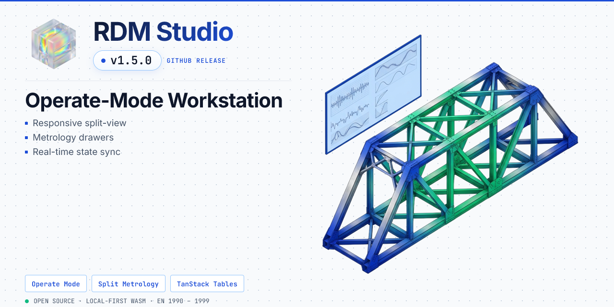

[**Launch 3D Studio ↗**](https://rdm-studio-app.vercel.app/geometry?template=warren-truss&lang=en) · [**Documentation ↗**](https://rdm-studio-docs.vercel.app/guides/results-and-section-cut/) · [**Overview & Benchmarks ↗**](https://rdm-studio-site.vercel.app) · [**Full Diff (`v1.4.0...v1.5.0`) ↗**](https://github.com/elcoosp/rdm-studio/compare/v1.4.0...v1.5.0) · [**Sponsor ♥**](https://github.com/sponsors/elcoosp)

# RDM Studio `v1.5.0`

> [!NOTE]
> **Release Summary (Swiss Metrology Layout-Craft):** Operate-Mode workstation overhaul with responsive desktop split-view, docked metrology tables, and mobile snap sheets.

## Architecture & Release Matrix

| Subsystem | Key Module / Entrypoint | Engineering & Product Scope |
| :--- | :--- | :--- |
| **Operate-Mode Routes** | [`apps/web/src/routes/_studio/geometry.tsx`](https://github.com/elcoosp/rdm-studio/blob/main/apps/web/src/routes/_studio/geometry.tsx) | Zero-scroll full-height `DesktopSplit` layout across all 5 studio steps (`geometry` → `report`) |
| **Docked Metrology Tables** | [`apps/web/src/routes/_studio/loads.tsx`](https://github.com/elcoosp/rdm-studio/blob/main/apps/web/src/routes/_studio/loads.tsx) | Collapsible bottom `data-dock` (`Nodes`/`Beams`), `equilibrium-pill`, `self-weight-mass`, `fiber-stresses` |
| **Command Palette & Exports** | [`apps/web/src/components/CommandPalette.tsx`](https://github.com/elcoosp/rdm-studio/blob/main/apps/web/src/components/CommandPalette.tsx) | Expanded `⌘K` actions and Step 5 export triggers (`PDF`, `CSV`, `3D HTML`, `Print`, `QR`) |
| **Mobile Bottom Sheet** | [`apps/web/src/components/BottomSheet.tsx`](https://github.com/elcoosp/rdm-studio/blob/main/apps/web/src/components/BottomSheet.tsx) | Patched `vaul@1.1.2` non-blocking snap-point drawers (`patches/vaul@1.1.2.patch`) |
| **Layout-Craft E2E Suite** | [`apps/web/e2e/layout-craft.spec.ts`](https://github.com/elcoosp/rdm-studio/blob/main/apps/web/e2e/layout-craft.spec.ts) | 221-line Playwright bounding-box, overflow, and dock integrity suite across desktop & mobile |

## Detailed Engineering Changelog

### 1. Operate-Mode Workstation & Split-View Metrology
- **Full 5-Route Operate-Mode Overhaul (`geometry.tsx`, `supports.tsx`, `loads.tsx`, `results.tsx`, `report.tsx`):** Re-architected every studio step around `DesktopSplit` (`inspector` + `main` viewport) with zero-scroll full-height desktop geometry, docked left property inspectors, and instant synchronization between 3D picking and tabular readouts.
- **Docked Metrology Tables (`data-dock`, `dock-tab-nodes`, `dock-tab-beams`):** Added collapsible bottom node/beam data dock (`data-dock-toggle`), profile legend (`profile-legend`), equilibrium status pill (`equilibrium-pill`), self-weight mass indicator (`self-weight-mass`), fiber stress readouts (`fiber-stresses`), and 1-click profile reinforcement (`upgrade-1click`).
- **Expanded Command Palette (`CommandPalette.tsx`):** Added keyboard-driven step jumps, model actions, and export triggers (`export-pdf`, `export-csv`, `export-html3d`, `print-report`, `share-qr`).

### 2. Mobile Bottom Sheet & Layout-Craft Verification
- **Vaul Drawer Patch & Mobile Sheet (`BottomSheet.tsx`, `patches/vaul@1.1.2.patch`):** Patched `vaul@1.1.2` so non-modal snap-point drawers never block 3D viewport pointer interactions or clip action footers on mobile viewports (`mobile-report-pdf`).
- **Layout-Craft E2E Suite (`apps/web/e2e/layout-craft.spec.ts`):** Added 221 lines of automated layout-integrity, bounding-box, overflow, and dock regression checks across desktop and mobile viewports.

> [!TIP]
> **Zero-Cloud Local-First Execution:** Open the [v1.5.0 reference model directly in RDM Studio](https://rdm-studio-app.vercel.app/geometry?template=warren-truss&lang=en) — the Rust/WASM solver (`f64` precision), Eurocode catalogs, and Takumi vector PDF generator run 100% locally in your browser.

<strong>Commit & Diff Ledger (5 commits · 38 files changed, 2566 insertions(+), 1782 deletions(-))</strong>

- [`4960816`](https://github.com/elcoosp/rdm-studio/commit/49608169eb8abb5218c49dea6b35df1b011c1a4c) docs(status): record v1.5.0 completion and gate verification
- [`62eb06d`](https://github.com/elcoosp/rdm-studio/commit/62eb06d3799b21e1e8bb59b1b5461cdf22a3a830) chore(web): config, i18n catalogs and packaging for v1.5.0
- [`4348d19`](https://github.com/elcoosp/rdm-studio/commit/4348d19686bd3acca6b50ee7abb716b8f73482c5) test(web): layout-craft suite and v1.5.0 regression updates
- [`0e77afa`](https://github.com/elcoosp/rdm-studio/commit/0e77afa809f50b8d517522e6df4c093d12ced3b6) feat(web): impeccable operate-mode UI/UX overhaul v1.5.0
- [`d7dba54`](https://github.com/elcoosp/rdm-studio/commit/d7dba54f665eca952ba55bf00c05dc179d39cdb7) docs(agents): update execution playbook for Base UI, Vaul and sandbox Playwright

---

**Links:** [GitHub Tag `v1.5.0`](https://github.com/elcoosp/rdm-studio/releases/tag/v1.5.0) · [Compare Changes](https://github.com/elcoosp/rdm-studio/compare/v1.4.0...v1.5.0) · [3D Studio](https://rdm-studio-app.vercel.app) · [Documentation](https://rdm-studio-docs.vercel.app) · [B2B & Discussions](https://github.com/elcoosp/rdm-studio/discussions)
