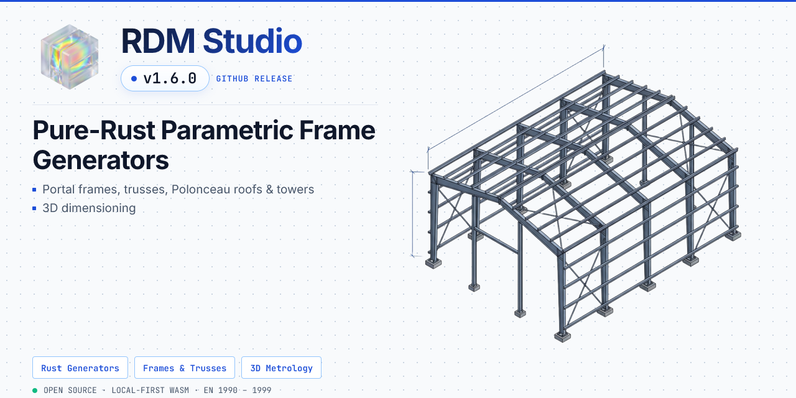

[**Launch 3D Studio ↗**](https://rdm-studio-app.vercel.app/geometry?template=portal-frame&lang=en) · [**Documentation ↗**](https://rdm-studio-docs.vercel.app/guides/cad-modeling-and-sections/) · [**Overview & Benchmarks ↗**](https://rdm-studio-site.vercel.app) · [**Full Diff (`v1.5.0...v1.6.0`) ↗**](https://github.com/elcoosp/rdm-studio/compare/v1.5.0...v1.6.0) · [**Sponsor ♥**](https://github.com/sponsors/elcoosp)

# RDM Studio `v1.6.0`

> [!NOTE]
> **Release Summary (EN 10365 · Persistent WebGL):** Pure-Rust parametric structure generator (`rdm-cad`) and zero-remount persistent 3D WebGL stage with 3D dimension lines.

## Architecture & Release Matrix

| Subsystem | Key Module / Entrypoint | Engineering & Product Scope |
| :--- | :--- | :--- |
| **Rust Parametric Engine** | [`crates/rdm-cad/src/parametric.rs`](https://github.com/elcoosp/rdm-studio/blob/main/crates/rdm-cad/src/parametric.rs) | `generate_structure` (`ParametricTemplate`, `ParametricParams`) with validation & automatic section sizing |
| **Persistent WebGL Stage** | [`apps/web/src/viewport3d/PersistentStage.tsx`](https://github.com/elcoosp/rdm-studio/blob/main/apps/web/src/viewport3d/PersistentStage.tsx) | Single persistent Three.js context projected via portal slots (`stageStore.ts`) + live `captureViewportPng()` |
| **3D Metrology Overlays** | [`apps/web/src/viewport3d/DimensionLines.tsx`](https://github.com/elcoosp/rdm-studio/blob/main/apps/web/src/viewport3d/DimensionLines.tsx) | Toggleable 3D architectural dimension ticks (`DimensionLines`), node/beam labels (`ViewportLabels`), reaction arrows |
| **Subdivision & Sections** | [`apps/web/src/routes/_studio/geometry.tsx`](https://github.com/elcoosp/rdm-studio/blob/main/apps/web/src/routes/_studio/geometry.tsx) | `N`-segment beam discretization (`subdivide-panel`), SVG `SectionDiagram`, and `.rdm` round-trip export |
| **Regression & Unit Suites** | [`apps/web/e2e/v160.spec.ts`](https://github.com/elcoosp/rdm-studio/blob/main/apps/web/e2e/v160.spec.ts) | 293-line E2E suite plus `projectStore.test.ts` and `en.po.test.ts` catalog verification |

## Detailed Engineering Changelog

### 1. Pure-Rust Parametric Structure Generator (`crates/rdm-cad/src/parametric.rs`)
- **Deterministic Topology & Section Engine (`generate_structure`, `ParametricTemplate`, `ParametricParams`):** Implemented pure-Rust parametric generators with strict domain validation (`ParametricError::validate`) producing ready-to-solve 2D/3D portal frames, multi-span beams, trusses, and pitched halls with primary/secondary EN 10365 sections and boundary conditions.
- **WASM & Worker Integration (`bindings/rdm-wasm/src/lib.rs`, `fea.worker.ts`, `workerClient.ts`):** Exposed `generate_parametric_structure` and `validate_model_issues` (`ModelIssueDto`) to the Web Worker, wired into `ProjectGalleryModal.tsx` (`data-testid="parametric-configurator"`, `data-testid="generate-parametric"`) alongside canonical `.rdm` round-trip export (`data-testid="gallery-export-rdm"`).

### 2. Persistent WebGL Stage & 3D Metrology Overlays
- **Zero-Remount Persistent 3D Stage (`PersistentStage.tsx`, `stageStore.ts`):** Replaced per-route `<Canvas>` instances with a single persistent Three.js WebGL context projected into route portal slots (`geometry-stage-slot`, `supports-stage-slot`, `loads-stage-slot`, `results-stage-slot`) and added `captureViewportPng()` for live 3D snapshots in Step 5 (`data-testid="report-3d-snapshot"`).
- **3D Dimension Lines & Labels (`DimensionLines.tsx`, `ViewportLabels.tsx`, `LayerToolbar.tsx`):** Added toggleable architectural dimension ticks (`data-testid="layer-dims"`, `dimension-lines`), node/beam ID callouts (`data-testid="layer-labels"`, `viewport-labels`), support reaction vectors (`data-testid="layer-reactions"`), and interactive cross-section SVG previews (`SectionDiagram`, `data-testid="section-diagram"`).
- **Subdivision, Springs & E2E Coverage (`apps/web/e2e/v160.spec.ts`, `projectStore.test.ts`):** Added `N`-segment beam discretization (`subdivide-panel`), elastic spring fields (`spring-section`), SLS deflection limit selectors (`sls-limit-selector`), and a 293-line Playwright regression suite.

> [!TIP]
> **Zero-Cloud Local-First Execution:** Open the [v1.6.0 reference model directly in RDM Studio](https://rdm-studio-app.vercel.app/geometry?template=portal-frame&lang=en) — the Rust/WASM solver (`f64` precision), Eurocode catalogs, and Takumi vector PDF generator run 100% locally in your browser.

<strong>Commit & Diff Ledger (13 commits · 52 files changed, 4428 insertions(+), 977 deletions(-))</strong>

- [`2ceffa6`](https://github.com/elcoosp/rdm-studio/commit/2ceffa6e444f002552a19854f8b5c5bdb4fef3a2) docs(status): record v1.6.0 completion and gate evidence
- [`a77752c`](https://github.com/elcoosp/rdm-studio/commit/a77752ca83b355bcd6ac9f9fa72c5d9416bd8e2a) chore(web): i18n catalogs for v1.6.0
- [`a64c385`](https://github.com/elcoosp/rdm-studio/commit/a64c3851f146fca8fa0cbda96dcf70d02facb8c6) test(web): v1.6.0 regression suites
- [`58674d6`](https://github.com/elcoosp/rdm-studio/commit/58674d6097483663cd57808cd82ea7d6400592e1) fix(web): security audit closures
- [`426acac`](https://github.com/elcoosp/rdm-studio/commit/426acac0fdad22a3a3c687415d394d65c2f2361e) feat(web): store actions, drawer and project gallery
- [`d800e83`](https://github.com/elcoosp/rdm-studio/commit/d800e83a3a0ba9ab2fba54e73b6c9466f5bf89d2) feat(web): viewport components on the shared stage
- [`122cf50`](https://github.com/elcoosp/rdm-studio/commit/122cf50d9d2c173a69cb66bbaf09e7b5b322798d) feat(web): routes on the persistent stage
- [`292256f`](https://github.com/elcoosp/rdm-studio/commit/292256f3e23ff74165d3d73cd57da4cedf01972e) feat(web): worker bridge DTOs and pub-sub
- [`63ae851`](https://github.com/elcoosp/rdm-studio/commit/63ae8510308d18bda6d95a948fcee805d8a56bc4) feat(web): 3D metrology annotations
- [`7222ccc`](https://github.com/elcoosp/rdm-studio/commit/7222ccc25951adebff115e875e10c7663961d0e1) feat(web): stage store and persistent 3D WebGL stage
- [`fcd34f4`](https://github.com/elcoosp/rdm-studio/commit/fcd34f4cdaf75afc6cc228398d8fdf642e714cad) feat(wasm): expose parametric, validation, cache and EC3 DTOs
- [`0e0c90d`](https://github.com/elcoosp/rdm-studio/commit/0e0c90df2feca7f8d92a1b7d91c6c3f2d595a596) feat(cad): pure-Rust parametric structure generator
- [`7d6bec5`](https://github.com/elcoosp/rdm-studio/commit/7d6bec5d2f03b86dbc6b22ffbfcb8570dfa5b6a6) chore: mega prompt

---

**Links:** [GitHub Tag `v1.6.0`](https://github.com/elcoosp/rdm-studio/releases/tag/v1.6.0) · [Compare Changes](https://github.com/elcoosp/rdm-studio/compare/v1.5.0...v1.6.0) · [3D Studio](https://rdm-studio-app.vercel.app) · [Documentation](https://rdm-studio-docs.vercel.app) · [B2B & Discussions](https://github.com/elcoosp/rdm-studio/discussions)
