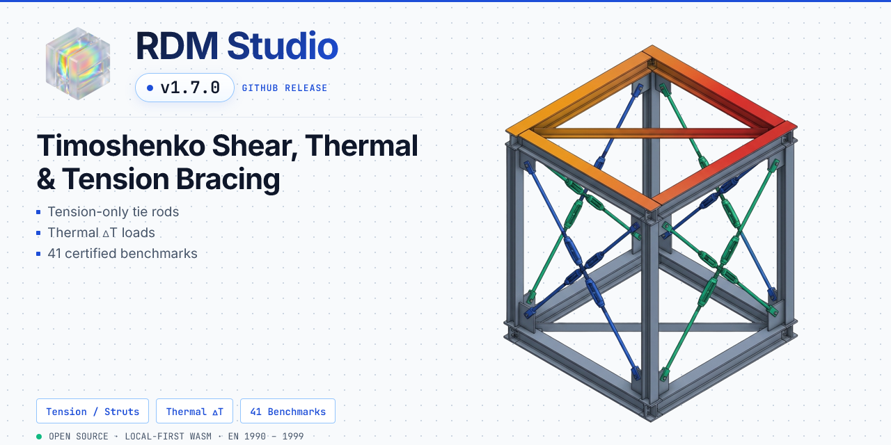

[**Launch 3D Studio ↗**](https://rdm-studio-app.vercel.app/geometry?template=warren-truss&lang=en) · [**Documentation ↗**](https://rdm-studio-docs.vercel.app/reference/validation-benchmarks/) · [**Overview & Benchmarks ↗**](https://rdm-studio-site.vercel.app) · [**Full Diff (`v1.6.0...v1.7.0`) ↗**](https://github.com/elcoosp/rdm-studio/compare/v1.6.0...v1.7.0) · [**Sponsor ♥**](https://github.com/sponsors/elcoosp)

# RDM Studio `v1.7.0`

> [!NOTE]
> **Release Summary (EN 1990 · EN 1991 · EN 1993-1-1):** Timoshenko shear deformation, thermal `ΔT` loads, nonlinear tension-only bracing, schema v2, and 41 analytical benchmarks.

## Architecture & Release Matrix

| Subsystem | Key Module / Entrypoint | Engineering & Product Scope |
| :--- | :--- | :--- |
| **Timoshenko & Thermal `ΔT`** | [`crates/rdm-solver/src/stiffness.rs`](https://github.com/elcoosp/rdm-studio/blob/main/crates/rdm-solver/src/stiffness.rs) | `shear_areas`, `local_stiffness_matrix_shear` (`Φ_y`, `Φ_z`), uniform/gradient `ΔT`, `partial_trapezoid_local_vector` |
| **Tension-Only & Envelopes** | [`crates/rdm-solver/src/static_sparse.rs`](https://github.com/elcoosp/rdm-studio/blob/main/crates/rdm-solver/src/static_sparse.rs) | Iterative `TensionOnly`/`CompressionOnly` member deactivation, `roller_inclined`, `compute_envelopes` |
| **EN 1990 / 1991 / 1993** | [`crates/rdm-eurocode/src/interaction.rs`](https://github.com/elcoosp/rdm-studio/blob/main/crates/rdm-eurocode/src/interaction.rs) | `NationalAnnex`, `build_combinations_v2`, `imposed_load`, `snow_load`, `wind_load`, `6.61`/`6.62` + `CalcTraceNode` |
| **Custom Parametric Sections** | [`crates/rdm-eurocode/src/custom_section.rs`](https://github.com/elcoosp/rdm-studio/blob/main/crates/rdm-eurocode/src/custom_section.rs) | `welded_i`, `rectangular_hollow`, `circular_hollow`, `solid_rect`, `solid_round` |
| **Schema v2 & 41 Benchmarks** | [`crates/rdm-solver/src/validation.rs`](https://github.com/elcoosp/rdm-studio/blob/main/crates/rdm-solver/src/validation.rs) | `migrate_to_v2`, 41 closed-form analytical benchmarks (`run_validation_suite`), and parser fuzz harnesses |

## Detailed Engineering Changelog

### 1. Timoshenko Shear, Thermal `ΔT` & Nonlinear Member Behaviors (`crates/rdm-solver`)
- **Shear-Flexible Timoshenko Formulation (`crates/rdm-solver/src/stiffness.rs`):** Implemented `shear_areas` (`A_vy`, `A_vz`) and `local_stiffness_matrix_shear` incorporating transverse shear deformation coefficients (`Φ_y`, `Φ_z`), alongside `partial_trapezoid_local_vector` for partial-span trapezoidal distributed loads.
- **Thermal Loads & Tension/Compression-Only Bracing (`static_sparse.rs`, `loads.rs`, `boundary.rs`):** Added uniform and cross-section gradient thermal loading (`ΔT`), iterative nonlinear member deactivation for `MemberBehavior::TensionOnly` and `CompressionOnly` bracing diagonals, 2D planar constraint solving, and inclined roller supports (`roller_inclined`).
- **Combination Envelopes (`crates/rdm-solver/src/envelopes.rs`):** Added `BeamEnvelope` and `compute_envelopes` for ULS/SLS Min/Max force and deflection envelopes.

### 2. Full EN 1990 / 1991 / 1993 Annexes & Custom Parametric Sections (`crates/rdm-eurocode`)
- **National Annexes & EN 1990 Combinations (`annex.rs`, `en1990.rs`):** Added `NationalAnnex` (`AnnexFactors`) and `build_combinations_v2` with checkerboard `pattern_live_loads`.
- **EN 1991 Climatic & Imposed Actions (`en1991.rs`):** Implemented `imposed_load` (`ImposedCategory` A–E), `snow_load` (roof slope shape coefficients), and `wind_load` (`WindParameters`, `peak_velocity_pressure`).
- **EN 1993-1-1 Interaction `6.61` / `6.62` & Proof Traces (`interaction.rs`):** Added `interaction_6_61_6_62` with Annex A (`annex_a_factors`) and Annex B (`annex_b_factors`) interaction factors, `torsional_buckling_ncr`, `c1_from_moment_ratio`, `class4_reduction` effective width reduction, and recursive `CalcTraceNode` formula trees.
- **Custom Parametric Sections (`custom_section.rs`):** Added analytical section builders for `welded_i`, `rectangular_hollow`, `circular_hollow`, `solid_rect`, and `solid_round`.

### 3. `.rdm` Schema v2 & 41-Benchmark Analytical Verification Suite
- **Schema v2 & Automatic v1 Migration (`crates/rdm-model/src/project.rs`):** Added `ModelSettings`, `LoadCaseDef`, `MemberGroup`, `Level`, `canonical_load_cases`, and `migrate_to_v2`.
- **41 Analytical Benchmarks & Fuzz Harnesses (`validation.rs`, `validation_40.rs`, `fuzz_cad.rs`, `fuzz_parsers.rs`):** Built the 41-benchmark closed-form structural verification suite (`run_validation_suite`) and parser fuzz tests.

> [!TIP]
> **Zero-Cloud Local-First Execution:** Open the [v1.7.0 reference model directly in RDM Studio](https://rdm-studio-app.vercel.app/geometry?template=warren-truss&lang=en) — the Rust/WASM solver (`f64` precision), Eurocode catalogs, and Takumi vector PDF generator run 100% locally in your browser.

<strong>Commit & Diff Ledger (6 commits · 32 files changed, 3598 insertions(+), 262 deletions(-))</strong>

- [`7b302e9`](https://github.com/elcoosp/rdm-studio/commit/7b302e9924b4561ee61dcf92a0f3c920b0ec4f4b) docs(status): record v1.7.0 session state and gate evidence
- [`cd36f87`](https://github.com/elcoosp/rdm-studio/commit/cd36f87d98aaf2cd72cb66b4860c0159df74a206) chore(workspace): clippy lint table tuning
- [`80f805e`](https://github.com/elcoosp/rdm-studio/commit/80f805e4aa169f1853b6f6073191c41600e95186) test(solver): 41-benchmark suite + parser fuzzing
- [`bd2e638`](https://github.com/elcoosp/rdm-studio/commit/bd2e638a9d71e75cc41786da90816234bc9e9d72) feat(eurocode): annex, 6.10a/b, 6.61/6.62, EN 1991, custom sections
- [`689418f`](https://github.com/elcoosp/rdm-studio/commit/689418fb11382d1a34422a5a8101d740bb72c5b7) feat(solver): Timoshenko, thermal, tension-only, 2D, envelopes
- [`cb430f0`](https://github.com/elcoosp/rdm-studio/commit/cb430f045c0b749e5567af5fc64e05af01fad4f6) feat(model): .rdm schema v2 + v1 migration

---

**Links:** [GitHub Tag `v1.7.0`](https://github.com/elcoosp/rdm-studio/releases/tag/v1.7.0) · [Compare Changes](https://github.com/elcoosp/rdm-studio/compare/v1.6.0...v1.7.0) · [3D Studio](https://rdm-studio-app.vercel.app) · [Documentation](https://rdm-studio-docs.vercel.app) · [B2B & Discussions](https://github.com/elcoosp/rdm-studio/discussions)
