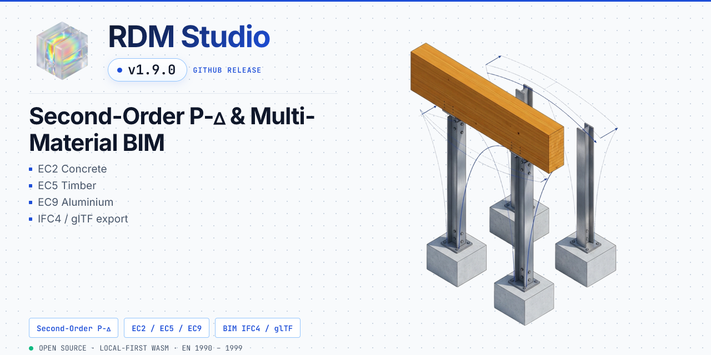

[**Launch 3D Studio ↗**](https://rdm-studio-app.vercel.app/geometry?template=glulam-beam&lang=en) · [**Documentation ↗**](https://rdm-studio-docs.vercel.app/tutorials/glulam-beam-verification/) · [**Overview & Benchmarks ↗**](https://rdm-studio-site.vercel.app) · [**Full Diff (`v1.7.0...v1.9.0`) ↗**](https://github.com/elcoosp/rdm-studio/compare/v1.7.0...v1.9.0) · [**Sponsor ♥**](https://github.com/sponsors/elcoosp)

# RDM Studio `v1.9.0`

> [!NOTE]
> **Release Summary (EN 1992 · EN 1995 · EN 1998 · EN 1999 · IFC4):** Second-order `P-Δ`, linear buckling `λ_cr`, multi-material EC2/EC5/EC9 engines, section optimizer, and BIM IFC4/SAF/glTF export.

## Architecture & Release Matrix

| Subsystem | Key Module / Entrypoint | Engineering & Product Scope |
| :--- | :--- | :--- |
| **P-Δ, Buckling & Seismic** | [`crates/rdm-solver/src/buckling.rs`](https://github.com/elcoosp/rdm-studio/blob/main/crates/rdm-solver/src/buckling.rs) | Second-order `p_delta.rs`, global eigenbuckling `λ_cr`, EN 1998-1 spectra (`seismic.rs`), EN 1991-2 LM1 (`moving_loads.rs`) |
| **EC2 / EC5 / EC9 / Fire** | [`crates/rdm-eurocode/src/multi_material.rs`](https://github.com/elcoosp/rdm-studio/blob/main/crates/rdm-eurocode/src/multi_material.rs) | Concrete (`ec2_flexure_as`), timber (`ec5_timber_bending`, `kmod`), aluminium (`ec9_aluminium_check`), bolts/welds/fire |
| **EC3 Section Optimizer** | [`crates/rdm-eurocode/src/optimizer.rs`](https://github.com/elcoosp/rdm-studio/blob/main/crates/rdm-eurocode/src/optimizer.rs) | Mass/carbon/cost-ranked section optimization (`OptimizerModal.tsx`) + 1-click failure remedies (`whyDoesThisFail`) |
| **BIM & FEA Interoperability** | [`crates/rdm-cad/src/bim_interop.rs`](https://github.com/elcoosp/rdm-studio/blob/main/crates/rdm-cad/src/bim_interop.rs) | Bidirectional **IFC4 Structural** & **SAF JSON**, plus **OpenSees TCL**, **glTF**, and **Solver JSON** writers |
| **Stateful WASM & KaTeX** | [`apps/web/src/components/CalcTraceTree.tsx`](https://github.com/elcoosp/rdm-studio/blob/main/apps/web/src/components/CalcTraceTree.tsx) | Incremental `ModelSession`, step-by-step KaTeX derivations, `ValidationModal`, and `SettingsPopover` |

## Detailed Engineering Changelog

### 1. Second-Order P-Δ, Eigenbuckling, Seismic & Moving Loads (`crates/rdm-solver`)
- **Second-Order Geometric Stiffness & Linear Buckling (`p_delta.rs`, `buckling.rs`):** Implemented second-order `P-Δ` geometric stiffness amplification and global linear eigenbuckling extraction (`buckling_analysis_json`, critical load factor `λ_cr` and buckling mode shapes).
- **EN 1998-1 Seismic & EN 1991-2 LM1 Moving Loads (`seismic.rs`, `modal.rs`, `moving_loads.rs`):** Added Type 1/Type 2 elastic and design response spectra (`seismic_spectrum_json`), CQC and SRSS modal combinations, and LM1 tandem + UDL moving-load train traversal.

### 2. Multi-Material Eurocode Engines & Section Optimizer (`crates/rdm-eurocode`)
- **EC2 Concrete, EC5 Timber, EC9 Aluminium & Joints/Fire (`multi_material.rs`):**
  - **EN 1992-1-1 (Reinforced Concrete):** `ConcreteClass` (`C20/25`–`C50/60`), `concrete_fck`, `concrete_fcd`, `ec2_flexure_as`, and `ec2_shear`.
  - **EN 1995-1-1 (Timber):** `TimberProduct` (`GL24h`–`GL32h`, `C24`), `timber_properties`, `timber_kmod` (`LoadDuration` & service classes 1–3), and `ec5_timber_bending`.
  - **EN 1999-1-1 (Aluminium):** `AluminiumAlloy` (`6061-T6`, `6082-T6`), `aluminium_properties`, and `ec9_aluminium_check`.
  - **Connections & Structural Fire (`EN 1993-1-8` / `EN 1993-1-2`):** `ec3_joint_bolt_shear`, `ec3_fillet_weld`, `ec3_fire_critical_temperature`, and `ec3_fire_check`.
- **Automated EC3 Section Optimizer (`optimizer.rs`, `OptimizerModal.tsx`):** Added mass-, carbon- (`kg CO₂e`), and cost-ranked profile optimization (`optimize_sections_json`) paired with 1-click failure diagnostics (`whyDoesThisFail`).

### 3. BIM Interoperability, Stateful `ModelSession` & Traceable KaTeX UI
- **Bidirectional BIM & FEA Writers (`crates/rdm-cad/src/bim_interop.rs`):** Added **IFC4 Structural** (`export_ifc4_structural`, `import_ifc4_structural`), **SAF JSON** (`export_saf_json`, `import_saf_json`), **OpenSees TCL** (`export_opensees_tcl`), **Solver JSON** (`export_solver_json`), and **glTF** (`export_gltf`).
- **Incremental WASM Session (`bindings/rdm-wasm/src/lib.rs`):** Introduced `ModelSession` (`open_model`, `apply_delta`, `solve_session`, `solve_case_rhs`, `cancel`, `has_cached_solve`) and exposed `member_calc_trace`, `compute_envelopes_json`, `custom_section_preview`, and `run_validation_suite`.
- **Studio Modals & KaTeX Formula Trees (`apps/web`):** Shipped `CalcTraceTree.tsx` (step-by-step KaTeX Eurocode derivations), `OptimizerModal.tsx`, `ValidationModal.tsx` (in-app 41-benchmark runner), `SettingsPopover.tsx` (National Annex & normative settings), `FamilyPills.tsx`, `cadTools.ts`, and `ForceDiagrams3D.tsx`.

> [!TIP]
> **Zero-Cloud Local-First Execution:** Open the [v1.9.0 reference model directly in RDM Studio](https://rdm-studio-app.vercel.app/geometry?template=glulam-beam&lang=en) — the Rust/WASM solver (`f64` precision), Eurocode catalogs, and Takumi vector PDF generator run 100% locally in your browser.

<strong>Commit & Diff Ledger (7 commits · 37 files changed, 4455 insertions(+), 133 deletions(-))</strong>

- [`01409ce`](https://github.com/elcoosp/rdm-studio/commit/01409ce992ccfd9e5bba216a3ba1ce819e733e4f) docs(status): record v1.9.0 session state and gate evidence
- [`e158851`](https://github.com/elcoosp/rdm-studio/commit/e158851c111ba1cbcdc7d72ef751bf13749a906e) chore(lints): config-level clippy tuning
- [`12a5a6a`](https://github.com/elcoosp/rdm-studio/commit/12a5a6aa9e956fdb3ca6d562908bb6b934460316) feat(web): modals, trace, pills, diagrams, CAD
- [`b7d515f`](https://github.com/elcoosp/rdm-studio/commit/b7d515f6f29d1bf5d9cc6a2534b12d314e15d4b5) feat(wasm): v1.8/v1.9 surface + stateful ModelSession
- [`456e993`](https://github.com/elcoosp/rdm-studio/commit/456e9938b15d6a7b7718ee2a3c9ec45bd6ac8e6e) feat(cad): IFC4/SAF/OpenSees/solver-JSON/glTF BIM interop
- [`9aff411`](https://github.com/elcoosp/rdm-studio/commit/9aff411db5ba058bcf1c3418f62fe7f917580d9e) feat(eurocode): optimizer + EC2/EC5/EC9 engines
- [`3169abe`](https://github.com/elcoosp/rdm-studio/commit/3169abe4b709c80700a2849fddef1cf91e600c2c) feat(solver): buckling, EC8, LM1, P-delta

---

**Links:** [GitHub Tag `v1.9.0`](https://github.com/elcoosp/rdm-studio/releases/tag/v1.9.0) · [Compare Changes](https://github.com/elcoosp/rdm-studio/compare/v1.7.0...v1.9.0) · [3D Studio](https://rdm-studio-app.vercel.app) · [Documentation](https://rdm-studio-docs.vercel.app) · [B2B & Discussions](https://github.com/elcoosp/rdm-studio/discussions)
