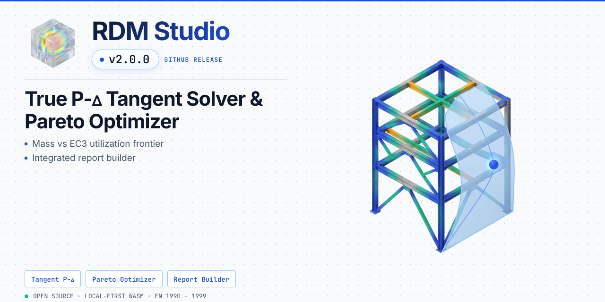

[**Launch 3D Studio ↗**](https://rdm-studio-app.vercel.app/geometry?template=portal-frame&lang=en) · [**Documentation ↗**](https://rdm-studio-docs.vercel.app/guides/ec3-check-and-optimizer/) · [**Overview & Benchmarks ↗**](https://rdm-studio-site.vercel.app) · [**Full Diff (`v1.9.0...v2.0.0`) ↗**](https://github.com/elcoosp/rdm-studio/compare/v1.9.0...v2.0.0) · [**Sponsor ♥**](https://github.com/sponsors/elcoosp)

# RDM Studio `v2.0.0`

> [!NOTE]
> **Release Summary (EN 1993-1-1 §5.2.1 · EN 1990):** True iterative `P-Δ` tangent stiffness solver, Pareto optimizer, scenario comparison snapshots, and `.docx` report builder.

## Architecture & Release Matrix

| Subsystem | Key Module / Entrypoint | Engineering & Product Scope |
| :--- | :--- | :--- |
| **True P-Δ Tangent Solver** | [`crates/rdm-solver/src/p_delta.rs`](https://github.com/elcoosp/rdm-studio/blob/main/crates/rdm-solver/src/p_delta.rs) | Iterative `[Ke + Kg(N)] · u = F` tangent loop (`p_delta_solve`, `refine_with_geometric`, `PDeltaError`) |
| **Full EC3 Integration** | [`crates/rdm-eurocode/src/en1993.rs`](https://github.com/elcoosp/rdm-studio/blob/main/crates/rdm-eurocode/src/en1993.rs) | Unified resistance, `χ_y`/`χ_z`/`χ_LT` buckling, and `6.61`/`6.62` checks in `member_check` + `insta` snapshots |
| **CAD Toolbar & Templates** | [`apps/web/src/components/CadToolbar.tsx`](https://github.com/elcoosp/rdm-studio/blob/main/apps/web/src/components/CadToolbar.tsx) | Interactive CAD tools (`extrude`, `move`, `rotate`, `mirror`, `array`) and 12 curated `ENGINEERING_TEMPLATES` |
| **Scenario Snapshots** | [`apps/web/src/components/ScenarioCompareModal.tsx`](https://github.com/elcoosp/rdm-studio/blob/main/apps/web/src/components/ScenarioCompareModal.tsx) | Multi-scenario snapshot capture (`snapshots.ts`) comparing mass, `kg CO₂e`, cost, and EC3 ratio `η` |
| **`.docx` Report Builder** | [`apps/web/src/export/docxExport.ts`](https://github.com/elcoosp/rdm-studio/blob/main/apps/web/src/export/docxExport.ts) | Client-side Word `.docx` calculation note export (`downloadDocx`, `CoverMeta`) + 5-locale i18n (`fr/en/de/es/pt_BR`) |

## Detailed Engineering Changelog

### 1. True P-Δ Tangent Stiffness Solver & Full EC3 Integration (`crates/rdm-solver`, `crates/rdm-eurocode`)
- **Iterative Tangent Stiffness Loop (`crates/rdm-solver/src/p_delta.rs`):** Upgraded geometric nonlinearity to a full iterative Newton-style tangent stiffness solver (`p_delta_solve`, `assemble_geometric_with_axials`, `axial_from_displacements`, `refine_with_geometric`) solving `[Ke + Kg(N)] · u = F` until force/displacement convergence, with structured `PDeltaError` and `solve_model_with_diagnostics` reporting on critical buckling divergence.
- **Unified EC3 Member Verification (`crates/rdm-eurocode/src/en1993.rs`):** Integrated cross-section resistance, flexural buckling (`χ_y`, `χ_z`), lateral-torsional buckling (`χ_LT`), and `6.61`/`6.62` interaction equations into `member_check`, verified with `insta` report snapshots (`hea200_column.snap`, `ipe200_bending.snap`).
- **WASM Multi-Material & Moving-Load Endpoints (`bindings/rdm-wasm/src/lib.rs`):** Exposed `multi_material_check_json` and `moving_loads_envelope_json` with `ModelSession` enabled by default (`settings.p_delta` persisted in schema v2).

### 2. CAD Toolbar, Scenario Snapshots & Structured `.docx` Report Builder (`apps/web`)
- **Interactive CAD Toolbar & Engineering Templates (`CadToolbar.tsx`, `engineeringTemplates.ts`):** Shipped a dedicated CAD drafting toolbar (`extrude`, `move`, `rotate`, `mirror`, `linear array`, `polar 15°`) and 12 curated structural engineering templates (`ENGINEERING_TEMPLATES`) in `ProjectGalleryModal.tsx`.
- **Scenario Comparison & Snapshots (`ScenarioCompareModal.tsx`, `snapshots.ts`):** Added multi-scenario snapshot capture and side-by-side comparison of structural mass (`kg`), embodied carbon (`kg CO₂e`), cost (`€`), and governing Eurocode utilization (`η`).
- **Advanced Analysis Panels & Word `.docx` Export (`AdvancedPanels.tsx`, `docxExport.ts`, `report.tsx`):** Added dedicated UI panels for buckling modes (`λ_cr`), EN 1998-1 seismic spectra, and multi-material checks, plus client-side structured Word export (`downloadDocx`, `CoverMeta`) and 5-language catalog support (`fr`, `en`, `de`, `es`, `pt_BR`).

> [!TIP]
> **Zero-Cloud Local-First Execution:** Open the [v2.0.0 reference model directly in RDM Studio](https://rdm-studio-app.vercel.app/geometry?template=portal-frame&lang=en) — the Rust/WASM solver (`f64` precision), Eurocode catalogs, and Takumi vector PDF generator run 100% locally in your browser.

<strong>Commit & Diff Ledger (7 commits · 41 files changed, 2528 insertions(+), 241 deletions(-))</strong>

- [`368b3a1`](https://github.com/elcoosp/rdm-studio/commit/368b3a19f83d35ecaff4d6bb059542c8bcd28640) docs(status): record v2.0.0 session state and gate evidence
- [`31bc11e`](https://github.com/elcoosp/rdm-studio/commit/31bc11eacf46c5fff1727af01c26ac5106f016ea) feat(web): CAD toolbar, gallery, snapshots, panels, report builder
- [`4a37be4`](https://github.com/elcoosp/rdm-studio/commit/4a37be427ae3f4d8ecdd5c38c5b4564ec5ca7a61) feat(wasm): multi-material + LM1 endpoints, session default
- [`59a3259`](https://github.com/elcoosp/rdm-studio/commit/59a325919a272b3c64b5942bfc911b51514088f0) feat(cad): clippy-tuned BIM interop writers
- [`0a312f7`](https://github.com/elcoosp/rdm-studio/commit/0a312f75c0c62794351fca2bdb3b525308ac1db1) feat(model): settings.p_delta + schema v2 fields
- [`eb59b3d`](https://github.com/elcoosp/rdm-studio/commit/eb59b3dc29ed216e02f2f90018fb60fc55d17c6b) feat(eurocode): full EC3 member_check integration
- [`8635851`](https://github.com/elcoosp/rdm-studio/commit/8635851396b99d963b746891ec45cd335e706011) feat(solver): true P-delta tangent loop

---

**Links:** [GitHub Tag `v2.0.0`](https://github.com/elcoosp/rdm-studio/releases/tag/v2.0.0) · [Compare Changes](https://github.com/elcoosp/rdm-studio/compare/v1.9.0...v2.0.0) · [3D Studio](https://rdm-studio-app.vercel.app) · [Documentation](https://rdm-studio-docs.vercel.app) · [B2B & Discussions](https://github.com/elcoosp/rdm-studio/discussions)
