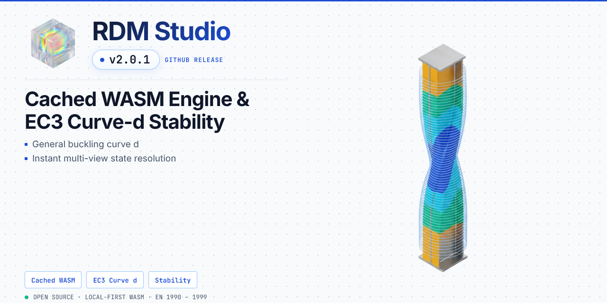

[**Launch 3D Studio ↗**](https://rdm-studio-app.vercel.app/geometry?template=portal-frame&lang=en) · [**Documentation ↗**](https://rdm-studio-docs.vercel.app/guides/ec3-check-and-optimizer/) · [**Overview & Benchmarks ↗**](https://rdm-studio-site.vercel.app) · [**Full Diff (`v2.0.0...v2.0.1`) ↗**](https://github.com/elcoosp/rdm-studio/compare/v2.0.0...v2.0.1) · [**Sponsor ♥**](https://github.com/sponsors/elcoosp)

# RDM Studio `v2.0.1`

> [!NOTE]
> **Release Summary (EN 1993-1-1 Table 6.2 (Curve d)):** Shared cached WASM solves across worker endpoints, EC3 general curve-`d` buckling fallback, and 32 custom engineering icons.

## Architecture & Release Matrix

| Subsystem | Key Module / Entrypoint | Engineering & Product Scope |
| :--- | :--- | :--- |
| **Cached WASM Solve Sharing** | [`apps/web/src/wasmBridge/fea.worker.ts`](https://github.com/elcoosp/rdm-studio/blob/main/apps/web/src/wasmBridge/fea.worker.ts) | Shared cached `ModelSession` solves across results, section cuts, and reports with unique `callId` worker lanes |
| **EC3 Curve-d Stability** | [`crates/rdm-eurocode/src/en1993.rs`](https://github.com/elcoosp/rdm-studio/blob/main/crates/rdm-eurocode/src/en1993.rs) | General buckling curve `d` (`α_imp = 0.76`) fallback for thick-flange and welded slender I-sections |
| **32 Engineering Icons** | [`apps/web/src/components/icons/EngineeringIcons.tsx`](https://github.com/elcoosp/rdm-studio/blob/main/apps/web/src/components/icons/EngineeringIcons.tsx) | 32 bespoke `1.5px`-stroke vector engineering icons for profiles, supports, loads, and buckling modes |
| **Pareto & Seismic Charts** | [`apps/web/src/components/OptimizerModal.tsx`](https://github.com/elcoosp/rdm-studio/blob/main/apps/web/src/components/OptimizerModal.tsx) | Interactive Pareto frontier scatter plot (`pareto-scatter`) and EN 1998-1 spectrum chart (`seismic-spectrum-chart`) |
| **Real-World E2E Suite** | [`apps/web/e2e/real-world-scenarios.spec.ts`](https://github.com/elcoosp/rdm-studio/blob/main/apps/web/e2e/real-world-scenarios.spec.ts) | 246-line Playwright test suite covering multi-step workflows, springs badges, and mobile drawer resilience |

## Detailed Engineering Changelog

### 1. Cached WASM Solve Sharing & Worker Call-ID Isolation
- **Shared Cached Solves Across Engine Endpoints (`bindings/rdm-wasm/src/lib.rs`, `fea.worker.ts`, `workerClient.ts`):** Eliminated redundant Cholesky factorizations across results, section cuts, envelope computations, and report generation by reusing cached `ModelSession` solves and isolating concurrent worker requests with unique `callId` correlation lanes.
- **Canonical Project Migration Endpoint (`migrate_project_json`):** Exposed schema migration directly through WASM so legacy `.rdm` v1 files upgrade cleanly before validation.

### 2. Eurocode 3 General Curve-d Buckling Stability (`crates/rdm-eurocode`)
- **General Curve-`d` Fallback (`crates/rdm-eurocode/src/en1993.rs`):** Added general buckling curve `d` (`α_imp = 0.76`) fallback handling for thick-flange rolled sections and slender welded I-profiles per EN 1993-1-1 Table 6.2.

### 3. 32 Custom Engineering Icons, Pareto Scatter & Real-World E2E Suite (`apps/web`)
- **32 Custom Engineering Icons (`EngineeringIcons.tsx`):** Replaced generic icons with 32 bespoke `1.5px`-stroke vector engineering symbols covering open/hollow/angle profiles (`ProfileIpe`, `ProfileHea`, `ProfileUpn`, `ProfileChs`, `ProfileRhs`, `ProfileAngle`), boundary restraints (`SupportFixed`, `SupportPinned`, `SupportRoller`, `SupportSlider`, `SupportSpring`, `ReleaseHinge`), load types, and stability modes (`FlexuralBuckling`, `LateralTorsionalBuckling`, `DeflectionLimit`, `ModalVibration`).
- **Pareto Frontier & Seismic Charts (`OptimizerModal.tsx`, `AdvancedPanels.tsx`):** Added interactive Pareto frontier scatter plots (`data-testid="pareto-scatter"`) and EN 1998-1 elastic/design spectrum charts (`data-testid="seismic-spectrum-chart"`).
- **Workflow Hardening & E2E Tests (`real-world-scenarios.spec.ts`):** Fixed springs badge updates, mobile drawer layout clipping, and parametric generator toast feedback, backed by a 246-line Playwright suite covering real-world multi-step workflows.

> [!TIP]
> **Zero-Cloud Local-First Execution:** Open the [v2.0.1 reference model directly in RDM Studio](https://rdm-studio-app.vercel.app/geometry?template=portal-frame&lang=en) — the Rust/WASM solver (`f64` precision), Eurocode catalogs, and Takumi vector PDF generator run 100% locally in your browser.

<strong>Commit & Diff Ledger (21 commits · 54 files changed, 1666 insertions(+), 696 deletions(-))</strong>

- [`22fd9fa`](https://github.com/elcoosp/rdm-studio/commit/22fd9fa0751edac7bcedc46dc790f07093b9943b) docs(status): record v2.0.1 session state and gate evidence
- [`4f91dd8`](https://github.com/elcoosp/rdm-studio/commit/4f91dd86ef8300d7935d7655f02c03a06f8b3379) chore(i18n): complete the Pareto frontier EN translation
- [`fdd967f`](https://github.com/elcoosp/rdm-studio/commit/fdd967f1debcd1af63e934989f15b49792cbd9a5) fix(web): pin router-generator override at the workspace root
- [`8f0dfff`](https://github.com/elcoosp/rdm-studio/commit/8f0dfff8ddd005ec4a27ba9be3c940ab030cec67) test(e2e): real-world structural workflows and edge cases
- [`d1638d3`](https://github.com/elcoosp/rdm-studio/commit/d1638d309a7463e459344ba283e7847d6eb200b2) feat(web): impeccable layout pass on geometry, results and report
- [`28a0f33`](https://github.com/elcoosp/rdm-studio/commit/28a0f333016286160d1049561ba1b51427f59aa7) feat(web): wire tw-animate-css, lucide-react, recharts and dnd-kit
- [`b7538c6`](https://github.com/elcoosp/rdm-studio/commit/b7538c6461ccd4352fa27e9d8eb1def773ac86ae) fix(web): springs badge, mobile drawer and parametric toast
- [`12218bb`](https://github.com/elcoosp/rdm-studio/commit/12218bb8e8ceda2d55bb962adef2bccb5914ebb2) fix(web): unique callId engine lanes and worker echo
- [`9a749c2`](https://github.com/elcoosp/rdm-studio/commit/9a749c2cd3f8bbea866646f2cf1b9f961c436cf7) perf(wasm): share cached solves across all engine endpoints
- [`9d6b65d`](https://github.com/elcoosp/rdm-studio/commit/9d6b65d27d8404ad8db4af8e001948a8b44703a1) fix(web): resolve conflict residues in settings, envelopes and loads
- [`7181c51`](https://github.com/elcoosp/rdm-studio/commit/7181c517df7520015c3272559505520b2ea8cd22) chore: session prompts del
- [`a9cac93`](https://github.com/elcoosp/rdm-studio/commit/a9cac938f3c97d483fcf9e2e8c6a91ee11837f96) docs(status): record v2.0.1 session state and gate evidence
- [`a04c717`](https://github.com/elcoosp/rdm-studio/commit/a04c717532cdcf723a4bb024f2a6e58bdf03720f) chore(i18n): complete the Pareto frontier EN translation
- [`c98291e`](https://github.com/elcoosp/rdm-studio/commit/c98291e121d09d0151debedc724edf51a5145172) fix(web): pin router-generator override at the workspace root
- [`2c69a31`](https://github.com/elcoosp/rdm-studio/commit/2c69a3144c79fbbe638fdcce981e6b245eaa9c56) test(e2e): real-world structural workflows and edge cases
- [`02ff5a8`](https://github.com/elcoosp/rdm-studio/commit/02ff5a8d6480f90ce48cba7074d29d20b05e23ae) feat(web): wire tw-animate-css, lucide-react, recharts and dnd-kit
- [`82b3bb6`](https://github.com/elcoosp/rdm-studio/commit/82b3bb6609ab8bf711d77c520a54a300c2a819b1) fix(web): springs badge, mobile drawer and parametric toast
- [`d9bd390`](https://github.com/elcoosp/rdm-studio/commit/d9bd390747fda5b4ae47091ed1e92eb770e2dc37) fix(web): unique callId engine lanes and worker echo
- [`1422630`](https://github.com/elcoosp/rdm-studio/commit/14226306d94a423f8cff914bc903908fe02ae9b0) perf(wasm): share cached solves across all engine endpoints
- [`645c97d`](https://github.com/elcoosp/rdm-studio/commit/645c97db5ac2d36b63201e542d6eb2636490dfeb) fix(ec3): general curve-d fallback for slender I-sections
- [`dab6813`](https://github.com/elcoosp/rdm-studio/commit/dab6813aa8deb6816d446727655bed9338f99a73) fix(web): resolve conflict residues in settings, envelopes and loads

---

**Links:** [GitHub Tag `v2.0.1`](https://github.com/elcoosp/rdm-studio/releases/tag/v2.0.1) · [Compare Changes](https://github.com/elcoosp/rdm-studio/compare/v2.0.0...v2.0.1) · [3D Studio](https://rdm-studio-app.vercel.app) · [Documentation](https://rdm-studio-docs.vercel.app) · [B2B & Discussions](https://github.com/elcoosp/rdm-studio/discussions)
