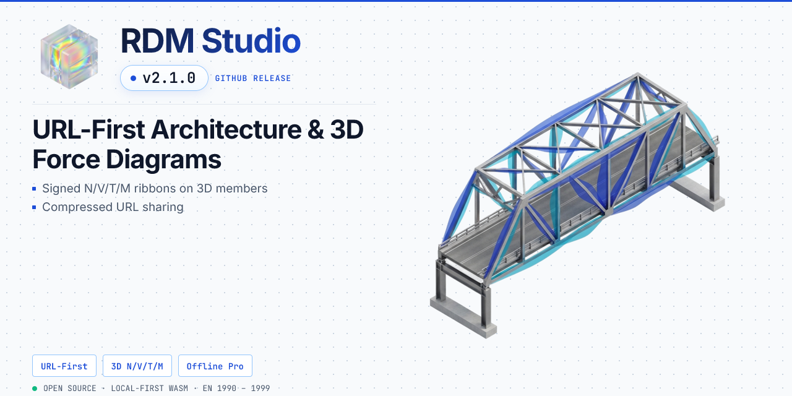

[**Launch 3D Studio ↗**](https://rdm-studio-app.vercel.app/geometry?template=warren-truss&lang=en) · [**Documentation ↗**](https://rdm-studio-docs.vercel.app/reference/keyboard-shortcuts-and-formats/) · [**Overview & Benchmarks ↗**](https://rdm-studio-site.vercel.app) · [**Full Diff (`v2.0.1...v2.1.0`) ↗**](https://github.com/elcoosp/rdm-studio/compare/v2.0.1...v2.1.0) · [**Sponsor ♥**](https://github.com/sponsors/elcoosp)

# RDM Studio `v2.1.0`

> [!NOTE]
> **Release Summary (Valibot URL Contracts · Z-Up SI):** Zero-duplicate URL-first router/state architecture, true 3D signed internal-force diagrams (`N/V/T/M`), and Offline Pro licensing.

## Architecture & Release Matrix

| Subsystem | Key Module / Entrypoint | Engineering & Product Scope |
| :--- | :--- | :--- |
| **URL-First Router & State** | [`apps/web/src/router.tsx`](https://github.com/elcoosp/rdm-studio/blob/main/apps/web/src/router.tsx) | TanStack pathless `_marketing` & `_studio` route groups with `beforeLoad` `?p=` / `?template=` hydration |
| **Valibot Search Contracts** | [`apps/web/src/schemas/searchParams.schema.ts`](https://github.com/elcoosp/rdm-studio/blob/main/apps/web/src/schemas/searchParams.schema.ts) | URL-backed selection (`?node=`, `?beam=`), camera views, load cases, and layers (`useStudioQuery.ts`) |
| **3D Signed Force Ribbons** | [`apps/web/src/viewport3d/ForceDiagrams3D.tsx`](https://github.com/elcoosp/rdm-studio/blob/main/apps/web/src/viewport3d/ForceDiagrams3D.tsx) | Extruded signed `N`, `Vy`, `Vz`, `Mx`, `My`, `Mz` internal-force diagrams directly along 3D members |
| **Canonical Z-Up Templates** | [`apps/web/src/lib/engineeringTemplates.ts`](https://github.com/elcoosp/rdm-studio/blob/main/apps/web/src/lib/engineeringTemplates.ts) | Re-oriented all 12 gallery templates to canonical Z-up coordinates |
| **Offline Pro & E2E Suites** | [`apps/web/src/state/licenseStore.ts`](https://github.com/elcoosp/rdm-studio/blob/main/apps/web/src/state/licenseStore.ts) | Local-first `RDM-PRO-` key activation (`LicenseModal`), LCEN/GDPR legal pages, `url-first.spec.ts`, `console-hygiene.spec.ts` |

## Detailed Engineering Changelog

### 1. Zero-Duplicate URL-First Router & State Architecture
- **TanStack File-Based Route Groups (`router.tsx`, `_marketing.tsx`, `_studio.tsx`):** Split the application into pathless marketing routes (`/_marketing/`, `/_marketing/legal`) and a unified 5-step studio shell (`/_studio/geometry`, `/supports`, `/loads`, `/results`, `/report`) with `beforeLoad` `?p=` and `?template=` project hydration before first render.
- **Valibot Search Param Contracts & Hooks (`searchParams.schema.ts`, `useStudioQuery.ts`):** Moved single selection (`?node=`, `?beam=`), camera presets (`?view=`), active load case/combination, SLS limits, section-cut station, and 3D layer visibility flags into validated URL query state (`useSelectedIds`, `useViewportParams`, `useUpdateSearch`), eliminating duplicate viewport/selection fields from Zustand stores (`projectStore.ts`, `viewportStore.ts`).
- **Canonical Z-Up Templates (`engineeringTemplates.ts`):** Re-oriented all 12 built-in gallery templates to the canonical Z-up structural coordinate system (`98b7065`).

### 2. True 3D Signed Internal-Force Diagrams (`ForceDiagrams3D.tsx`)
- **3D Extruded Force Ribbons (`2a7523b`):** Rendered true signed bending-moment (`My`, `Mz`), shear-force (`Vy`, `Vz`), axial (`N`), and torsion (`Mx`) diagrams directly along the 3D beam axes in the WebGL viewport (`data-testid="force-diagrams-toggle"`).

### 3. Commercial Landing Surface, Offline Pro Layer & E2E Suites
- **Commercial Landing & Legal Surface (`_marketing/index.tsx`, `_marketing/legal.tsx`):** Shipped the full Swiss Metrology product landing page with interactive 3-model showcase (`data-testid="showcase-*"`) and French LCEN / GDPR legal documentation.
- **Local-First Offline Pro Licensing (`licenseStore.ts`, `LicenseModal.tsx`, `LicenseBadge.tsx`):** Added offline `RDM-PRO-` license key activation (`data-testid="license-modal"`), firm branding pre-fill on Step 5 reports, and zero server calls.
- **Verification Suites (`url-first.spec.ts`, `marketing.spec.ts`, `console-hygiene.spec.ts`):** Added dedicated Playwright suites verifying URL hydration, commercial routes, and zero console/page errors across the entire app.

> [!TIP]
> **Zero-Cloud Local-First Execution:** Open the [v2.1.0 reference model directly in RDM Studio](https://rdm-studio-app.vercel.app/geometry?template=warren-truss&lang=en) — the Rust/WASM solver (`f64` precision), Eurocode catalogs, and Takumi vector PDF generator run 100% locally in your browser.

<strong>Commit & Diff Ledger (52 commits · 57 files changed, 7925 insertions(+), 1293 deletions(-))</strong>

- [`fb9f1a3`](https://github.com/elcoosp/rdm-studio/commit/fb9f1a3996dfc3b0523fa60d20bfbdde65b64e27) docs(status): record the v2.1.0 session state
- [`7b94bfc`](https://github.com/elcoosp/rdm-studio/commit/7b94bfcaab8792294f35d522878e9a61ac23fec3) test(e2e): zero console/page errors across routes
- [`5127d43`](https://github.com/elcoosp/rdm-studio/commit/5127d43e676490af9a40a044d1a49f1b0fc3b4dc) test(e2e): commercial layer suite
- [`1dcceb0`](https://github.com/elcoosp/rdm-studio/commit/1dcceb06c9cd12114e28d15fb32c28d002097b67) test(e2e): URL-first architecture suite (template/p hydration, retainSea
- [`98a11b6`](https://github.com/elcoosp/rdm-studio/commit/98a11b6ee1ab4e476497ace96e4fcf4d939dd360) test(e2e): fix the Extruder regression assertion to read the node count
- [`9f8ddc4`](https://github.com/elcoosp/rdm-studio/commit/9f8ddc49e110c359ca887441580ead509c42e4f5) chore(i18n): recompile the PT-BR runtime catalog
- [`53c3c36`](https://github.com/elcoosp/rdm-studio/commit/53c3c363c5b9cc58c7587ef1c40ded4835459efe) chore(i18n): refresh the PT-BR catalog extraction
- [`d35eeaa`](https://github.com/elcoosp/rdm-studio/commit/d35eeaa7485447e2dbc66834297cc0de8247e6bd) chore(i18n): recompile the DE runtime catalog
- [`269be19`](https://github.com/elcoosp/rdm-studio/commit/269be190aceac5bc3bb1c81c5875bee8c6575fdf) chore(i18n): refresh the DE catalog extraction
- [`ba6e38d`](https://github.com/elcoosp/rdm-studio/commit/ba6e38dcff1ec2036d9ae11ae871fbfa19ed2a01) chore(i18n): recompile the ES runtime catalog
- [`98a90d1`](https://github.com/elcoosp/rdm-studio/commit/98a90d129c8fda36603232b94ec99300073e81c6) chore(i18n): refresh the ES catalog extraction
- [`f1ac920`](https://github.com/elcoosp/rdm-studio/commit/f1ac9200f9cd2f8526f7032c45965858b92618d7) chore(i18n): recompile the FR runtime catalog
- [`aa1d66a`](https://github.com/elcoosp/rdm-studio/commit/aa1d66a0cbfdffc23fdf641de1701cf5a2b90daa) chore(i18n): refresh the source catalog extraction
- [`c35a9e0`](https://github.com/elcoosp/rdm-studio/commit/c35a9e0f1ed0f9be10a0844789f2bc21e02a9092) chore(i18n): recompile the EN runtime catalog
- [`54d9c35`](https://github.com/elcoosp/rdm-studio/commit/54d9c351f8af8324f33c42d8b3ded623c062deda) chore(i18n): complete the v2.1.0 EN translation
- [`7fb4d1d`](https://github.com/elcoosp/rdm-studio/commit/7fb4d1d82151d8d089373706e7238229ec1bfdd3) chore(routes): regenerate the route tree
- [`e306de1`](https://github.com/elcoosp/rdm-studio/commit/e306de114513b7808ec0ea7431b19d9dfd96371a) refactor(studio): Step 5 license cover pre-fill
- [`b01562e`](https://github.com/elcoosp/rdm-studio/commit/b01562ecc4cf717792351e252559422c3a49e417) refactor(studio): Step 4 route under _studio with combo/sls/scale/cutBea
- [`dd89476`](https://github.com/elcoosp/rdm-studio/commit/dd894769cc74e4d512b1209e46f1f2f8cfb597e1) refactor(studio): Step 3 with URL case/load-tab
- [`9894394`](https://github.com/elcoosp/rdm-studio/commit/989439466ee530b1b0d472b43eb2bd70690e03b5) refactor(studio): Step 2 with URL node selection
- [`4451d05`](https://github.com/elcoosp/rdm-studio/commit/4451d05c0d319eaed94853a1e007b7c572ce6eeb) refactor(studio): Step 1 route under _studio with staticData metadata an
- [`18338f4`](https://github.com/elcoosp/rdm-studio/commit/18338f4ece7bf92c184ac0d2f724151f345178fb) feat(studio): pathless studio layout with beforeLoad ?p=/?template= hydr
- [`8b1992d`](https://github.com/elcoosp/rdm-studio/commit/8b1992d191d2939f5048cb52b609cb738890e4d2) feat(marketing): legal surface covering LCEN mentions, CGU/CGV, zero-clo
- [`c5fccc8`](https://github.com/elcoosp/rdm-studio/commit/c5fccc84c6b46884fdad263b96df48071504b714) feat(marketing): commercial landing page with hero, interactive 3-model
- [`1279e05`](https://github.com/elcoosp/rdm-studio/commit/1279e0574c2a8d1f2eab25123939b56513f67760) feat(marketing): pathless marketing layout with the editorial header, /d
- [`8f798ad`](https://github.com/elcoosp/rdm-studio/commit/8f798ad03a9c63340c7d819e3c5aef3dc955b4bd) refactor(routes): lean root hosting only the global overlays (palette, t
- [`bd519cb`](https://github.com/elcoosp/rdm-studio/commit/bd519cbabac2bbe6345eb6bbb65996829bcf362c) chore(components): drop dead computeMeta variable
- [`cd89436`](https://github.com/elcoosp/rdm-studio/commit/cd89436beb8a218616b41a7106b8a7f52d66f7b8) refactor(components): controllable FamilyPills
- [`bce9519`](https://github.com/elcoosp/rdm-studio/commit/bce9519f7d8062bab636e5d109431c7204da69a2) refactor(cad): URL-backed single selection
- [`a1b0f3a`](https://github.com/elcoosp/rdm-studio/commit/a1b0f3a0c754e128949bd7446c9445c24c215eae) refactor(palette): derive the steps group from getStudioSteps() and pres
- [`b73eebb`](https://github.com/elcoosp/rdm-studio/commit/b73eebb570f09ca8f6eab74bc68bae943b2edec5) fix(components): Lucide X icon in ValidationModal
- [`3ec4119`](https://github.com/elcoosp/rdm-studio/commit/3ec4119edbe0b2cf1316246a5ff0dba9a67e73af) refactor(viewport): URL layer flags for dims
- [`c9d95b2`](https://github.com/elcoosp/rdm-studio/commit/c9d95b2cf72e882fa4f062962bc04006179cb83b) refactor(viewport): URL layer flags for labels
- [`af5ad81`](https://github.com/elcoosp/rdm-studio/commit/af5ad81dc6547ec12b140f7d6e7bf167d3338536) refactor(viewport): camera presets ride the URL view param and the WebGL
- [`020a2f4`](https://github.com/elcoosp/rdm-studio/commit/020a2f4016c08920fb62de48f11d8d0e47859d57) refactor(viewport): URL-backed layers, render and snap
- [`2a7523b`](https://github.com/elcoosp/rdm-studio/commit/2a7523b3f7d98d828b67a1ea3aa4b14c57920bc1) feat(viewport): true 3D signed internal-force diagrams along the members
- [`dd5c508`](https://github.com/elcoosp/rdm-studio/commit/dd5c50866c0ee37881ea7a7756b8532f2de94d02) refactor(stage): derive stage visibility from useMatches staticData, rea
- [`59d5a28`](https://github.com/elcoosp/rdm-studio/commit/59d5a28962f6ee0f29d803fe5c2d84796f189815) feat(license): EditionBadge pill for both headers
- [`7f019ee`](https://github.com/elcoosp/rdm-studio/commit/7f019ee5bd7835c21c6946dd4881a8c076299052) feat(license): Base UI license modal with plan limits, offline key activ
- [`7d16f65`](https://github.com/elcoosp/rdm-studio/commit/7d16f6578f066792a1ec112c44bbba7d522c95c2) feat(license): local-first Offline Pro license store (tier, RDM-PRO- key
- [`17b2dee`](https://github.com/elcoosp/rdm-studio/commit/17b2deed0fd4cfbf48bba588805f3dcaa1d564c2) refactor(store): move the single selection to the URL and keep only the
- [`1854ec9`](https://github.com/elcoosp/rdm-studio/commit/1854ec993eaeee7765ddead4ce17f97fccaadfd1) refactor(store): strip every URL-duplicated viewport field from the Zust
- [`3780ad5`](https://github.com/elcoosp/rdm-studio/commit/3780ad5d9061d70a6b57abb8d5bdaa7b8a603f8e) refactor(hotkeys): URL selection and preserved step jumps
- [`4507dd5`](https://github.com/elcoosp/rdm-studio/commit/4507dd52a1159314827a02a79ec4858cfa419455) feat(hooks): zero-duplicate URL-first hooks useSelectedIds/useViewportPa
- [`da34dba`](https://github.com/elcoosp/rdm-studio/commit/da34dbab5ac176018f3a6fdb5806451665772cc1) refactor(main): mount the shared router instance and drop the legacy mai
- [`0e1c5ff`](https://github.com/elcoosp/rdm-studio/commit/0e1c5fff6f29fa092a9ff9f275b707871a5db7fb) feat(router): typed router instance with defaultPreload intent, structur
- [`43d5bb8`](https://github.com/elcoosp/rdm-studio/commit/43d5bb8e50d77dc12946d793e223b6f8e35865e3) test(schemas): cover the URL search schemas
- [`3635969`](https://github.com/elcoosp/rdm-studio/commit/363596993c3779c05b3a4c0828eb4162a5666342) feat(schemas): comprehensive Valibot search schemas (StudioBase + Geomet
- [`98b7065`](https://github.com/elcoosp/rdm-studio/commit/98b7065412e74349f54a0b7ae954c194bc771ef2) fix(templates): re-orient all 12 gallery templates to the canonical Z-up
- [`b74ce33`](https://github.com/elcoosp/rdm-studio/commit/b74ce33565d794083c8aae4d0cdd07df286caa3a) feat(schemas): accept the Uniform beam load variant in ProjectFileSchema
- [`684997d`](https://github.com/elcoosp/rdm-studio/commit/684997ddb72159ea5891d219679c52a763768d64) chore(web): add @tanstack/router-core as a direct dev dependency for Sta
- [`141da9d`](https://github.com/elcoosp/rdm-studio/commit/141da9da0c0cff6dcb37df3cb04c6b3b15c191e5) chore(deps): allow the fresh @types/node and lucide-react releases and a

---

**Links:** [GitHub Tag `v2.1.0`](https://github.com/elcoosp/rdm-studio/releases/tag/v2.1.0) · [Compare Changes](https://github.com/elcoosp/rdm-studio/compare/v2.0.1...v2.1.0) · [3D Studio](https://rdm-studio-app.vercel.app) · [Documentation](https://rdm-studio-docs.vercel.app) · [B2B & Discussions](https://github.com/elcoosp/rdm-studio/discussions)
