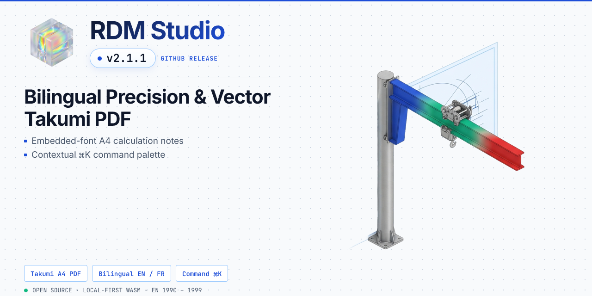

[**Launch 3D Studio ↗**](https://rdm-studio-app.vercel.app/geometry?template=portal-frame&lang=en) · [**Documentation ↗**](https://rdm-studio-docs.vercel.app/guides/reports-and-bim-exports/) · [**Overview & Benchmarks ↗**](https://rdm-studio-site.vercel.app) · [**Full Diff (`v2.1.0...v2.1.1`) ↗**](https://github.com/elcoosp/rdm-studio/compare/v2.1.0...v2.1.1) · [**Sponsor ♥**](https://github.com/sponsors/elcoosp)

# RDM Studio `v2.1.1`

> [!NOTE]
> **Release Summary (Vector A4 PDF · 5-Locale i18n):** Client-side vector Takumi A4 PDF reports with embedded fonts, icon-rich `⌘K` command palette, and 5-language catalog parity.

## Architecture & Release Matrix

| Subsystem | Key Module / Entrypoint | Engineering & Product Scope |
| :--- | :--- | :--- |
| **Takumi Vector A4 PDF** | [`apps/web/src/export/pdfTakumiReport.tsx`](https://github.com/elcoosp/rdm-studio/blob/main/apps/web/src/export/pdfTakumiReport.tsx) | Web Worker vector PDF generation with self-hosted `Inter` & `JetBrains Mono` `.ttf` fonts and localized headings |
| **Contextual `⌘K` Palette** | [`apps/web/src/components/CommandPalette.tsx`](https://github.com/elcoosp/rdm-studio/blob/main/apps/web/src/components/CommandPalette.tsx) | Rebuilt command palette with engineering icons, `Kbd` shortcut chips, `1–5` step hotkeys, and `/` home shortcut |
| **Header Stepper & 2-Tab Rail** | [`apps/web/src/routes/_studio.tsx`](https://github.com/elcoosp/rdm-studio/blob/main/apps/web/src/routes/_studio.tsx) | Named 5-step workflow stepper with Deep Cobalt active pill, split Step 4 rail, and docked 3D envelopes |
| **WASM & Worker Fixes** | [`bindings/rdm-wasm/src/lib.rs`](https://github.com/elcoosp/rdm-studio/blob/main/bindings/rdm-wasm/src/lib.rs) | `serde_json` serialization for `generate_env_loads_json` and concurrent `fetchValidationSuite` coalescing |
| **5-Locale Parity & Assets** | [`apps/web/e2e/v211-polish.spec.ts`](https://github.com/elcoosp/rdm-studio/blob/main/apps/web/e2e/v211-polish.spec.ts) | Localized 41 French benchmark titles, 100% `fr/en/de/es/pt_BR` catalog parity, and 12 Stitch illustrations |

## Detailed Engineering Changelog

### 1. Client-Side Vector Takumi A4 PDF & Localized Calculation Reports
- **Takumi Worker Vector PDF (`pdfTakumiReport.tsx`, `report.tsx`):** Generated crisp vector A4 calculation notes in a Web Worker using self-hosted `Inter` and `JetBrains Mono` `.ttf` fonts with localized French/English section headings, reordered export rail (`PDF`, `.docx`, `IFC4`/`SAF`, `CSV`, `3D HTML`, `.rdm`), and Discovery edition evaluation watermark (`data-testid="edition-watermark"`).
- **WASM Load Serialization & Worker Coalescing (`bindings/rdm-wasm/src/lib.rs`, `workerClient.ts`):** Serialized `generate_env_loads_json` via `serde_json` (`301588c`) and coalesced concurrent `fetchValidationSuite` requests (`7eab74d`).

### 2. Contextual `⌘K` Command Palette & Studio Navigation Ergonomics
- **Icon-Rich Command Palette (`CommandPalette.tsx`, `CadToolbar.tsx`):** Rebuilt `data-testid="command-palette"` with engineering icons, `Kbd` shortcut chips, live CAD command dispatch (`rdm-cad-command`), `1–5` step jump hotkeys, `/` home shortcut, and dialog-aware `Escape` handling (`useAppHotkeys.ts`).
- **Named Workflow Stepper & Docked 3D Envelopes (`_studio.tsx`, `results.tsx`, `geometry.tsx`):** Redesigned the studio header with a named 5-step workflow stepper and Deep Cobalt active pill, split Step 4 into a 2-tab rail (`data-testid="rail-tab-*"`) with `uPlot` timestamp axis fixes and docked 3D force envelopes (`data-testid="force-diagrams-dock"`), and added unit-parsing placement fields in Step 1 (`a3562b8`).

### 3. 5-Language Catalog Parity & Visual Assets
- **Bilingual Benchmark Localization & i18n (`ValidationModal.tsx`, `i18n/locales/`):** Localized all 41 analytical benchmark titles into French, removed legacy flat route files, and achieved 100% translation catalog parity across `fr`, `en`, `de`, `es`, and `pt_BR`.
- **Visual Assets & Regression Suite (`mockups/`, `apps/web/e2e/v211-polish.spec.ts`):** Added 12 Swiss Metrology Stitch illustrations (`1600×900` PNG), 12 additional `1.5px` engineering icons (`icons-sheet-v2.html`), and a 213-line Playwright polish/regression suite.

> [!TIP]
> **Zero-Cloud Local-First Execution:** Open the [v2.1.1 reference model directly in RDM Studio](https://rdm-studio-app.vercel.app/geometry?template=portal-frame&lang=en) — the Rust/WASM solver (`f64` precision), Eurocode catalogs, and Takumi vector PDF generator run 100% locally in your browser.

<strong>Commit & Diff Ledger (46 commits · 53 files changed, 1883 insertions(+), 5058 deletions(-))</strong>

- [`bf6f832`](https://github.com/elcoosp/rdm-studio/commit/bf6f832906332695793b1b27aaa0692f7b827e51) docs(status): record v2.1.1 milestone completion and green gate ledger
- [`bf0e7ec`](https://github.com/elcoosp/rdm-studio/commit/bf0e7ec9df7d2fd0f5e7970a525d23886534307b) docs(agents): document 44 icons, WASM Load serialization, and Lingui rules
- [`722b518`](https://github.com/elcoosp/rdm-studio/commit/722b51839b49c2e4b0e2596d0ca225115da70e25) test(e2e): add v2.1.1 polish and regression test suite
- [`9dd0e4d`](https://github.com/elcoosp/rdm-studio/commit/9dd0e4d92580b469be31a53daab89905891e4f64) test(e2e): use exact role matching and 1920px viewport for header checks
- [`b4d7595`](https://github.com/elcoosp/rdm-studio/commit/b4d759541d774050e984d4308fa39ab4cfd5f571) test(e2e): stabilize EC3 η polling, fault banner wait, and docx export
- [`4a3b661`](https://github.com/elcoosp/rdm-studio/commit/4a3b661866d6740df41e215e0df2a1aee44c8698) test(e2e): test license badge click at 1920x900 viewport
- [`dc76a44`](https://github.com/elcoosp/rdm-studio/commit/dc76a44282bbb01f88119c06e46e8299afbb0b49) test(e2e): exclude headless Firefox WebGL noise from console hygiene
- [`773c02c`](https://github.com/elcoosp/rdm-studio/commit/773c02cac54dcde9d1defd231fa4e524d30a6ad5) chore(i18n): compile Portuguese (BR) locale bundle
- [`7dec779`](https://github.com/elcoosp/rdm-studio/commit/7dec7799e4c5db2171666698026383a6df41ffbc) chore(i18n): update Portuguese (BR) message catalog keys
- [`62c0526`](https://github.com/elcoosp/rdm-studio/commit/62c0526efbf8dacb60cc1f049f087553123df161) chore(i18n): compile Spanish locale bundle
- [`daa00a1`](https://github.com/elcoosp/rdm-studio/commit/daa00a1202cd9f6dd02ac241bccb5600211a21d4) chore(i18n): update Spanish message catalog keys
- [`f1ae29d`](https://github.com/elcoosp/rdm-studio/commit/f1ae29dee72f150e1f8fb61e63d137abe3671f20) chore(i18n): compile German locale bundle
- [`0bc1309`](https://github.com/elcoosp/rdm-studio/commit/0bc13091a12c9381ff732c1b44466a572eeec430) chore(i18n): update German message catalog keys
- [`5bc78d1`](https://github.com/elcoosp/rdm-studio/commit/5bc78d13ceeb1631d75c926eeb344d17a4e3f9b5) chore(i18n): compile English locale bundle
- [`40c62d6`](https://github.com/elcoosp/rdm-studio/commit/40c62d661e87fe4e12617b74f4d0a3cbf210dd78) chore(i18n): translate all v2.1.1 strings in English catalog
- [`0d135de`](https://github.com/elcoosp/rdm-studio/commit/0d135de226827eb7d95c30ad3d26129bf2a361cd) chore(i18n): compile French locale bundle
- [`d80640d`](https://github.com/elcoosp/rdm-studio/commit/d80640ddacd5cd98cf31414993c4f6d6b3a94117) chore(i18n): extract updated French message catalog
- [`522baeb`](https://github.com/elcoosp/rdm-studio/commit/522baebf1c5a84b642dff04a87f0402015cca7b2) feat(report): localize A4 headings, reorder export rail, and add watermark
- [`cd4db27`](https://github.com/elcoosp/rdm-studio/commit/cd4db27816451fb09d9ab458bfd8d1780e7b57c8) feat(results): fix uPlot timestamp axis, split 2-tab rail, and dock 3D envelopes
- [`956c2ea`](https://github.com/elcoosp/rdm-studio/commit/956c2ea903bf981323a86a833c389e7f9dd596db) refactor(supports): derive active restraint preset from selected node DOFs
- [`751b278`](https://github.com/elcoosp/rdm-studio/commit/751b27827b84d37f71028021c8ccbeb3c20acae6) feat(loads): auto-switch EN 1990 case tab with toast on generator action
- [`a3562b8`](https://github.com/elcoosp/rdm-studio/commit/a3562b80433b5c46f7b3cf323dfa962f09b95b81) feat(geometry): add unit-parsing placement fields and unclipped action row
- [`7981890`](https://github.com/elcoosp/rdm-studio/commit/7981890e28200ad4c4cdf47084ae368763ed82ba) feat(studio): redesign header with named workflow stepper and Cobalt active pill
- [`50156db`](https://github.com/elcoosp/rdm-studio/commit/50156dbfacbb464f8b2d6354de10da0d2d372fed) feat(marketing): upgrade HeroArt schematic and add mount-time hash scroll
- [`6d4521d`](https://github.com/elcoosp/rdm-studio/commit/6d4521dfb302246214f63f33040038c234021da1) feat(marketing): use TanStack hash Links with activeProps highlights
- [`f805b90`](https://github.com/elcoosp/rdm-studio/commit/f805b908881d7f6bc855e215c487bf47b6969c32) feat(validation): localize 41 benchmark titles to French and guard unmount
- [`2ec02e1`](https://github.com/elcoosp/rdm-studio/commit/2ec02e1276e80b14c2fa4bd49b75ff2010f3db67) feat(settings): wire rdm-open-settings event and reactive Lingui aria-label
- [`f4f21c7`](https://github.com/elcoosp/rdm-studio/commit/f4f21c75a62b2f43582c193c8a6376cffb350621) style(header): restrict license badge pill visibility to 2xl viewports
- [`a0fa87b`](https://github.com/elcoosp/rdm-studio/commit/a0fa87b9d9442fc823509ad491040fa914e0a007) feat(ui): rebuild command palette with icons, Kbd chips, and live actions
- [`2746d0d`](https://github.com/elcoosp/rdm-studio/commit/2746d0df3ae00c14c7fbec9732d5529ae4a98273) feat(cad): listen for rdm-cad-command window events
- [`9c01f55`](https://github.com/elcoosp/rdm-studio/commit/9c01f55443777fa8464c46ad2571355ef3fca9b2) feat(export): add Discovery edition evaluation watermark to Takumi PDF
- [`97942be`](https://github.com/elcoosp/rdm-studio/commit/97942be666096502bf7cb82dd916515cca6b8a4a) feat(export): add Discovery edition evaluation watermark to docx cover
- [`c040ecd`](https://github.com/elcoosp/rdm-studio/commit/c040ecdfea3a227238e0eaf6b4facfd5e1ec8403) fix(io): attach shell drag-and-drop listeners at module load and guard v1 migration
- [`08cc074`](https://github.com/elcoosp/rdm-studio/commit/08cc07453656a4c8eefbfcc1c469ebfbcaafe0aa) feat(hotkeys): add 1-5 step jumps, '/' home shortcut, and dialog-aware Escape
- [`7eb4e13`](https://github.com/elcoosp/rdm-studio/commit/7eb4e136e468bf4cdd01276dc7e5ee3b27549cfb) fix(state): lock Rx torsion DOF on travees quick-start template
- [`7eab74d`](https://github.com/elcoosp/rdm-studio/commit/7eab74df49a911749d4a7ab6caa5e46858ba3cb6) fix(worker): coalesce concurrent fetchValidationSuite calls
- [`301588c`](https://github.com/elcoosp/rdm-studio/commit/301588c1d359cc25aa7bf3fc2659e359cbd58f1a) fix(wasm): serialize generate_env_loads_json via serde_json
- [`0533c08`](https://github.com/elcoosp/rdm-studio/commit/0533c086576ebe928d75b45c885930244d3a8db8) docs(mockups): add 12 Stitch Swiss Metrology illustrations (1600x900 PNG)
- [`7004d84`](https://github.com/elcoosp/rdm-studio/commit/7004d84405563db91a37fdae567015d0a10366c4) docs(mockups): add icons-sheet-v2.html with 12 new 1.5px engineering icons
- [`a744d54`](https://github.com/elcoosp/rdm-studio/commit/a744d54225353dbd1e096562c7a01a3da9c1a194) chore(deps): refresh the workspace lockfile
- [`2fa989e`](https://github.com/elcoosp/rdm-studio/commit/2fa989e64bdbe0c77ffb8e09da33f6e4a5251554) refactor(routes): remove the / redirect
- [`89df8e4`](https://github.com/elcoosp/rdm-studio/commit/89df8e49a7e5c56a8dc568a8a33a139fe73b0b5a) refactor(routes): remove the flat report route
- [`e16ee4f`](https://github.com/elcoosp/rdm-studio/commit/e16ee4f6349862d392587622e8d7d19394185b19) refactor(routes): remove the flat results route
- [`b0fc6d0`](https://github.com/elcoosp/rdm-studio/commit/b0fc6d0369d7d6a76ad8c33c69304a6e9c8fb873) refactor(routes): remove the flat loads route
- [`10e41c8`](https://github.com/elcoosp/rdm-studio/commit/10e41c8e2a6be7f466bb6453793d4b507c154dd2) refactor(routes): remove the flat supports route
- [`82aadb2`](https://github.com/elcoosp/rdm-studio/commit/82aadb22f707a641d4545ef997ca92a5457eaaeb) refactor(routes): remove the flat geometry route

---

**Links:** [GitHub Tag `v2.1.1`](https://github.com/elcoosp/rdm-studio/releases/tag/v2.1.1) · [Compare Changes](https://github.com/elcoosp/rdm-studio/compare/v2.1.0...v2.1.1) · [3D Studio](https://rdm-studio-app.vercel.app) · [Documentation](https://rdm-studio-docs.vercel.app) · [B2B & Discussions](https://github.com/elcoosp/rdm-studio/discussions)
