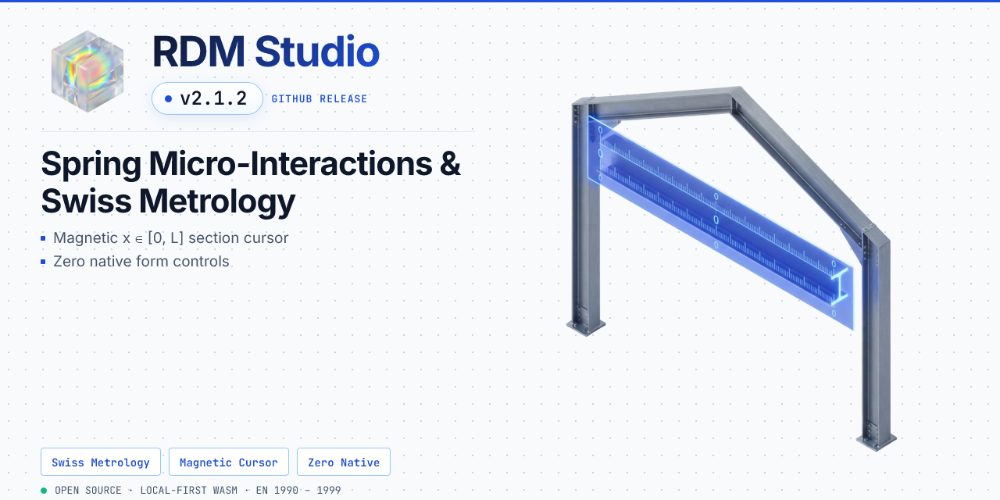

[**Launch 3D Studio ↗**](https://rdm-studio-app.vercel.app/geometry?template=portal-frame&lang=en) · [**Documentation ↗**](https://rdm-studio-docs.vercel.app/explanation/solver-architecture/) · [**Overview & Benchmarks ↗**](https://rdm-studio-site.vercel.app) · [**Full Diff (`v2.1.1...v2.1.2`) ↗**](https://github.com/elcoosp/rdm-studio/compare/v2.1.1...v2.1.2) · [**Sponsor ♥**](https://github.com/sponsors/elcoosp)

# RDM Studio `v2.1.2`

> [!NOTE]
> **Release Summary (Swiss Metrology · Zero Native Controls):** 8 `interior.dev` tactile micro-interactions, 44 custom engineering icons, zero raw native form controls, and interactive 3D hero stage.

## Architecture & Release Matrix

| Subsystem | Key Module / Entrypoint | Engineering & Product Scope |
| :--- | :--- | :--- |
| **8 `interior.dev` Controls** | [`packages/ui/src/interior/index.ts`](https://github.com/elcoosp/rdm-studio/blob/main/packages/ui/src/interior/index.ts) | `SegmentedControl`, `SliderDetents` (`x ∈ [0, L]`), `HoldToConfirm` (`800ms`), `StatusBadge`, `CopyButton`, `LoadingButton`, `TooltipGroup`, `ExpandablePanel` |
| **44 Custom Icons & Hygiene** | [`apps/web/e2e/v211-polish.spec.ts`](https://github.com/elcoosp/rdm-studio/blob/main/apps/web/e2e/v211-polish.spec.ts) | Ported 12 v2 icons (44 total) and enforced zero raw `<select>`/`
`/`<input type=checkbox|range>` hygiene |
| **48px Swiss Header & Menus** | [`apps/web/src/components/ui/context-menu.tsx`](https://github.com/elcoosp/rdm-studio/blob/main/apps/web/src/components/ui/context-menu.tsx) | Redesigned 48px Swiss Metrology header, Base UI `ContextMenu`, portal popovers, and `fr-FR` tabular readouts |
| **Interactive 3D Hero Stage** | [`apps/web/src/components/HeroViewport3D.tsx`](https://github.com/elcoosp/rdm-studio/blob/main/apps/web/src/components/HeroViewport3D.tsx) | Live Three.js marketing hero (`portique`, `warren`, `travees`) with load slider, proof strip, and Bento grid |
| **Illustrated Onboarding Tour** | [`apps/web/src/components/OnboardingTour.tsx`](https://github.com/elcoosp/rdm-studio/blob/main/apps/web/src/components/OnboardingTour.tsx) | 9-step bilingual illustrated onboarding tour precached in Workbox + 8 Playwright E2E regression specs |

## Detailed Engineering Changelog

### 1. 8 Tactile `interior.dev` Micro-Interactions (`apps/web/src/components/interior/`)
- **Precision Spring & Magnetic Controls (`d576104`):** Built and integrated 8 custom interactive primitives across all 5 studio steps:
  1. `SegmentedControl` — spring-animated gliding pill for view selectors, camera presets, and SLS deflection limits.
  2. `SliderDetents` — magnetic detent scrubber for section-cut position `x ∈ [0, L]` (`0`, `0.25L`, `0.50L`, `0.75L`, `L`).
  3. `HoldToConfirm` — `800ms` radial-progress destructive guard preventing accidental deletion of loads or supports.
  4. `StatusBadge` — animated `pass` | `fail` | `warn` | `accent` | `neutral` Eurocode utilization badges.
  5. `CopyButton` — stateful clipboard confirmation for TSV tables, KaTeX formulas, and share URLs.
  6. `LoadingButton` — locked-width async solve/export trigger eliminating layout shift.
  7. `TooltipGroup` — warm-delay grouped tooltips across the 3D layer and CAD toolbars.
  8. `ExpandablePanel` — smooth disclosure container for RDM 7 restraint presets and spring stiffness matrices.

### 2. 44 Custom Icons, Zero Raw Native Controls & 48px Swiss Metrology Header
- **Zero-Native-Control Hygiene (`bdfe24c`, `EngineeringIcons.tsx`):** Ported 12 additional `1.5px`-stroke vector engineering icons (`BeamSegment`, `NodePin`, `PortalFrameIcon`, `WarrenTrussIcon`, `ContinuousBeamIcon`, `WindLoadIcon`, `SnowLoadIcon`, `ThermalLoadIcon`, `MassWeightIcon`, `ConcreteBeamIcon`, `TimberBeamIcon`, `SteelJointIcon` — **44 total**) and enforced automated hygiene assertions guaranteeing zero raw `<select>`, `
`, `<input type="checkbox">`, or `<input type="range">` primitives across `apps/web/src/`.
- **Redesigned 48px Header & Base UI Overlays (`dc13dcc`, `ContextMenuRoot`):** Unified the 48px Swiss Metrology header, migrated all modals and popovers (`ValidationModal`, `OptimizerModal`, `ScenarioCompareModal`, `SettingsPopover`) onto Base UI portal primitives, added a 3D viewport context menu, and standardized tabular readouts with `fr-FR` locale formatting.

### 3. Interactive 3D Marketing Hero & Bilingual Illustrated Onboarding Tour
- **Live Three.js Hero Stage (`HeroViewport3D.tsx`, `_marketing/index.tsx`):** Added an interactive 3D hero viewport (`portique`, `warren`, `travees`) with live load slider, proof strip, Bento feature grid, and 12 Swiss Metrology illustrations precached in Workbox (`4907352`).
- **9-Step Illustrated Onboarding Tour (`OnboardingTour.tsx`):** Shipped bilingual illustrated popover cards (`tour-cad-import.png` through `tour-settings-benchmarks.png`) and 8 targeted Playwright E2E regression specs.

> [!TIP]
> **Zero-Cloud Local-First Execution:** Open the [v2.1.2 reference model directly in RDM Studio](https://rdm-studio-app.vercel.app/geometry?template=portal-frame&lang=en) — the Rust/WASM solver (`f64` precision), Eurocode catalogs, and Takumi vector PDF generator run 100% locally in your browser.

<strong>Commit & Diff Ledger (77 commits · 73 files changed, 5903 insertions(+), 1601 deletions(-))</strong>

- [`6fdb913`](https://github.com/elcoosp/rdm-studio/commit/6fdb913db78b29be50903683889cc9a4578b9557) docs(status): record v2.1.2 milestones and gate ledger
- [`bdfe24c`](https://github.com/elcoosp/rdm-studio/commit/bdfe24cbcf319d433d550cd1d3242f4ee01814c6) test(hygiene): enforce zero raw native controls and 44 icons
- [`247c090`](https://github.com/elcoosp/rdm-studio/commit/247c09091c9e174c008152e0826d1b1774ddc7ac) test(e2e): hero switcher, load slider, settings popover
- [`f3f4a53`](https://github.com/elcoosp/rdm-studio/commit/f3f4a537028787abc21f0626d9c300f5c7a52b62) test(e2e): switch toggle and SLS radio assertions
- [`2c474a2`](https://github.com/elcoosp/rdm-studio/commit/2c474a24f87e1d4118b57e9266128af0cab00705) test(e2e): assert combination select popup options
- [`bb0ba9b`](https://github.com/elcoosp/rdm-studio/commit/bb0ba9bede78e7480ddd493d07f7a4f74ed789f4) test(e2e): assert the redesigned 48px header
- [`5454c5c`](https://github.com/elcoosp/rdm-studio/commit/5454c5c0f55441766913280d94ccc798de23720e) test(e2e): dialog test ids and radio assertions
- [`325cef4`](https://github.com/elcoosp/rdm-studio/commit/325cef4749f4a4d456a14e52467ec5cdf1947eab) test(e2e): radio locale switch and ExpandablePanel trigger
- [`62d9486`](https://github.com/elcoosp/rdm-studio/commit/62d94866a553b536b04b5b3607543909242c3b88) test(e2e): drive combobox N1/N2 and library trigger
- [`7db033e`](https://github.com/elcoosp/rdm-studio/commit/7db033e2defc458d14a18161fb45928ba72a5141) test(e2e): drive Base UI checkbox DOF matrix
- [`45cad36`](https://github.com/elcoosp/rdm-studio/commit/45cad365daca6026d6472fa87fe5395d3f7bdc7b) chore(i18n): compile the v2.1.2 catalog
- [`cb76685`](https://github.com/elcoosp/rdm-studio/commit/cb7668588c099dbaad9e92c548efbf6053bc8423) chore(i18n): extract the v2.1.2 catalog
- [`21b57d3`](https://github.com/elcoosp/rdm-studio/commit/21b57d346e754e526163fe78e7772874e55dede2) chore(i18n): compile the v2.1.2 catalog
- [`02f05d3`](https://github.com/elcoosp/rdm-studio/commit/02f05d31df983b5af758b6d799de7205292a63b1) chore(i18n): extract the v2.1.2 catalog
- [`28094eb`](https://github.com/elcoosp/rdm-studio/commit/28094eb06d595644105e0914f505f48db3a3f2c6) chore(i18n): compile the v2.1.2 catalog
- [`b2aa8f0`](https://github.com/elcoosp/rdm-studio/commit/b2aa8f08b7b1dda8983dcf175d89f82a878e77c2) chore(i18n): extract the v2.1.2 catalog
- [`edf0fad`](https://github.com/elcoosp/rdm-studio/commit/edf0fad02af5f073db0d54e16290b341f1285238) chore(i18n): compile the v2.1.2 catalog
- [`811ad72`](https://github.com/elcoosp/rdm-studio/commit/811ad72a6190add8704be128952b9622ac624786) chore(i18n): extract the v2.1.2 catalog
- [`9db5b6a`](https://github.com/elcoosp/rdm-studio/commit/9db5b6a0e460b3db059c03b3e17af77ed8cb09f1) chore(i18n): compile the v2.1.2 catalog
- [`ffdd071`](https://github.com/elcoosp/rdm-studio/commit/ffdd071af2d17a3468448e160ad7865c08d673c1) chore(i18n): translate 100% of the v2.1.2 catalog
- [`3472abc`](https://github.com/elcoosp/rdm-studio/commit/3472abc0513d6b5730414d50410ae8c58a7aa320) fix(report): QR effect, compact share payload, interior controls
- [`2400460`](https://github.com/elcoosp/rdm-studio/commit/2400460bc8bf1d6956e031bcb874dc689197770e) feat(results): SegmentedControl, SliderDetents, LoadingButton
- [`5aad7f6`](https://github.com/elcoosp/rdm-studio/commit/5aad7f67308b71870cd2280ff244f45b50851bf3) refactor(loads): combobox targets and HoldToConfirm wipe
- [`6806fda`](https://github.com/elcoosp/rdm-studio/commit/6806fdacc7169560b915e9bdc9f2471e56d5eea8) refactor(supports): HoldToConfirm, StatusBadge, ExpandablePanel
- [`8afe3d0`](https://github.com/elcoosp/rdm-studio/commit/8afe3d009fe348687ec9d777cbf924cd22bbe698) refactor(geometry): Base UI selects, combobox and checkboxes
- [`1e5c5b3`](https://github.com/elcoosp/rdm-studio/commit/1e5c5b3a0f6a361a31b4a3834342a0e9e93c98a1) feat(marketing): 3D hero, proof strip, Bento grid, 4-tier pricing
- [`dc13dcc`](https://github.com/elcoosp/rdm-studio/commit/dc13dcc6c50ef626c675fd549be5f71f9ddfe7f4) feat(header): redesign 48px Swiss Metrology header
- [`e6a48d2`](https://github.com/elcoosp/rdm-studio/commit/e6a48d2e227a85ef8a7fcb95d7669b3fdf8b32ad) feat(stage): camera presets as SegmentedControl
- [`be6d691`](https://github.com/elcoosp/rdm-studio/commit/be6d691ddb27dd2a6cc2f33b50e2cf46eca765e1) feat(stage): wrap layer toolbar in TooltipGroup
- [`e808751`](https://github.com/elcoosp/rdm-studio/commit/e80875108a9523d4ef68ec41b9599f5f443ab190) fix(dock): compact panel fits the 220px dock
- [`c2e4a36`](https://github.com/elcoosp/rdm-studio/commit/c2e4a36d3906d8581caae9e8cff3825b712fd1b8) fix(loads): render Uniform loads as 3D arrow arrays
- [`c6b493a`](https://github.com/elcoosp/rdm-studio/commit/c6b493ace50780a9b87c8134b337fc2817b75373) feat(stage): context menu, status bar, stable geometry memo
- [`445f3a3`](https://github.com/elcoosp/rdm-studio/commit/445f3a3912112e502defb8c08e109acc83405098) refactor(advanced): Base UI selects and number fields
- [`d5b956b`](https://github.com/elcoosp/rdm-studio/commit/d5b956b803b4ebb02afaf4698739bad3dcfc1f60) fix(gallery): gravity direction, toast, Base UI pickers
- [`ab5a821`](https://github.com/elcoosp/rdm-studio/commit/ab5a821e2ee324a3fe521ba897d643457e02f9b4) refactor(scenarios): Base UI dialog and select pickers
- [`70ef10e`](https://github.com/elcoosp/rdm-studio/commit/70ef10e93d4e8b261120eed3f8150fcec917e6e5) refactor(validation): use Base UI Dialog shell
- [`17e2030`](https://github.com/elcoosp/rdm-studio/commit/17e20301bd681730fe2599d867cf8ffdf75519c4) refactor(optimizer): use Base UI Dialog shell
- [`2bf2858`](https://github.com/elcoosp/rdm-studio/commit/2bf2858f310a03ee0655509cacd3258b95a1f2be) refactor(cad): swap raw checkbox for Base UI Checkbox
- [`25a51e6`](https://github.com/elcoosp/rdm-studio/commit/25a51e6bb9e0a15b01abc00080444aff3c6fbe75) feat(cad): wire TooltipGroup, Dialog and Kbd chips
- [`bf74ccb`](https://github.com/elcoosp/rdm-studio/commit/bf74ccb71be2326b602e96a3b6220b27b10b2391) fix(trace): render KaTeX with trust disabled
- [`28c9bed`](https://github.com/elcoosp/rdm-studio/commit/28c9bedf24ed58870e359c47a109b484d2d7f533) feat(tour): add bilingual illustrated 9-step onboarding
- [`187fdc7`](https://github.com/elcoosp/rdm-studio/commit/187fdc76b84b723d0c8b010832c2609c312431f9) fix(readouts): format tabular telemetry with fr-FR locale
- [`fb287fd`](https://github.com/elcoosp/rdm-studio/commit/fb287fdaa3a15bd506ce8f47ac3612ef773f5e1f) feat(license): add Pass Projet 48h tier and LoadingButton
- [`12226ab`](https://github.com/elcoosp/rdm-studio/commit/12226ab2d67591725b6aedbbc01f24b454753a7e) fix(settings): migrate onto Base UI portal popover
- [`df5ea9b`](https://github.com/elcoosp/rdm-studio/commit/df5ea9b4ca6b6756a15a6b6ece1d5c3cd5103608) feat(ui): generalize combobox content to typed items
- [`427c2f1`](https://github.com/elcoosp/rdm-studio/commit/427c2f1e3b728a41c2547cd8859fb3d9250f23e1) feat(ui): portal-align popover content
- [`9ba5ffc`](https://github.com/elcoosp/rdm-studio/commit/9ba5ffcd6e2a94d95734be76389c9187bc44ddef) feat(ui): add Base UI context-menu primitives
- [`dd82523`](https://github.com/elcoosp/rdm-studio/commit/dd82523d3b9bb837b1f57d906d14e536646c4cde) feat(marketing): add interactive Three.js hero stage
- [`8b82e3b`](https://github.com/elcoosp/rdm-studio/commit/8b82e3bd71fbaab01115eb023000963b2dcca41b) feat(interior): add smooth ExpandablePanel
- [`6609e98`](https://github.com/elcoosp/rdm-studio/commit/6609e981ee4ee95e9b6c506b18998aa435aedf67) feat(interior): add animated StatusBadge
- [`076b14e`](https://github.com/elcoosp/rdm-studio/commit/076b14e1bb0a51fe91cc185860ac654ec9fed728) feat(interior): add magnetic SliderDetents
- [`516bc23`](https://github.com/elcoosp/rdm-studio/commit/516bc2395068f22409ac7d78fa47ae0d10e8424e) feat(interior): add warm TooltipGroup
- [`df83660`](https://github.com/elcoosp/rdm-studio/commit/df83660acb979382cb0501b78d3dbd5f23e57537) feat(interior): add 800ms HoldToConfirm guard
- [`ce86b9f`](https://github.com/elcoosp/rdm-studio/commit/ce86b9ffb76cc145f1119f4b7aaafe260a9cd4d9) feat(interior): add animated CopyButton
- [`babdb94`](https://github.com/elcoosp/rdm-studio/commit/babdb9426805416506e736ff566fe74893730338) feat(interior): add locked-width LoadingButton
- [`77626cd`](https://github.com/elcoosp/rdm-studio/commit/77626cd1c3e3242b192838fbdf2c98f39db18f17) feat(interior): add spring-pill SegmentedControl
- [`d576104`](https://github.com/elcoosp/rdm-studio/commit/d576104947ce6c23925f2cc1d43914233f94eade) feat(interior): export the 8 interior.dev micro-interactions
- [`64daacf`](https://github.com/elcoosp/rdm-studio/commit/64daacf7d67cfb95443efd75c7461f6017cc7178) feat(icons): port 12 v2 engineering icons verbatim (44 total)
- [`cb9ce8e`](https://github.com/elcoosp/rdm-studio/commit/cb9ce8e75d1134f307be24573f77b9076ee5c734) feat(router): enable native view transitions by default
- [`43ec051`](https://github.com/elcoosp/rdm-studio/commit/43ec05136297d68bbb517a76fe3706d4e2d43145) feat(tour): style illustrated popover cards
- [`81e8119`](https://github.com/elcoosp/rdm-studio/commit/81e81194a5a7c0a331421fd357b09f0dd6532b8c) feat(theme): add native view-transition and tour illustration rules
- [`4907352`](https://github.com/elcoosp/rdm-studio/commit/49073529c5eeafed1b9f6140942e57dfba473263) feat(pwa): precache png illustrations in workbox globPatterns
- [`a6c2aec`](https://github.com/elcoosp/rdm-studio/commit/a6c2aece68b573103962b90cb5012a00ce3446f1) feat(tour): add normative settings tour illustration
- [`2a43d88`](https://github.com/elcoosp/rdm-studio/commit/2a43d8840ece0960837345e43d54c94d71e2b35f) feat(tour): add section-cut results tour illustration
- [`7b589f1`](https://github.com/elcoosp/rdm-studio/commit/7b589f1e71cf183d5d5755ec01f8ca9649dfc127) feat(tour): add EN 1990 loads tour illustration
- [`d35957a`](https://github.com/elcoosp/rdm-studio/commit/d35957af54ace09585c1a7f9b94ec29512c1bbb8) feat(tour): add RDM7 supports tour illustration
- [`fe8286f`](https://github.com/elcoosp/rdm-studio/commit/fe8286f07d507359db92af218783d6b62606017a) feat(tour): add viewport snap tour illustration
- [`0659d54`](https://github.com/elcoosp/rdm-studio/commit/0659d54272d4bbd69267251b0276df77940ac855) feat(tour): add CAD import tour illustration
- [`9b6863d`](https://github.com/elcoosp/rdm-studio/commit/9b6863d35ff488d9f1afdcfa0910f5e69f8293eb) feat(marketing): add report and BIM Stitch illustration
- [`87e2654`](https://github.com/elcoosp/rdm-studio/commit/87e2654fa864bf02f33cb4daf50b14beb9d5e037) feat(marketing): add CAD optimizer Stitch illustration
- [`32d0ad4`](https://github.com/elcoosp/rdm-studio/commit/32d0ad4fa8f1aaab3e16ec883858647c22e6d0ad) feat(marketing): add naval and dynamic Stitch illustration
- [`d28c381`](https://github.com/elcoosp/rdm-studio/commit/d28c381852a5a1659a5e7228fb42f5239cad13c3) feat(marketing): add multi-material Stitch illustration
- [`869a0cf`](https://github.com/elcoosp/rdm-studio/commit/869a0cf0606ead112c62c696db44388b315edc12) feat(marketing): add EC3 CalcTrace Stitch illustration
- [`cb52402`](https://github.com/elcoosp/rdm-studio/commit/cb52402b630a07b568661622acee45310f42e7d7) feat(marketing): add P-delta solver Stitch illustration
- [`40fbf76`](https://github.com/elcoosp/rdm-studio/commit/40fbf76009de175981091b37b2b3fa45d4c6d7cc) chore: AGENTS.md
- [`519229b`](https://github.com/elcoosp/rdm-studio/commit/519229b0a4c0afd62cb60a57a28826f6a3abc41a) fix: gitignore
- [`2f17823`](https://github.com/elcoosp/rdm-studio/commit/2f17823b094a587b14a34fd1fd32e2601ea6937d) docs(prompts): update v2.1.2 session specification

---

**Links:** [GitHub Tag `v2.1.2`](https://github.com/elcoosp/rdm-studio/releases/tag/v2.1.2) · [Compare Changes](https://github.com/elcoosp/rdm-studio/compare/v2.1.1...v2.1.2) · [3D Studio](https://rdm-studio-app.vercel.app) · [Documentation](https://rdm-studio-docs.vercel.app) · [B2B & Discussions](https://github.com/elcoosp/rdm-studio/discussions)
