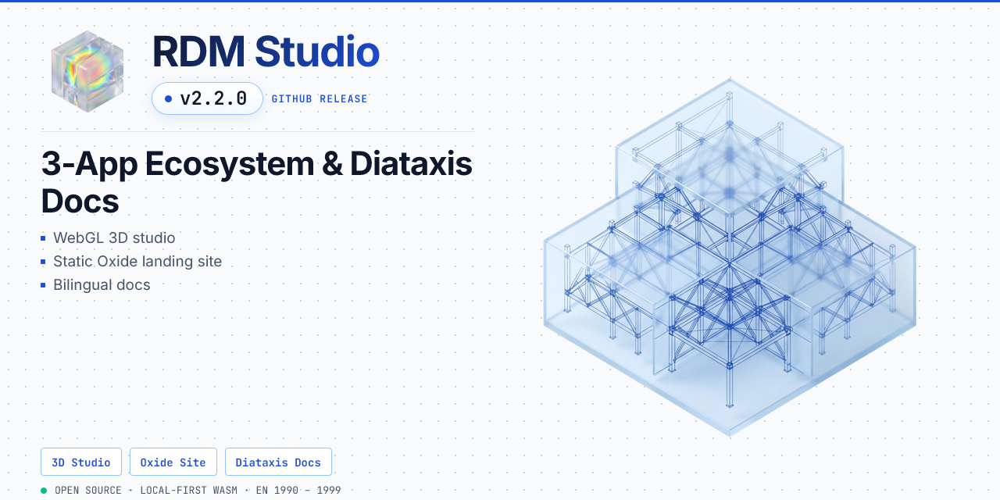

[**Launch 3D Studio ↗**](https://rdm-studio-app.vercel.app/geometry?template=portal-frame&lang=en) · [**Documentation ↗**](https://rdm-studio-docs.vercel.app/) · [**Overview & Benchmarks ↗**](https://rdm-studio-site.vercel.app) · [**Full Diff (`v2.1.2...v2.2.0`) ↗**](https://github.com/elcoosp/rdm-studio/compare/v2.1.2...v2.2.0) · [**Sponsor ♥**](https://github.com/sponsors/elcoosp)

# RDM Studio `v2.2.0`

> [!NOTE]
> **Release Summary (3-App Monorepo · Diataxis Starlight):** Three-application ecosystem (`apps/web`, Oxide `apps/site`, Starlight `apps/docs`), pedagogical fault diagnostics, and zero-dead-link audit.

## Architecture & Release Matrix

| Subsystem | Key Module / Entrypoint | Engineering & Product Scope |
| :--- | :--- | :--- |
| **Oxide Marketing & SEO Site** | [`apps/site/oxide.config.ts`](https://github.com/elcoosp/rdm-studio/blob/main/apps/site/oxide.config.ts) | Static Oxide v0.18.0 landing site with client islands, JSON-LD, and 4 programmatic Eurocode SEO calculators |
| **Bilingual Diataxis Docs** | [`apps/docs/astro.config.mjs`](https://github.com/elcoosp/rdm-studio/blob/main/apps/docs/astro.config.mjs) | 30-page EN + FR Starlight portal (`@elcoosp/docs-toolkit`) with glossary, `llms.txt`, and 19 `<DocMedia>` recipes |
| **Mechanism Fault Diagnostics** | [`apps/web/src/routes/_studio/results.tsx`](https://github.com/elcoosp/rdm-studio/blob/main/apps/web/src/routes/_studio/results.tsx) | Actionable solver fault card (`solve-fault`) with 1-click *Enable 2D Plane & Re-solve* recovery |
| **Persistent Geometry Fallback** | [`apps/web/src/viewport3d/PersistentStage.tsx`](https://github.com/elcoosp/rdm-studio/blob/main/apps/web/src/viewport3d/PersistentStage.tsx) | Guaranteed undeformed geometry rendering on fault states + Step 5 auto-solve and route-leave snapshots |
| **Cross-App URL & Link Audit** | [`scripts/audit_zero_dead_links.py`](https://github.com/elcoosp/rdm-studio/blob/main/scripts/audit_zero_dead_links.py) | Centralized `VITE_DOCS_URL` resolver (`apps/web/src/lib/urls.ts`) and automated zero-dead-link verification |

## Detailed Engineering Changelog

### 1. Three-Application Monorepo Architecture
- **Static Marketing & Programmatic Eurocode SEO Site (`apps/site`):** Built on the Oxide v0.18.0 static adapter with interactive client islands (`Hero3D`, `ShowcaseTabs`, `FaqAccordion`), self-hosted `Inter`/`JetBrains Mono` `.woff2` fonts, `SoftwareApplication` / `FAQPage` JSON-LD metadata, and dedicated Eurocode calculation pages (`calcul-poutre-ipe`, `calcul-portique-eurocode-3`, `calcul-poutre-bois-eurocode-5`, `calcul-berceau-levage-naval`) with full English routes (`/en/...`).
- **Bilingual Diataxis Documentation Portal (`apps/docs`):** Built a 30-page EN + FR Starlight documentation site on `@elcoosp/docs-toolkit` featuring a topics sidebar, 108-key i18n parity, bilingual structural glossary (`glossary.yml`), `llms.txt`, `<TryInStudio>` deep links, and `<DocMedia>` slots backed by `media-manifest.json` (19 automated capture recipes).

### 2. Studio Reliability, Pedagogical Diagnostics & Zero-Dead-Link Audit (`apps/web`)
- **Actionable Mechanism Fault Card (`data-testid="solve-fault"`):** Replaced raw singular-matrix solver errors with a pedagogical fault card offering a 1-click *"Enable 2D Plane & Re-solve"* recovery action.
- **Persistent Geometry Fallback & Cross-App URL Resolver (`lib/urls.ts`, `PersistentStage.tsx`):** Guaranteed undeformed 3D geometry never disappears during solver faults, upgraded Step 5 auto-solve and route-leave snapshots, centralized `VITE_DOCS_URL` / `VITE_SITE_URL` resolution, and verified zero dead links across all HTML and source files (`scripts/audit_zero_dead_links.py`).

> [!TIP]
> **Zero-Cloud Local-First Execution:** Open the [v2.2.0 reference model directly in RDM Studio](https://rdm-studio-app.vercel.app/geometry?template=portal-frame&lang=en) — the Rust/WASM solver (`f64` precision), Eurocode catalogs, and Takumi vector PDF generator run 100% locally in your browser.

<strong>Commit & Diff Ledger (3 commits · 4 files changed, 181 insertions(+), 152 deletions(-))</strong>

- [`3f3f23b`](https://github.com/elcoosp/rdm-studio/commit/3f3f23b1f99757269e74d4f4abbb46c19cfc5ca5) docs(status): record Session 20 milestone ledger for v2.2.0
- [`cade3f9`](https://github.com/elcoosp/rdm-studio/commit/cade3f9b2b2a38330c50b2f879f1b30289966d63) docs(changelog): add v2.2.0 release notes
- [`b809e7c`](https://github.com/elcoosp/rdm-studio/commit/b809e7cf4d0acde4efc799b84f03273ee324df5c) chore(git): ignore .oxide, .astro, and docs dist build artifacts

---

**Links:** [GitHub Tag `v2.2.0`](https://github.com/elcoosp/rdm-studio/releases/tag/v2.2.0) · [Compare Changes](https://github.com/elcoosp/rdm-studio/compare/v2.1.2...v2.2.0) · [3D Studio](https://rdm-studio-app.vercel.app) · [Documentation](https://rdm-studio-docs.vercel.app) · [B2B & Discussions](https://github.com/elcoosp/rdm-studio/discussions)
