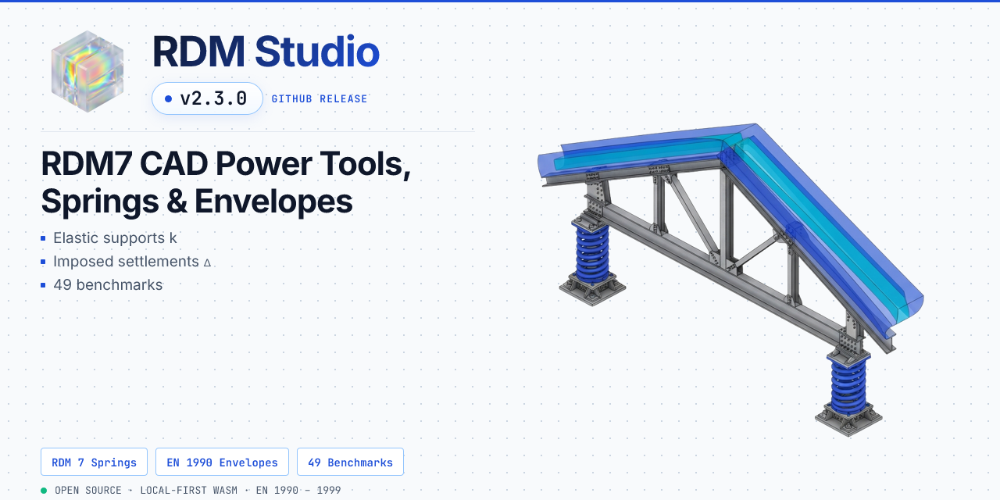

[**Launch 3D Studio ↗**](https://rdm-studio-app.vercel.app/geometry?template=polonceau-truss&lang=en) · [**Documentation ↗**](https://rdm-studio-docs.vercel.app/reference/validation-benchmarks/) · [**Overview & Benchmarks ↗**](https://rdm-studio-site.vercel.app) · [**Full Diff (`v2.2.0...v2.3.0`) ↗**](https://github.com/elcoosp/rdm-studio/compare/v2.2.0...v2.3.0) · [**Sponsor ♥**](https://github.com/sponsors/elcoosp)

# RDM Studio `v2.3.0`

> [!NOTE]
> **Release Summary (EN 1990 · EN 1993-1-1 · EN 1998-1 · RDM6/7):** Shared `@rdm-studio/ui` package, RDM7 CAD power tools (M9), elastic springs & settlements, 49 benchmarks, and EN 1990 envelopes (M10).

## Architecture & Release Matrix

| Subsystem | Key Module / Entrypoint | Engineering & Product Scope |
| :--- | :--- | :--- |
| **`@rdm-studio/ui` & Brand Mark** | [`packages/ui/src/index.ts`](https://github.com/elcoosp/rdm-studio/blob/main/packages/ui/src/index.ts) | Consolidated `tokens.css`, 44+ icons, Base UI primitives, `interior` controls, 15 templates, and 3D spectral prism cube |
| **RDM7 CAD Power Tools (M9)** | [`apps/web/src/modeling/modelCleanup.ts`](https://github.com/elcoosp/rdm-studio/blob/main/apps/web/src/modeling/modelCleanup.ts) | 1-click `Compacter` (`T`/`X` split, weld, dedup), `2..50` `Discrétiser`, live SVG `ParametricFrameModal`, `DrawGhost`, `ModelDataTable` |
| **Solver & EC3 Audit Fixes (M10)** | [`crates/rdm-solver/src/modal.rs`](https://github.com/elcoosp/rdm-studio/blob/main/crates/rdm-solver/src/modal.rs) | True modal participation factors `Γ_d` & effective mass ratios `EN 1998-1 §4.3.3.3`, exact `N_cr` in `6.61`/`6.62`, real fire `μ_0` |
| **Elastic Springs & Settlements** | [`apps/web/src/viewport3d/SupportMarkers.tsx`](https://github.com/elcoosp/rdm-studio/blob/main/apps/web/src/viewport3d/SupportMarkers.tsx) | Translational/rotational springs (`kx..krz` 3D coils), imposed settlements (`Δux..Δrz`), `Tirant`/`Buton` turnbuckles, `Timoshenko`/`Bernoulli` toggle |
| **49 Benchmarks & Envelopes** | [`crates/rdm-solver/tests/rdm6_benchmarks.rs`](https://github.com/elcoosp/rdm-studio/blob/main/crates/rdm-solver/tests/rdm6_benchmarks.rs) | All 8 Yves Debard *RDM – Flexion* §6.1–§6.8 benchmarks (`49/49` passing at `< 0.5%`), Step 3 case manager, `ENV:ULS`/`ENV:SLS` bands |

## Detailed Engineering Changelog

### 1. Shared `@rdm-studio/ui` Package & Optical-Glass Spectral Cube Brand Mark
- **Single Source of Truth (`packages/ui`):** Consolidated Swiss Metrology `tokens.css`, 44+ `EngineeringIcons`, Base UI primitives, `interior` micro-interactions (`SegmentedControl`, `SliderDetents`, `HoldToConfirm`, `StatusBadge`, `CopyButton`, `LoadingButton`, `TooltipGroup`, `ExpandablePanel`, `NumberFlowValue`, `LikeBurst`), 15 canonical engineering catalog templates (`engineeringCatalog.ts`), 5-tier thermal spectrum helpers (`spectrum.ts`), and typed studio deep-link builders (`studioLinks.ts`) into `@rdm-studio/ui`.
- **Optical-Glass Spectral Cube Emblem (`BrandMark.tsx`, `spectral-logo-cube.tsx`):** Replaced legacy SVG marks with the high-resolution spectral prism cube brand mark across `apps/web`, `apps/site`, and `apps/docs`, accompanied by an interactive 3D WebGL cube island on the landing page.
- **Open-Source Edition & Bilingual Site/Docs Expansion (`apps/site`, `apps/docs`):** Added full `/en/` routes on `apps/site`, 15-model interactive showcase (`showcase-tabs.tsx`), trade tutorials (`glulam-beam-verification`, `naval-cradle-verification`, `lifting-beam-and-modal`, `multi-storey-wind-seismic`) with `<TryInStudio>` deep links, and zero-dead-link verification (`scripts/audit_zero_dead_links.py`).

### 2. RDM7 CAD Power Tools, Parametric Library & Synchronized Metrology Table (Milestone M9)
- **1-Click Topological Cleanup & Auto-Split (`apps/web/src/modeling/modelCleanup.ts`):** Added `compactModel` (`mergeDuplicateNodes` within `1e-4 m`, `splitIntersectingBeams` at `T`/`X` junctions with proportional load remapping, `deduplicateBeams`, `purgeOrphanNodes`) and `autoSplitOnDraw`, wired to `CadToolbar.tsx` (`compact-model`) and Step 1 (`compact-model-inspector`).
- **Member Discretization & Parametric Generators (`subdivideBeam`, `parametricGenerators.ts`, `ParametricFrameModal.tsx`):** Added `2..50` segment beam subdivision (`Discrétiser`, `subdivide-preset-*`) and live-preview SVG parametric generators for broken-rafter/monopitch portal frames, Pratt/Howe/Warren trusses, Polonceau roofs, and tapered 3D lattice towers (`open-parametric-generator`).
- **Magnetic CAD Draw Ghost & Bidirectional Spreadsheet (`DrawGhost.tsx`, `ModelDataTable.tsx`):** Added dashed Deep Cobalt preview segments with live `ΔL` / `α` HUD and a bottom `Nodes` / `Beams` TanStack spreadsheet supporting CSV/TSV paste and bidirectional 3D hover/selection sync (`apps/web/e2e/m9-cad-powertools.spec.ts`).

### 3. Solver Audit Fixes, RDM7 Elastic Springs, 49 Benchmarks & EN 1990 Envelopes (Milestone M10)
- **Solver & Eurocode Accuracy (`crates/rdm-solver`, `crates/rdm-eurocode`, `bindings/rdm-wasm`):**
  - Computed true modal participation factors `Γ_d` and effective modal mass ratios `M_eff,d / M_T` per EN 1998-1 §4.3.3.3 (`modal.rs`, `ModeShapeDto`, `AdvancedPanels.tsx`).
  - Replaced hardcoded slenderness constants in `6.61` / `6.62` interaction checks with exact member `N_cr` geometry (`en1993.rs`).
  - Reported true utilization `μ_0` in `ec3_fire_check` (`multi_material.rs`) and exposed `inactive_beam_ids` on `SolvedModel`.
- **RDM7 Elastic Springs & Imposed Settlements (`supports.tsx`, `SupportMarkers.tsx`):** Added translational/rotational spring supports (`kx..krz`, rendered as 3D Deep Cobalt helical spring coils) and prescribed support settlements (`Δux..Δrz` on locked DOFs, rendered with cyan displacement arrows).
- **Axial Behavior Toggle & Beam Theory Switch (`geometry.tsx`, `BeamMeshes.tsx`, `SettingsPopover.tsx`):** Added `Standard` | `Tirant` | `Buton` (`beam-axial-behavior`) with 3D turnbuckle markers and inactive-member badges (`inactive-beams-banner`), plus `Timoshenko` | `Bernoulli` shear deformation switch (`shear-deformation-toggle`).
- **49 Closed-Form Benchmarks & EN 1990 Envelopes (`rdm6_benchmarks.rs`, `loads.tsx`, `results.tsx`):** Added all 8 Yves Debard *RDM – Flexion* §6.1–§6.8 analytical benchmarks (`49 / 49` passing at `< 0.5%` in `ValidationModal.tsx`), Step 3 multi-case manager with Annex A1 `ψ` factors, and `ENV:ULS` / `ENV:SLS` Min/Max `uPlot` bands and 3D extremum callout pills.

> [!TIP]
> **Zero-Cloud Local-First Execution:** Open the [v2.3.0 reference model directly in RDM Studio](https://rdm-studio-app.vercel.app/geometry?template=polonceau-truss&lang=en) — the Rust/WASM solver (`f64` precision), Eurocode catalogs, and Takumi vector PDF generator run 100% locally in your browser.

<strong>Commit & Diff Ledger (74 commits · 325 files changed, 29819 insertions(+), 2832 deletions(-))</strong>

- [`94414e0`](https://github.com/elcoosp/rdm-studio/commit/94414e080027911418a40213d7a40b0394390795) docs(status): record Milestone M10 session 2 progress
- [`1b5a0ee`](https://github.com/elcoosp/rdm-studio/commit/1b5a0ee3bee154c111188d93bac3aa7d03aa9a22) feat(web): load case manager and EN 1990 envelopes
- [`e344fec`](https://github.com/elcoosp/rdm-studio/commit/e344fecb169eea73227e43b6f2dd12da38959372) feat(web): shear-deformation segmented toggle
- [`f2eb9ef`](https://github.com/elcoosp/rdm-studio/commit/f2eb9ef608df6260d9f1ec4dff2ea54da69e87ef) feat(web): 49-benchmark validation modal and modal masses panel
- [`662103a`](https://github.com/elcoosp/rdm-studio/commit/662103a7f958dec46c3be2cb2b2a83f563c38e16) feat(web): axial behavior toggle and turnbuckle rendering
- [`4d91dc6`](https://github.com/elcoosp/rdm-studio/commit/4d91dc6bbdc70aa538d6027928a295b397fafa9c) feat(web): RDM7 elastic supports and imposed displacements UI
- [`40d74e1`](https://github.com/elcoosp/rdm-studio/commit/40d74e18ae9ca63efb0a7fdad3a2fe0ca35b34ee) feat(web): M10 DTOs, schemas and store actions
- [`8482297`](https://github.com/elcoosp/rdm-studio/commit/84822972a576d63262c08e4a67545e0f0e29c9ac) feat(wasm): effective mass ratios and inactive beam ids
- [`d8dfd29`](https://github.com/elcoosp/rdm-studio/commit/d8dfd29d54ea247c2105bfc3c32c58f5ed7c197b) fix(eurocode): report real utilization in EC3 fire check
- [`0b12833`](https://github.com/elcoosp/rdm-studio/commit/0b12833811ca58cc1d50b857735d0d3c66b3bb07) fix(eurocode): exact member slenderness in 6.61/6.62 interaction
- [`2748baf`](https://github.com/elcoosp/rdm-studio/commit/2748baf6dfe1601359daa84ccb580871f0eb0d65) test(solver): surface the 49-benchmark validation suite
- [`fea1aa3`](https://github.com/elcoosp/rdm-studio/commit/fea1aa3bd5d7ba523cb29a1325bf2ca213dba6f7) test(solver): eight Debard RDM6-Flexion closed-form benchmarks
- [`ec8cff0`](https://github.com/elcoosp/rdm-studio/commit/ec8cff0611aa4dcf18fa3ce566a49e6b34102fd9) fix(solver): expose deactivated member ids in SolvedModel
- [`58ed781`](https://github.com/elcoosp/rdm-studio/commit/58ed781612fc72855af8908ef9427e0758292c67) fix(solver): effective modal masses and debug cleanup
- [`22876e1`](https://github.com/elcoosp/rdm-studio/commit/22876e16523bd32df9632e644d506ce2dd2db699) chore: ignore prompts
- [`785536e`](https://github.com/elcoosp/rdm-studio/commit/785536ef3546b9b2634d28fabcea52a81b1c89f6) feat(site): add interactive 3D SpectralLogoCube island and lock BrandMark dimensions
- [`2ac8aee`](https://github.com/elcoosp/rdm-studio/commit/2ac8aeef478c101286d9b6d8b01c141b687aad84) chore: logo.html
- [`9840605`](https://github.com/elcoosp/rdm-studio/commit/9840605b71753d391db06caed1fad52db2a90dfb) chore(brand): replace SVG logo with new PNG brand mark across web, site, and docs
- [`fcf4e18`](https://github.com/elcoosp/rdm-studio/commit/fcf4e18ff556a1b98e207bc57e0b3575d8b9dd6c) docs(status): record Milestone M9 completion and gates
- [`f0c4472`](https://github.com/elcoosp/rdm-studio/commit/f0c4472ca23b29ae57e0d4d12768d0fa7c2fa914) test(e2e): M9 CAD power tools suite
- [`dd46b01`](https://github.com/elcoosp/rdm-studio/commit/dd46b01b23c96046d1b60bca7c0678a094155463) test(e2e): align v160 toast wording with the Discrétiser rename
- [`1fe8a8f`](https://github.com/elcoosp/rdm-studio/commit/1fe8a8f599f23cba320d91204cd0c4394f935e49) build(i18n): compile pt_BR catalog for M9
- [`4d2c45c`](https://github.com/elcoosp/rdm-studio/commit/4d2c45c5e7901761d6223f1053a376adf116c529) build(i18n): compile es catalog for M9
- [`46ff8c5`](https://github.com/elcoosp/rdm-studio/commit/46ff8c5abf084af7bf8224cc00e9121466dde83b) build(i18n): compile de catalog for M9
- [`9a1d347`](https://github.com/elcoosp/rdm-studio/commit/9a1d3475e63897288ca5c15b69e891d270309a6f) build(i18n): compile en catalog for M9
- [`160cdf6`](https://github.com/elcoosp/rdm-studio/commit/160cdf6bdecf732f363fc0f93fb22e490670f3dc) build(i18n): compile fr catalog for M9
- [`450c9d7`](https://github.com/elcoosp/rdm-studio/commit/450c9d702b0532055b74f1dbfc03bee712327c42) chore(i18n): refresh pt_BR catalog with M9 strings
- [`def5083`](https://github.com/elcoosp/rdm-studio/commit/def5083b82247528c2c9f6c541ce022e1bddb273) chore(i18n): refresh es catalog with M9 strings
- [`87f2501`](https://github.com/elcoosp/rdm-studio/commit/87f2501196f8e80255120169439891104466dc67) chore(i18n): refresh de catalog with M9 strings
- [`4816175`](https://github.com/elcoosp/rdm-studio/commit/481617581ea39f39bf480442ad6fc529d0912316) chore(i18n): fill EN translations for M9 strings
- [`39d7328`](https://github.com/elcoosp/rdm-studio/commit/39d732820dd784d28b1f7d7f935fc5b69250dc08) chore(i18n): extract M9 strings (fr source catalog)
- [`8e77974`](https://github.com/elcoosp/rdm-studio/commit/8e7797438588e3d673d5eb8a006016501fcef1bd) feat(studio): M9 Step 1 UI — compact, discretize, generators
- [`aa002e5`](https://github.com/elcoosp/rdm-studio/commit/aa002e5fa43cb2aa91ea1d9c0dfcc02440a9d569) feat(components): Compacter toolbar button with summary toast
- [`de4056e`](https://github.com/elcoosp/rdm-studio/commit/de4056eea6f6b7b2c7dd0550084aa57d1325c8c9) feat(components): parametric frame modal with live SVG preview
- [`e5e54ed`](https://github.com/elcoosp/rdm-studio/commit/e5e54ed32f2d605fec0791e233bd73628afd2515) feat(components): synchronized nodes and beams metrology drawer
- [`8598f99`](https://github.com/elcoosp/rdm-studio/commit/8598f99c3ecb41ee71f34bdf9380e62c03ddb350) feat(viewport3d): auto-split on draw and ghost cursor snapping
- [`f7cc0d1`](https://github.com/elcoosp/rdm-studio/commit/f7cc0d12716c3c0b3d8268b652d1426fe8b2cb0a) feat(viewport3d): dashed CAD ghost preview with length HUD
- [`fb22cf6`](https://github.com/elcoosp/rdm-studio/commit/fb22cf672e6c2db9b39e2fcbe5182668295379a4) feat(state): autoSplitOnDraw flag and beam draw ghost state
- [`9932fb1`](https://github.com/elcoosp/rdm-studio/commit/9932fb1ec3a8b17617bdbb808d0a79531c355113) feat(state): hoveredNodeId render option for table sync
- [`098594f`](https://github.com/elcoosp/rdm-studio/commit/098594ff55a3d2cbc79da336c30242ff81cfc030) refactor(state): delegate subdivideBeam to modelCleanup
- [`a7e574a`](https://github.com/elcoosp/rdm-studio/commit/a7e574aacf32f37dd7d62e54ed5739ea52865264) test(modeling): generator topology and insertion contracts
- [`4db029e`](https://github.com/elcoosp/rdm-studio/commit/4db029eb3ef643b8e12eb6e85e667607a8e146c2) feat(modeling): RDM6/7 parametric structure generators
- [`669d032`](https://github.com/elcoosp/rdm-studio/commit/669d03289d491875a624125cd793cd153217bceb) test(modeling): cover cleanup, split, compact and subdivision
- [`494d3c0`](https://github.com/elcoosp/rdm-studio/commit/494d3c0f3819b2ba4106cc19a74dc4514203ae8d) feat(modeling): pure topological cleanup and subdivision transforms
- [`3eb93c7`](https://github.com/elcoosp/rdm-studio/commit/3eb93c785900c681b689a6c7737122c3389a4031) fix(viewport): wrap layer toolbar to avoid mobile h-clip
- [`4189cbb`](https://github.com/elcoosp/rdm-studio/commit/4189cbbb1167ed0f0622599680530d96e77602b2) chore(scripts): add docs media capture pipeline, license minting, and portable root path
- [`12e7e8e`](https://github.com/elcoosp/rdm-studio/commit/12e7e8e6177a817fb3d6948a1a9f3899150f4bab) style(ui): align CalcTraceTree card radius to 8px token
- [`f647ed4`](https://github.com/elcoosp/rdm-studio/commit/f647ed4692afdb62bebe15e61d25a85531af784f) build(workspace): link local oxide packages and register packages/ui
- [`035aa1d`](https://github.com/elcoosp/rdm-studio/commit/035aa1de53ac70f178587ff0bcf9037663bb01c3) docs: add trade tutorials, TryInStudio deep links, and update STATUS.md
- [`94654a2`](https://github.com/elcoosp/rdm-studio/commit/94654a2f8bda37c5e2fa738a20c9c16fe5755b21) feat(site): add bilingual EN/FR routes, 15-model showcase, and @rdm-studio/ui migration
- [`155345e`](https://github.com/elcoosp/rdm-studio/commit/155345e2ad2f9da307c0c6d23d021bb67a914896) chore(i18n): extract and compile updated web translation catalogs
- [`0e8a37d`](https://github.com/elcoosp/rdm-studio/commit/0e8a37d037cd66b10bd13ebd8ee093a01148054f) feat(web): add naval/lifting templates, open-source edition UI, and local diagnostic telemetry
- [`c0b3c5a`](https://github.com/elcoosp/rdm-studio/commit/c0b3c5a54148a2b18c9c41524010b20a9a385526) feat(report): include Mx, My, Mz support reaction moments in report, PDF, and CSV
- [`fa9dbab`](https://github.com/elcoosp/rdm-studio/commit/fa9dbabaf0d516c0a876ca60649975328c87f6db) feat(results): add Von Mises stress curve, cursor readout, and redesigned SectionCutCard
- [`57ff308`](https://github.com/elcoosp/rdm-studio/commit/57ff308c5a5960f27f8dde6505178441c6df3cf2) feat(loads): render directional force arrows, moment torus arcs, and Direction column
- [`b94101d`](https://github.com/elcoosp/rdm-studio/commit/b94101d656d79e71f965ef24521b587915dca90f) feat(studio): add beam deletion toggle, roll angle presets, and support tooltips
- [`baf46ed`](https://github.com/elcoosp/rdm-studio/commit/baf46edb1a4bbc9338fe842490c3465e14f720af) feat(viewport): add cursor-anchored orbit pivot, section colors, roll rotation, and click-to-delete
- [`6b31bdc`](https://github.com/elcoosp/rdm-studio/commit/6b31bdc24f96a46595ab7da78d313d2a3b7939d3) refactor(solver): use enumerate iterators in buckling and modal deflation
- [`ebc025a`](https://github.com/elcoosp/rdm-studio/commit/ebc025ab7e8f5b652b88cf2a9ede85570429d036) feat(ui): consolidate Swiss Metrology components into @rdm-studio/ui
- [`4c4b9fa`](https://github.com/elcoosp/rdm-studio/commit/4c4b9fa8786a7bb6112e419199b607f7c0d03b3a) docs(prompts): add Session 2.3.0 prompt specification
- [`f66c8e0`](https://github.com/elcoosp/rdm-studio/commit/f66c8e09af96744cffd5366cdc616766bc590c2d) chore(scripts): add zero dead links audit script across site and docs
- [`97675f6`](https://github.com/elcoosp/rdm-studio/commit/97675f64158c300c1ec640dfaabe9b587d05b2a8) test(e2e): update Playwright polish suite for cross-app routes
- [`c2079e1`](https://github.com/elcoosp/rdm-studio/commit/c2079e1b17cb963d593a873cdfd85d7f899464ba) chore(i18n): update Lingui catalogs across EN, FR, DE, ES, and PT-BR
- [`a2742c5`](https://github.com/elcoosp/rdm-studio/commit/a2742c53f5ed239bc63f9a9e10f52e61673784a3) feat(web): refine studio bottom sheet, scenario compare modal, and 3D stage
- [`19b0322`](https://github.com/elcoosp/rdm-studio/commit/19b03222d1817a01c808cf7a191a92fd4b710768) feat(web): wire cross-app navigation and fault card links in routes
- [`af0ee57`](https://github.com/elcoosp/rdm-studio/commit/af0ee572957dba747faec51304af4ad12490c3ee) feat(web): add centralized cross-app URL resolver for site, app, and docs
- [`9ba633a`](https://github.com/elcoosp/rdm-studio/commit/9ba633a1f40602692efb595e4f240e630b6ef5b0) feat(site): add Astro marketing site with programmatic Eurocode SEO pages
- [`14c4ab5`](https://github.com/elcoosp/rdm-studio/commit/14c4ab51ee1419e4bb7240773e0b0a51dca3f9ba) chore(vendor): add local docs-toolkit package
- [`0806f20`](https://github.com/elcoosp/rdm-studio/commit/0806f2010a1bdc8f641179ff65633491bff87b35) chore(workspace): register apps/site, apps/docs, and vendor packages
- [`d4db540`](https://github.com/elcoosp/rdm-studio/commit/d4db540d3c291bb0687afdea4375dc83fe33260e) chore(git): ignore site dist output and local helper files
- [`6de7e21`](https://github.com/elcoosp/rdm-studio/commit/6de7e218cb98b7cac57c9699edb84e36a108271d) docs(fr): add French Diataxis tutorials, guides, reference, and explanation
- [`be6d622`](https://github.com/elcoosp/rdm-studio/commit/be6d6225346eb8b9d97e4cb2a270dde2673f0f7c) docs(en): add English Diataxis tutorials, guides, reference, and explanation
- [`759dcf5`](https://github.com/elcoosp/rdm-studio/commit/759dcf51ed95e44eb9f8aff2794f5c65ef9c03ef) feat(docs): add DocMedia component, glossary, i18n, and visual assets
- [`d0f16d0`](https://github.com/elcoosp/rdm-studio/commit/d0f16d0994e7d6364558bbde2d3ad9362c189c8e) feat(docs): configure Starlight, docs-toolkit, and media manifest

---

Links: GitHub Tag `v2.3.0` · Compare Changes · 3D Studio · Documentation · B2B & Discussions
