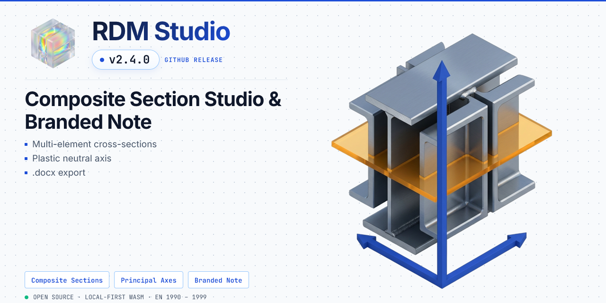

[**Launch 3D Studio ↗**](https://rdm-studio-app.vercel.app/geometry?template=portal-frame&lang=en) · [**Documentation ↗**](https://rdm-studio-docs.vercel.app/guides/cad-modeling-and-sections/) · [**Overview & Benchmarks ↗**](https://rdm-studio-site.vercel.app) · [**Full Diff (`v2.3.0...v2.4.0`) ↗**](https://github.com/elcoosp/rdm-studio/compare/v2.3.0...v2.4.0) · [**Sponsor ♥**](https://github.com/sponsors/elcoosp)

# RDM Studio `v2.4.0`

> [!NOTE]
> **Release Summary (EN 1993-1-1 Tab. 5.2 · Huygens-Steiner · Vector & `.docx` Reports):** Multi-element built-up cross-section engine (*Sections Droites Composées*), interactive SVG studio with live normal-stress diagram `σ(z)`, and branded client-side A4/PDF/`.docx`/3D-HTML calculation notes.

## Architecture & Release Matrix

| Subsystem | Key Module / Entrypoint | Engineering & Product Scope |
| :--- | :--- | :--- |
| **Composite Section Engine** | [`crates/rdm-cad/src/sections.rs`](https://github.com/elcoosp/rdm-studio/blob/main/crates/rdm-cad/src/sections.rs) | Multi-element built-up cross-section mechanics (`A`, `m`, `(yG, zG)`, `(Iy, Iz, Iyz, Iu, Iv, α)`, `Wel`, exact bisection `Wpl` + `ANP`, `It`, `Iw`, `Av`, EN 1993-1-1 Tab. 5.2 class) |
| **WASM & Solver Persistence** | [`bindings/rdm-wasm/src/lib.rs`](https://github.com/elcoosp/rdm-studio/blob/main/bindings/rdm-wasm/src/lib.rs) | `compute_composite_section` preview endpoint & `Structure::custom_sections` native resolution in 3D Timoshenko solver |
| **Visual Sections Droites Studio** | [`apps/web/src/components/CompositeSectionStudio.tsx`](https://github.com/elcoosp/rdm-studio/blob/main/apps/web/src/components/CompositeSectionStudio.tsx) | 2-column daylight dialog with mm SVG grid, fillets, `(u, v)` axes, amber `ANP`, live `σ(z)` stress diagram, 5 presets, and 1-click beam apply |
| **Branded Calculation Note** | [`apps/web/src/routes/_studio/report.tsx`](https://github.com/elcoosp/rdm-studio/blob/main/apps/web/src/routes/_studio/report.tsx) | `<BrandMark />` cover header, benchmark `49/49` seal, dedicated *Sections Droites Composées* SVG + property chapter |
| **Native `.docx` & Offline 3D HTML** | [`apps/web/src/export/docxExport.ts`](https://github.com/elcoosp/rdm-studio/blob/main/apps/web/src/export/docxExport.ts) | Client-side `.docx` calculation note with native Word tables + self-contained offline 3D HTML viewer (`0 bytes cloud`) |

## Detailed Engineering Changelog

### 1. Multi-Element Composite Cross-Section Engine (`crates/rdm-cad/src/sections.rs`)
- **Exact Analytical Section Mechanics (`CompositeSectionDef`, `compute_composite_section`):** Computes total area `A`, linear mass `m`, centroid `(yG, zG)`, centroidal second moments `(Iy, Iz, Iyz)` via Huygens-Steiner parallel-axis theorem, principal moments `(Iu, Iv)` and angle `α`, radii of gyration `(iy, iz)`, elastic moduli `Wel`, exact bisection plastic moduli `Wpl` with Plastic Neutral Axis (`ANP`) for asymmetric built-ups, shear areas `(Av,y, Av,z)`, Saint-Venant torsion `It`, and warping constant `Iw`.
- **EN 1993-1-1 Table 5.2 Classification & Native Solver Integration:** Classifies pure bending and pure compression (`Class 1..4`) across `S235`–`S460`, persists `custom_sections` on `Structure`, and resolves composite sections natively inside the 3D Timoshenko WASM solver (`crates/rdm-cad/tests/composite_sections.rs`).

### 2. Visual *Sections Droites* Studio (`CompositeSectionStudio.tsx`, `geometry.tsx`)
- **Interactive Millimeter SVG & Stress Canvas (`composite-section-svg`):** Renders exact element outlines (with rolled profile fillets), centroid reticle `G`, `(y, z)` and principal `(u, v)` axes, dashed amber Plastic Neutral Axis (`ANP`), and an interactive normal-stress diagram `σ(z) = N/A + (My/Iy)·z` driven by `NumberField` and `SliderDetents` controls.
- **1-Click Built-Up Presets & Beam Assignment:** Ships 5 canonical structural presets (`PRS symétrique`, `Caisson soudé`, `2×UPN dos-à-dos`, `IPE + platine semelle`, `Chemin de roulement HEA+UPN`), TSV telemetry export, `⌘K` palette launch, and 1-click assignment to selected beams with immediate WASM re-solve.

### 3. Client-Side Branded Calculation Note & Native Exports (`report.tsx`, `docxExport.ts`)
- **Branded Cover & Composite Chapter:** Upgrades Step 5 with `<BrandMark />` cover header, `49/49` benchmark seal, and a dedicated *Sections Droites Composées* chapter embedding the vector SVG cross-section diagram, full mechanical property table, and EN 1993-1-1 Table 5.2 classification.
- **Zero-Cloud Client Exports (`0 bytes cloud`):** Delivers vector A4 PDF/print, structured `.docx` calculation notes with native Word tables, and self-contained offline 3D HTML reports.

> [!TIP]
> **Zero-Cloud Local-First Execution:** Open the [v2.4.0 reference model directly in RDM Studio](https://rdm-studio-app.vercel.app/geometry?template=portal-frame&lang=en) — the Rust/WASM solver (`f64` precision), composite cross-section engine, and `.docx`/PDF report generators run 100% locally in your browser.

<strong>Commit & Diff Ledger (45 commits · 40 files changed, 5018 insertions(+), 416 deletions(-))</strong>

- [`cf3f01c`](https://github.com/elcoosp/rdm-studio/commit/cf3f01cfd4ab03e498950a39c313fe7d9eb7aee9) fix(m11): stabilize composite section WASM bridge, persistence, and E2E contracts
- [`89b4792`](https://github.com/elcoosp/rdm-studio/commit/89b4792752765fcdbd06253a90c055a93cc5d61b) docs: record Milestone M11 Session 3 progress in STATUS.md
- [`d84c708`](https://github.com/elcoosp/rdm-studio/commit/d84c708a6fa458cfb6bfb72d657c5b0ace413fcb) test(e2e): add M11 composite section studio and report E2E suite
- [`444a9db`](https://github.com/elcoosp/rdm-studio/commit/444a9dbc1e45cf7980c687f5792c4c550ed34245) test(e2e): add M10 RDM7 solver and envelope E2E suite
- [`f06ce06`](https://github.com/elcoosp/rdm-studio/commit/f06ce069a53fab909b2dc2a177981b00367901e7) test(e2e): update DOCX export button testid
- [`4d64130`](https://github.com/elcoosp/rdm-studio/commit/4d6413035c4054add030fa317104d1aa608bb781) test(e2e): update HTML report export button testid
- [`90b11bd`](https://github.com/elcoosp/rdm-studio/commit/90b11bd7319b7f2dc7d3e8f18c545a6a506cc0ef) chore(i18n): remove compiled pt_BR.mjs artifact from tracking
- [`d07b697`](https://github.com/elcoosp/rdm-studio/commit/d07b6971a90b0cb8e5fbee8bd839babc5058d4be) chore(i18n): remove compiled es.mjs artifact from tracking
- [`f9062f3`](https://github.com/elcoosp/rdm-studio/commit/f9062f3e3193852b6527868a07f7bf278e771bef) chore(i18n): remove compiled de.mjs artifact from tracking
- [`cee437f`](https://github.com/elcoosp/rdm-studio/commit/cee437f6c80474016b9a26124b575f8fcb786a05) chore(i18n): remove compiled en.mjs artifact from tracking
- [`dac18dc`](https://github.com/elcoosp/rdm-studio/commit/dac18dccd299e4e87709e9f7b64df4c0d3448aa8) chore(i18n): remove compiled fr.mjs artifact from tracking
- [`4d56e80`](https://github.com/elcoosp/rdm-studio/commit/4d56e80e9e7ed2946d5559d705bb3b834e42a7fb) chore(i18n): extract M11 Portuguese catalog keys
- [`fadfb7e`](https://github.com/elcoosp/rdm-studio/commit/fadfb7effd131752176ce7b9b80f539bb73b3b63) chore(i18n): extract M11 Spanish catalog keys
- [`0588cc2`](https://github.com/elcoosp/rdm-studio/commit/0588cc22477139d8bfc2b5a86f9b4a1a09698bf7) chore(i18n): extract M11 German catalog keys
- [`50a2606`](https://github.com/elcoosp/rdm-studio/commit/50a260679e44905ca060dc5df6aa8c6f66bf401d) chore(i18n): translate M11 English catalog strings
- [`2263987`](https://github.com/elcoosp/rdm-studio/commit/2263987041df771e5e054a5ef5c16f632a9ad4ae) chore(i18n): extract M11 French catalog strings
- [`4a3caca`](https://github.com/elcoosp/rdm-studio/commit/4a3caca04186b0476215b108dbd6f5ecb60ecff2) feat(web): add branded cover, composite chapter, and .docx tables
- [`5fadb17`](https://github.com/elcoosp/rdm-studio/commit/5fadb178e696cb7236e0b5bf99e029b32ad82100) feat(web): support native Word tables and core metadata in .docx
- [`70a28a2`](https://github.com/elcoosp/rdm-studio/commit/70a28a230ea44e9090e3d9554d30511fe729a83e) style(web): format settlement panel markup in SupportsPage
- [`d6f98ea`](https://github.com/elcoosp/rdm-studio/commit/d6f98eaa2d5bf714763f9d4fde45f8f1892e72cf) style(web): format envelope series definitions in ResultsPage
- [`b718b9b`](https://github.com/elcoosp/rdm-studio/commit/b718b9bb0aede1e4d916f5347a98f4badc911460) style(web): format canonical load cases in LoadCaseManager
- [`1c48a38`](https://github.com/elcoosp/rdm-studio/commit/1c48a38c3889563e3fc905d3ee80882485cfecc5) feat(web): integrate CompositeSectionStudio trigger into Step 1
- [`872f06e`](https://github.com/elcoosp/rdm-studio/commit/872f06e29c8dc6b7b94f4f4f6cca390c54475c37) style(web): format inactiveBeamIds memo in PersistentStage
- [`e63d8d3`](https://github.com/elcoosp/rdm-studio/commit/e63d8d34cfcdf8dc8af32eaa2777aa66f0d6b3af) style(web): clean up formatting and zero offset in BeamMeshes
- [`21f2147`](https://github.com/elcoosp/rdm-studio/commit/21f21476e114e073fad10de222e9acb996532567) style(web): format SettingsPopover callback
- [`ca79c3b`](https://github.com/elcoosp/rdm-studio/commit/ca79c3b1d9f6c2900ddf2b7f11f6be42a2100aa9) style(web): align modal effective masses card border radius
- [`6359784`](https://github.com/elcoosp/rdm-studio/commit/6359784514295f43b9665161a33b6c6c08bd20b7) feat(web): add Composite Section Studio entry to command palette
- [`44a8a40`](https://github.com/elcoosp/rdm-studio/commit/44a8a40a75e55c850d6d86d97370f0b6dc65edcc) feat(web): build visual Sections Droites composite studio dialog
- [`eb682fa`](https://github.com/elcoosp/rdm-studio/commit/eb682fa3114ba4ece350e7dd70824bd6814b9827) feat(web): track composite_section_applied telemetry event
- [`b20a112`](https://github.com/elcoosp/rdm-studio/commit/b20a11290d8dfcc8c6d2296dbe7d2a2dc4f1f1b4) style(web): format beam behavior schema definition
- [`f6249f5`](https://github.com/elcoosp/rdm-studio/commit/f6249f5f486a5c79e0cd535d8a53d0a604f9569c) feat(web): add custom_sections state and store actions
- [`d42b2e1`](https://github.com/elcoosp/rdm-studio/commit/d42b2e1f6dba7e1ca81c30ed6cdac253dfe69b34) feat(web): add CompositeSectionResult DTOs and worker client method
- [`a1dd795`](https://github.com/elcoosp/rdm-studio/commit/a1dd795be44bb2a4b6d5b28a13709192fbced916) feat(web): route compute_composite_section in FEA worker
- [`49cdb69`](https://github.com/elcoosp/rdm-studio/commit/49cdb69fb37c7a08489779d70b74b1b251646dd7) feat(rdm-wasm): expose compute_composite_section and native resolution
- [`9887af4`](https://github.com/elcoosp/rdm-studio/commit/9887af4e3cede8749d3a28a1843b3e1a4c2a9424) style(rdm-solver): format RDM6 analytical benchmark tests
- [`8be688d`](https://github.com/elcoosp/rdm-studio/commit/8be688d5115c37d66c60e45eb1998bb21a367a86) style(rdm-solver): fix clippy lints and rustfmt in validation suite
- [`90e9232`](https://github.com/elcoosp/rdm-studio/commit/90e9232fe699f658cdf6c5fbb3ea82883f88f10b) style(rdm-solver): format modal mass calculation
- [`286cd7f`](https://github.com/elcoosp/rdm-studio/commit/286cd7f9425bb3d23c8b155b543a12344527a25d) test(rdm-cad): add composite section integration tests
- [`f8a3a71`](https://github.com/elcoosp/rdm-studio/commit/f8a3a715ae66263eed2d96327427350cff414047) feat(rdm-cad): export composite cross-section engine API
- [`0fc35be`](https://github.com/elcoosp/rdm-studio/commit/0fc35be2acf1adad8a3d8c00d9e189bf280be3d3) feat(rdm-cad): implement analytical composite section mechanics
- [`f68a6d6`](https://github.com/elcoosp/rdm-studio/commit/f68a6d675837be5921d66fc17c26d47360b1aca3) build(rdm-cad): add rdm-eurocode dependency
- [`0b561d1`](https://github.com/elcoosp/rdm-studio/commit/0b561d17126c55850610575470b33c7ddc7deadb) feat(rdm-model): expose custom_sections on Structure
- [`f9b9380`](https://github.com/elcoosp/rdm-studio/commit/f9b938045074907e36c80e001c6a8c458aaa5036) feat(rdm-model): add composite cross-section data definitions
- [`18fa626`](https://github.com/elcoosp/rdm-studio/commit/18fa6266abf829d0a846743a6039e9b597808ad9) chore: ignore dist
- [`d6424f4`](https://github.com/elcoosp/rdm-studio/commit/d6424f49a54978e3b53b91447ca7099fa13141f6) chore: lock

---

**Links:** [GitHub Tag `v2.4.0`](https://github.com/elcoosp/rdm-studio/releases/tag/v2.4.0) · [Compare Changes](https://github.com/elcoosp/rdm-studio/compare/v2.3.0...v2.4.0) · [3D Studio](https://rdm-studio-app.vercel.app) · [Documentation](https://rdm-studio-docs.vercel.app) · [B2B & Discussions](https://github.com/elcoosp/rdm-studio/discussions)
